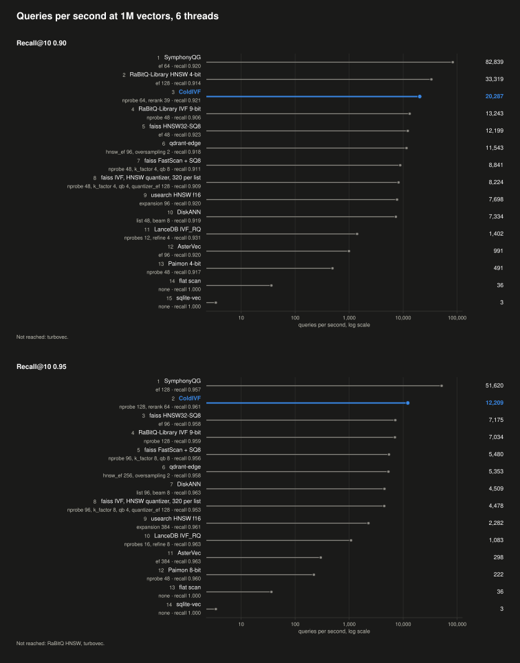
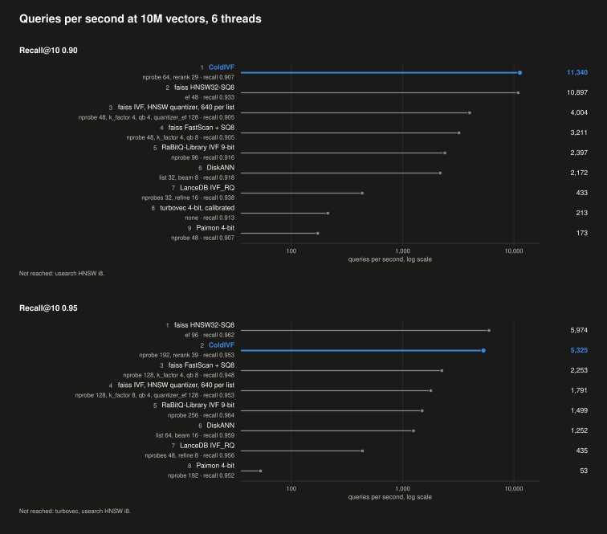

# ColdIVF

A read-optimized vector index in Rust, built for cold reads: it answers a query against an index that isn't in memory by fetching only the data that query needs in a few batched disk reads.

## Contents

- [Usage](#usage)
- [Design](#design)
- [Benchmarks](#benchmarks)
  - [1M Vectors](#1m-vectors)
    - [Cold First Query](#cold-first-query)
    - [ColdIVF's Cold First Query in Each Setup](#coldivfs-cold-first-query-in-each-setup)
    - [Warm Query](#warm-query)
    - [Memory and Build](#memory-and-build)
  - [10M Vectors](#10m-vectors)
    - [Cold First Query](#cold-first-query-1)
    - [Warm Query](#warm-query-1)
    - [Memory and Build](#memory-and-build-1)
    - [Not Run at 10M](#not-run-at-10m)
- [Caveats](#caveats)

## Usage

### Python

`coldivf-python` builds the `coldivf` module with [maturin](https://www.maturin.rs). Vectors need 128 to 4,080 dimensions.

```
cd coldivf-python
maturin develop --release
```

```python
import coldivf

coldivf.build("index.coldivf", vectors)  # a 2-D float32 array, one vector per row, whose ids are the row numbers
index = coldivf.Index("index.coldivf")
index.prepare()  # when the query text arrives, so the index's tables load while the embedding runs
ids, scores = index.search(query, 10, nprobe=96, rerank=35)
```

### Rust

```toml
[dependencies]
coldivf = { git = "https://github.com/13lack13lood/ColdIVF.git" }
```

```rust
use std::path::Path;

use coldivf::{Anchor, BuildParams, Builder, Clustering, Index, LeafOrder, Limits, Metric, SearchCtx, SearchParams,
              VectorSource};

// The vectors to index, one per row. A row's id is its row number.
struct Rows {
    data: Vec<f32>,
    dim: usize,
}

impl VectorSource for Rows {
    fn count(&self) -> usize {
        self.data.len() / self.dim
    }

    fn dim(&self) -> usize {
        self.dim
    }

    fn rows(&self, start: usize, rows: usize) -> &[f32] {
        &self.data[start * self.dim..(start + rows) * self.dim]
    }
}

fn run(rows: &Rows, query: &[f32]) -> std::io::Result<()> {
    let path = Path::new("index.coldivf");
    let params = BuildParams {
        metric: Metric::Cosine,
        vectors_per_list: 160,
        parents: 128,
        order: LeafOrder::Chained,
        anchor: Anchor::Cluster,
        page_size: 4096,
        threads: 0,
        seed: 7,
    };
    Builder::new(params).clustering(Clustering::TwoLevel).build(rows, path)?;

    let index = Index::open(path)?;
    let mut ctx = SearchCtx::new(Limits { max_k: 10, max_nprobe: 96, max_rerank: 35 });
    // Call prepare when the query text arrives, so the cluster tables load while the embedding runs.
    index.prepare(&mut ctx)?;
    let params = SearchParams { k: 10, nprobe: 96, rerank: 35, reach: None };

    for hit in index.search(query, &params, &mut ctx)? {
        println!("{} {}", hit.id, hit.score);
    }

    Ok(())
}
```

`Writer::open(path)` takes inserts and deletes, which searches see at once, and `calibrate` picks the cheapest `nprobe` and `rerank` for a recall target.

## Design

ColdIVF is an inverted-file (IVF) index in one file. It splits the vectors into clusters and gathers nearby clusters into groups. It keeps a compact code of each vector inside its cluster, and a more precise copy of each vector beside the codes. A cold query reads only the clusters it needs and the copies of its best candidates, in two batches of reads, so it never loads the whole index.

### File Layout

The file holds these sections, in order. Each section after the rotation starts on a 16 KiB boundary.

| Section | What It Holds |
|---|---|
| Header | The first 4 KiB. It starts with the format's magic number and version and a byte-order mark. Then come the dimension, the dimension rounded up to a multiple of 64, and the counts of vectors, clusters and groups. Next are the metric, whether the 1-bit codes are measured from the mean or from each cluster's center, the page size, the rows per page, the build's seed and the number of maintenance runs since the build. Last come each section's offset, length and 32-bit cyclic redundancy check (CRC32), then the header's own CRC32. That CRC32 also tells the file apart from any other, so a log written for another file is ignored. |
| Rotation | The round count, the dimension and the random sign flips of the fast rotation that every vector and query goes through, 1 bit per dimension in each of 3 rounds. The rest of the rotation follows from the dimension, so it takes no bytes. Then the mean of the vectors at build, as 32-bit floats. Every row, center and query is measured from it, and maintenance never changes it. At 768 dimensions the section takes 8 + 288 + 3,072 = 3,368 bytes. |
| Centers | Each group's center as an 8-bit row like a vector's, without the id, 776 bytes at 768 dimensions. Searches skip these rows, and a fold copies them as they are. Then each cluster's center, rotated and measured from the mean, as 4-bit values, 384 bytes at 768 dimensions. Then arrays with one value per cluster: the lowest value and the step that decode each center, its squared length before rounding, which routing uses, and its 16-bit group. |
| Extents | 16 bytes per cluster: where its codes start, how many vectors it holds and the position of its first vector. |
| Codes | Each cluster's 1-bit codes in blocks of 32 vectors, cluster after cluster. A block holds the codes, 96 bytes per vector at 768 dimensions, interleaved for the single instruction, multiple data (SIMD) scan. Then come 4 numbers per vector: 3 that turn its code into a distance estimate, and an error bound. A block takes 3,584 bytes at 768 dimensions. |
| Rows | An 8-bit copy of every vector, for rescoring candidates. The rows follow the vectors' positions, so a cluster's rows sit together. At 768 dimensions a row holds 768 values of the vector's offset from the mean, one scale, the squared length of the offset as it decodes and the id, 784 bytes in all. Rows never cross a page, so each 4 KiB page holds 5. The page size is a build setting, and 4 KiB suits both 16 KiB-page Macs and 4 KiB-page PCs. |
| Ids | Each vector's id, 8 bytes, in position order. A writer reads them to find the row of an id it deletes or replaces. Then one deleted bit per vector. Every file leaves these bits at 0, since deletes stay in the log until maintenance drops their vectors. Searches take the ids from the rows instead. |
| Trailer | Only in a file that maintenance wrote, after the ids, with its own magic number and CRC32. It holds what maintenance keeps between runs: each cluster's region and the counts that tell when a run is due. |

At 768 dimensions that comes to 946.4 bytes per vector at 1M vectors and 942.7 at 10M. The 8-bit rows take 819.2 of them, 86.6% and 86.9%, since 5 rows of 784 bytes share each 4 KiB page. The codes take 117.6 and 114.8, more than the 112 bytes per vector of a full block, since each cluster's last block is partly empty. Routing reads the cluster tables: the 4-bit centers with their numbers and groups, and the extents, but not the group rows. They take 414 bytes per cluster, 1.32 MB for the 3,195 clusters of the 1M index.

### Cold Queries

A cold query runs in seven steps:
1. Opening the index reads the first 16 KiB, the header and the rotation, in one read. Up to 2,806 dimensions, both fit in that read. It checks their CRC32s and that every section is in place and the right size. Searches skip the other sections' CRC32s, and `verify` checks them all. It then maps the whole file into memory without reading it. Every later read goes through the file handle it opened, so all of them see the same file even if a rebuild renames a new one over the index. On Linux each search context also opens that file again with direct I/O for its batches.
2. `prepare`, called when the query text arrives, asks the operating system to start reading the cluster tables, with `F_RDADVISE` on macOS and `posix_fadvise` on Linux. It also sets up the query's buffers. The tables then load while the embedding model runs. The first search reads them, by then mostly from memory, and keeps them for later searches.
3. Routing picks the clusters to read. It rotates the query and stores it as 8-bit values from −127 to 127 with one scale. Each center is stored as 4-bit values from 0 to 15 with its own lowest value and step. So the query's distance to a center takes one integer dot product of the two, plus a few multiplications with the center's lowest value, step and squared length. On Arm CPUs, NEON's `sdot` computes that dot product 16 values at a time. On x86 CPUs, the Advanced Vector Extensions (AVX) do it 32 values at a time with AVX2's `vpmaddubsw` and 64 with AVX-512's `vpdpbusd`. The dot product is a whole number, so every CPU gets the same route scores. Every center is scored this way, and a heap keeps the `nprobe` nearest. With `reach` set, routing also applies the pruning rule of [SPANN](https://arxiv.org/abs/2111.08566): it keeps only the clusters whose distance is at most (1 + `reach`) times the nearest one's. A query deep inside one cluster then reads only the few clusters around it, while a query between clusters still reads up to `nprobe`.
4. The chosen clusters are read in one batch. They're sorted by their position in the file. Each becomes the byte range of its blocks, rounded out to whole pages, 16 KiB on macOS and 4 KiB on Linux. Ranges that touch or overlap merge into one read. The build puts nearby clusters next to each other in the file, so many of a query's clusters merge. Every range then goes to the disk at once, so the solid-state drive (SSD) works on all of them together instead of one after another:
   - On macOS, `F_RDADVISE` tells the kernel to start reading each range. Then `pread` takes the ranges in file order, and by then most of them have arrived. If the file system refuses the hints, eg. FAT32 (File Allocation Table), the index reads on the thread pool that other systems use.
   - On Linux, all the reads go into one `io_uring` submission, and the ranges come back in the order they finish. They use direct I/O, which skips the page cache. So each search context keeps its own cache of up to 16 MiB of the pages it has read twice. Without `io_uring`, the index falls back to `posix_fadvise` hints and `pread`.
   - Other systems, eg. Windows, read the ranges on a pool of up to 16 threads, and the scan starts once all of them are in. On Windows the reads through one handle still run one at a time.
5. The scan estimates each vector's distance from its 1-bit code as each range comes in, while the other reads are still in flight. It works like [FastScan](https://dl.acm.org/doi/10.14778/2856318.2856324): instead of testing the bits one at a time, it turns every 4 bits of a code into one table lookup, and SIMD does 16, 32 or 64 lookups in one instruction.
   - For the scan, the rotated query is also stored as 4-bit values from 0 to 15. Each set of 4 dimensions gets a table with one entry for each of the 16 patterns that 4 code bits can take. An entry is the sum of the query's values over the dimensions whose bit the pattern sets, a whole number of at most 60.
   - A block interleaves the codes of 32 vectors. For each set of 4 dimensions, 16 bytes hold those 4 bits of each of the 32 vectors, vector i in the low half of byte i and vector 16 + i in its high half.
   - One lookup instruction then finds the table entries of 16 vectors: `tbl` on NEON for one set of 4 dimensions at a time, and `vpshufb` for 2 sets on AVX2 and 4 on AVX-512.
   - The sums stay exact. An entry is at most 60, so the kernels add the lookups of 4 sets in single bytes, at most 240, before they widen them to 16 bits. A vector's total stays below 2^16, since the dimension is at most 4,080.
   - Three fused multiply-adds then turn each sum and 3 of the vector's 4 numbers, all but the error bound, into its distance estimate. They run in the same order on every CPU, so every kernel returns exactly the same estimates.
   - The scan keeps the best `rerank` candidates so far, or the best `k` if `k` is larger. A vector stays a candidate only if its estimate beats the worst of them.

   The index picks its kernels once, when it opens, by what the CPU supports: NEON with its dot-product instructions, AVX2 with fused multiply-adds, AVX-512 with its Vector Neural Network Instructions (VNNI), or portable scalar code.
6. When the scan ends, a second batch reads the candidates' 8-bit rows. Since 5 rows fill each 4 KiB page, a vector's position gives its row's page and its place in that page. So the batch reads one page per candidate, and a single page for candidates that share one. On macOS each page rounds out to a 16 KiB read. The 1-bit codes also come with an error bound, as in [RaBitQ](https://arxiv.org/abs/2405.12497). ColdIVF stores it but doesn't use it. Instead it rescores a fixed number of candidates, `rerank`, so this batch has one small, known size.
7. Each candidate is rescored from its row without decoding it. Its squared distance is ‖q − μ‖² + n2 − 2 · scale · ⟨q − μ, c⟩. Here q − μ is the query's offset from the mean, and c, scale and n2 are the row's values, scale and stored squared length. Deleted rows drop out, and the best `k` come back with the ids stored in their rows. For cosine, the build, each insert and each query first scale their vectors to length 1, and the score is 1 minus half the squared distance.

Recall@10 is the share of a query's true 10 nearest neighbors that a search finds. At 1M vectors, a cold query at recall@10 0.95 uses `nprobe` 128 and `rerank` 64. Its 128 clusters come in a median of 59.5 reads. It reads 8.22 MB and takes 7.83 ms at the median, as [Cold First Query](#cold-first-query) shows.

`search` is `route`, then `fetch`, then `Fetched::search`, and an application can call them apart. On macOS and Linux `fetch` returns while the cluster reads run, so it can start them from a guessed query before the final embedding is ready. `Fetched::prefetch_rows` then starts reading the rows of the guess's best candidates. `Fetched::search` ranks only the fetched clusters for the final query, and reads only the row pages that the guess missed.

### Encoding

Each vector first goes through a fast random rotation. It spreads the vector's values evenly over all the dimensions, so that keeping 1 bit per dimension loses as little as possible. The usual version needs a dimension that is a power of two. It runs 3 rounds of random sign flips, each followed by a Walsh-Hadamard transform. That transform makes every output a sum of all the inputs, each added or subtracted. ColdIVF changes each round so that it works for any dimension d:
- It flips the signs of the values that the build's seed picks.
- It splits the values into parts whose sizes are the powers of two that add up to d, largest first, eg. 512 and 256 for 768. It applies a Walsh-Hadamard transform to each part, scaled by 1/√b for a part of b values.
- It reorders the values with a fixed stride, so the next round mixes them across the parts. Output j takes input (j · stride) mod d. The stride is the smallest odd number of 7 or more that shares no factor with d, eg. 7 for 768.

Every step keeps lengths and dot products, so the rotation changes no distance. It costs O(d log d) per vector and needs no padding. It runs 3 rounds, since with 2 rounds some values of a 768-dimension vector spread over only about 700 of the 768 outputs.

As in [RaBitQ](https://arxiv.org/abs/2405.12497), a vector's 1-bit code keeps the sign of each value of its rotated offset from its cluster's center, 96 bytes at 768 dimensions. With it come 4 numbers: 3 that turn a sum over the bits into a distance estimate, and an error bound. ColdIVF measures the code from the center ĉ that the cluster's 4-bit values decode to, rather than the exact center. With P the rotation and μ the mean, the estimate needs the code's dot product with P(q − ĉ) = P(q − μ) − P(ĉ − μ). The first part is the same for every cluster. The second depends only on the vector and its center, so it is folded once into one of the vector's 4 numbers. So one lookup table, built once from the query, serves every cluster, and each cluster only adds the query's exact squared distance from its center. Routing's estimate of that distance takes one integer dot product, and the exact one takes 4. Each query value goes to 32-bit fixed point, and each dot product multiplies one of its 4 bytes with the center's 4-bit values. So every CPU gets the same distance. The center sits nearer the vector than the mean of all the vectors, so the estimate is more accurate and fewer candidates need rescoring.

The 8-bit rows hold each vector's offset from the mean, not rotated, as values from −127 to 127. Each vector has one scale, its offset's largest absolute value divided by 127.

### Build

The build clusters the vectors with k-means, 20 rounds of Lloyd's algorithm from random starting vectors, run as matrix products. It aims for an average of `vectors_per_list` vectors per cluster, and the benchmarks set it to 320 at 1M and 640 at 10M. A group is a set of nearby clusters. A flat build, the default, makes n / `vectors_per_list` clusters for n vectors, rounded up, then finds `parents` groups with k-means over the cluster centers.

With `Clustering::TwoLevel`, which both benchmark indexes use, it first finds the groups. There are `parents` of them or the square root of n / `vectors_per_list`, whichever is larger. k-means finds them from a sample of 256 vectors per group. Both benchmark indexes have 128 groups, the `parents` they were built with, since the square root is 55 at 1M and 125 at 10M. It sorts the vectors into their nearest group and runs k-means inside each group. Each group gets its own vector count / `vectors_per_list` clusters, rounded up, so the 1M index has 3,195 clusters rather than 3,125, and the 10M index 15,687 rather than 15,625. Then each vector moves to its nearest cluster among those of its 4 nearest groups. The build repeats that move 2 more times, each time after it moves every center to the mean of its vectors.

The groups also set the clusters' order in the file. A greedy walk visits the group centers, starting at the one nearest the mean and always stepping to the nearest one not yet visited. Inside each group the same walk orders its clusters, starting from the one nearest the last cluster placed. Nearby clusters then sit next to each other in the file, so a query's clusters merge into fewer reads.

Once the clusters are set, the build reads the vectors twice more, once for the mean and once to encode each vector into a scratch file on disk, 900 bytes per vector at 768 dimensions. Before that, flat k-means reads them 21 times, and two-level clustering 7 times. Two-level clustering also copies them into a temporary file next to the index, a group after another, so that k-means can read each group's vectors in one run. Then the build writes the index a part at a time. Each part is a run of whole clusters whose encoded vectors take at most 256 MiB. Besides the part it is writing, it holds only 8 bytes per vector and the centers in memory. Two-level clustering holds more: 20 bytes per vector and a 256 MiB copy of the vectors in each pass that reassigns them. While k-means runs inside a group, it also holds all of that group's vectors, eg. about 443 MB for the largest group at 10M. Over the whole build, its memory peaked at [359 MB at 1M](#memory-and-build) and [0.84 GB at 10M](#memory-and-build-1).

It writes to a temporary file, the header last, with a sync to disk before and after the header. Then it renames the file over the index, so a crash never leaves a half-written index. Once maintenance has run, it instead commits the file as a maintenance run does, with an empty log. It writes the same bytes for any number of threads, since its seeds are fixed, its sums add up in a fixed order, and ties go to the lower id.

### Warm Queries

`warm_up` starts a low-priority thread that reads the codes section into the operating system's cache. It reads in file order, 4 MiB at a time, with `MADV_POPULATE_READ` on Linux 5.14 and later, and with read hints elsewhere. When it finishes, the index marks itself warm. Searches then scan the clusters in place through the memory map instead of reading them, and read only their candidates' rows, in one batch. On macOS a memory-pressure warning clears the mark, and searches go back to reading the clusters from disk.

### Writes and Maintenance

A `Writer` logs each insert and delete beside the index. Each record carries its length and a CRC32. `Writer::sync` makes the log survive a power loss, with `F_FULLFSYNC` on macOS. One writer holds an index at a time, through a lock file, and a second one fails with `WouldBlock`.

An insert goes to its nearest cluster, gets its 1-bit code and 8-bit row, and joins the pending inserts in memory. An insert with an id that the index already holds replaces that vector. Each cluster's pending inserts sit in blocks of 32 like the file's, so the same kernels scan them. An insert near a query may sit in a cluster just outside the query's `nprobe` nearest. So a search with inserts pending also scans the inserts of the 256 nearest clusters. Each delete marks the row or the pending insert that holds its id, and marked ones never become candidates.

Every search of the index in this process sees a change as soon as it is logged. A search loads the changes once, as a snapshot, without a lock, so it sees them as they were when it began. Opening the index replays its log, so another process sees the changes when it next opens the index. Its `prepare` and `refresh` only look for a newer data file that maintenance committed, so through them it sees the changes once a run commits them.

Maintenance folds the changes into a new data file. The index keeps no full-precision copy of the vectors, so a run clusters their decoded 8-bit rows, copies every row as it is and keeps the mean and the rotation. A vector whose cluster or center changed gets its code measured again from its row. A run is due once the pending inserts reach 5% of the vectors or take 32 MiB of memory. It is also due once the deleted rows reach 5% of the vectors, or once searches scan 5% more than they would with every change folded in. The inserts since the last major run also make one due once they reach 25% of the vector count at that run. A run is one of three kinds:
- A fold keeps every cluster that still has vectors, and its center. It drops the deleted vectors and adds each insert to the cluster it was routed to.
- A minor run clusters again every region that is due, most changed first. A region is a set of nearby clusters, and the number of regions is about the square root of the cluster count. The first run makes them with k-means over the cluster centers, apart from the build's groups, and the file's trailer keeps them. A region is due once its inserts and deletes since it was last clustered reach 10% of the vectors it had then, or once it shrinks by 20%. It is also due once one of its clusters grows past 8 times the mean cluster size or loses half its vectors. k-means runs over a region's 8-bit rows, and then each of its vectors moves to its nearest cluster in the whole file. Like the rebalancing of [SPFresh](https://arxiv.org/abs/2410.14452), it also checks the vectors of the 16 clusters outside the region nearest each new cluster, and moves those that are nearer a new cluster than their own.
- A major run clusters every vector again.

A due run is major once the inserts since the last major run reach that 25%. Otherwise it is minor when a region is due, and a fold when none is.

`Writer::begin_compact` starts a due run as a job, which the application runs on any thread. A due run still waits 1 hour after the last run ended, or 10 times that run's length if that is longer. It also waits while one more run would take what runs wrote in the last 24 hours past twice the data file's size. The job's own threads run at low priority. A job writes in bursts of at most 2 MiB, each once no search has run for 100 ms. It ends each burst with a sync, so the drive is idle again by the next search. Once no search has run for 2 s, bursts grow to 16 MiB and run back to back. The job saves its progress every 64 MiB so that it can resume.

Changes made while a job runs stay in the old log, and its commit moves them to the new one. The first run makes a folder, `name.d`. From then on it holds each generation of the index, a data file and its log, and two root slots that name the current generation. A commit syncs the new files and the folder, then writes and syncs the slot that doesn't name the current generation. A crash before that write leaves the old generation current with every change. A slot that a crash tore fails its CRC32, so the other one stays current. Searches load the current generation without a lock, and an old generation is freed once no search holds it.

### Collections and Calibration

`Collections` searches several index files as one. Every file's clusters go into one ranking. Each file measures the query from its own mean, with its own rotation. A route score still estimates the squared distance from the query to a center, so the scores of different files compare. The files must share a dimension and a metric. The nearest `nprobe` clusters overall are read in one batch across all the cold files, while warm files scan in place. On macOS and Linux the files' reads overlap. On other systems, eg. Windows, and on Mac file systems that refuse read hints, each file's reads run in turn. The best `rerank` candidates overall get one more batch of row reads. Each file rescores its own share, and then the hits merge. So `nprobe`, `rerank` and `reach` count across all the files. A search over several files costs a few batched reads instead of one cold query per file.

`calibrate` picks the cheapest `nprobe`, `rerank` and `reach` that meet a recall target on sample queries with known neighbors. The target is a mean recall@10, or a share of queries that each reach a recall@10. Every setting reads the first clusters of one route, so one search per query measures 38 `nprobe` values and 28 `rerank` values. It scans the query's clusters nearest first and keeps a copy of the best 2,048 candidates after each `nprobe` it measures. Rescoring each copy, best estimate first, then gives the recall at every `rerank` depth on the way. A second search per query measures settings with a `reach` from 0.01 to 0.6, each reading at most 1.5 times the clusters of the cheapest fixed setting that met the target on half the queries. A setting's cost is the bytes it reads: its clusters' blocks plus one read page per rescored candidate, eg. 16 KiB on macOS. It tests the settings as [Learn then Test](https://arxiv.org/abs/2110.01052) does. It sorts them by how well they did on half the sample queries. Then it tests them in that order on the other half and stops at the first that fails. Of those that passed, it returns the cheapest, which meets the target with 90% confidence. A setting with a `reach` wins only when the cheapest fixed one costs at least 1.1 times as much.

## Benchmarks

The data is [Cohere 10M](https://github.com/zilliztech/VectorDBBench) from VectorDBBench, 10M Cohere embeddings of 768 dimensions with 1,000 queries, from `https://assets.zilliz.com/benchmark/cohere_large_10m/`, with every vector scaled to length 1 for cosine. The 1M results use its first 1M rows.

Every system ran on one Apple M3 Pro with 36 GB of memory and a 512 GB SSD, one at a time, at its cheapest setting that reaches each recall@10 target on 500 tuning queries, measured on 500 held-out queries. A cold query is a fresh process with the index dropped from the cache, and a warm one runs with every index file read into memory first. [coldivf-bench/py/README.md](coldivf-bench/py/README.md) describes the protocol.

## 1M Vectors

The first 1M rows of Cohere 10M.

### Cold First Query

ColdIVF has the fastest cold first query, 7.8 ms at recall@10 0.95 and 6.1 ms at 0.90. faiss with batched reads, a read path this harness added to faiss, comes within 10 to 13%, and every other system takes 2.7 to 580 times as long.

Each dot is a system's median and its line runs to the p99, on a log scale.


<details>
<summary>Cold first query at 1M, by system</summary>

**Recall@10 0.95**

| System | Setting | Recall@10 | Trials (Queries) | Cold p50 | Cold p99 | p50 Against ColdIVF |
|---|---|---|---|---|---|---|
| ColdIVF | nprobe 128, rerank 64 | 0.961 | 300 (50) | 7.83 ms | 10.1 ms | 1.00x |
| faiss IVF, batched reads, 2,560 per list | nprobe 24, k_factor 8, qb 4 | 0.958 | 300 (50) | 8.64 ms | 11.9 ms | 1.10x |
| LanceDB IVF_RQ | nprobes 16, refine 8 | 0.963 | 100 (50) | 21.4 ms | 43.5 ms | 2.74x |
| DiskANN | list 96, beam 8 | 0.963 | 100 (50) | 23.5 ms | 28.3 ms | 3.00x |
| Paimon 8-bit | nprobe 48 | 0.960 | 100 (50) | 41.9 ms | 46.0 ms | 5.35x |
| RaBitQ-Library IVF 5-bit | nprobe 192 | 0.961 | 100 (50) | 125 ms | 135 ms | 15.94x |
| faiss FastScan + SQ8 | nprobe 96, k_factor 8, qb 8 | 0.956 | 100 (50) | 172 ms | 186 ms | 21.92x |
| faiss HNSW32-SQ8 | ef 96 | 0.958 | 100 (50) | 659 ms | 771 ms | 84.22x |
| AsterVec | ef 384 | 0.963 | 100 (50) | 813 ms | 962 ms | 103.94x |
| qdrant-edge | hnsw_ef 256, oversampling 2 | 0.958 | 100 (50) | 1,005 ms | 1,051 ms | 128.36x |
| usearch HNSW f16 | expansion 384 | 0.961 | 99 (50) | 1,283 ms | 1,674 ms | 163.94x |
| SymphonyQG | ef 128 | 0.957 | 99 (50) | 1,594 ms | 1,682 ms | 203.67x |
| sqlite-vec | none | 1.000 | 30 (30) | 1,930 ms | 2,014 ms | 246.66x |
| flat scan | none | 1.000 | 30 (30) | 3,537 ms | 3,668 ms | 451.98x |

**Recall@10 0.90**

| System | Setting | Recall@10 | Trials (Queries) | Cold p50 | Cold p99 | p50 Against ColdIVF |
|---|---|---|---|---|---|---|
| ColdIVF | nprobe 64, rerank 39 | 0.921 | 100 (50) | 6.12 ms | 7.86 ms | 1.00x |
| faiss IVF, batched reads, 2,560 per list | nprobe 12, k_factor 4, qb 4 | 0.905 | 30 (30) | 6.89 ms | 9.23 ms | 1.13x |
| LanceDB IVF_RQ | nprobes 12, refine 4 | 0.931 | 30 (30) | 18.7 ms | 44.6 ms | 3.05x |
| Paimon 4-bit | nprobe 48 | 0.917 | 30 (30) | 22.0 ms | 24.1 ms | 3.59x |
| DiskANN | list 48, beam 8 | 0.919 | 30 (30) | 22.5 ms | 25.8 ms | 3.68x |
| RaBitQ-Library IVF 5-bit | nprobe 64 | 0.918 | 30 (30) | 126 ms | 133 ms | 20.56x |
| faiss FastScan + SQ8 | nprobe 48, k_factor 4, qb 8 | 0.911 | 30 (30) | 171 ms | 180 ms | 27.96x |
| RaBitQ-Library HNSW 4-bit | ef 128 | 0.914 | 30 (30) | 221 ms | 237 ms | 36.04x |
| AsterVec | ef 96 | 0.920 | 30 (30) | 483 ms | 532 ms | 78.90x |
| faiss HNSW32-SQ8 | ef 48 | 0.923 | 30 (30) | 553 ms | 610 ms | 90.28x |
| usearch HNSW f16 | expansion 96 | 0.920 | 30 (30) | 584 ms | 849 ms | 95.37x |
| qdrant-edge | hnsw_ef 96, oversampling 2 | 0.918 | 30 (30) | 1,004 ms | 1,048 ms | 164.11x |
| SymphonyQG | ef 64 | 0.920 | 30 (30) | 1,607 ms | 1,664 ms | 262.53x |
| sqlite-vec | none | 1.000 | 30 (30) | 1,930 ms | 2,014 ms | 315.44x |
| flat scan | none | 1.000 | 30 (30) | 3,537 ms | 3,668 ms | 578.01x |

</details>

<details>
<summary>Every configuration, at each target</summary>

### Disclaimer: This section is very AI generated.

Every configuration each system ran, from `coldivf-bench/py/headtohead.py`, with ColdIVF's binaries as a control.

**Recall@10 0.90**

| System | Setting | Test Recall@10 | Warm p50 ms | QPS on 6 Threads | QPS on 12 Threads | QPS Method | C0 p50 ms | C0 p99 ms | C0 Trials (Queries) | C0 p50 at Exactly the Target ms |
|---|---|---|---|---|---|---|---|---|---|---|
| ColdIVF, binaries | nprobe 64, rerank 39 | 0.9212 | 0.205 | 20,101 | 20,159 | threads | 5.46 | 6.55 | 100 (50) | - |
| ColdIVF | nprobe 64, rerank 39 | 0.9214 | 0.208 | 20,287 | 19,247 | threads | 6.12 | 7.86 | 100 (50) | - |
| faiss IVF, batched reads, 2,560 per list | nprobe 12, k_factor 4 | 0.9048 | 1.10 | 4,606 | 6,027 | processes | 6.89 | 9.23 | 30 (30) | - |
| faiss IVF, batched reads, 320 per list | nprobe 48, k_factor 4 | 0.9114 | 0.853 | 5,331 | 6,146 | processes | 8.54 | 11.7 | 30 (30) | - |
| faiss IVF, on-disk lists, 2,560 per list | nprobe 12, k_factor 4 | 0.9048 | 1.11 | 5,175 | 5,822 | batch call | 13.7 | 37.5 | 30 (30) | - |
| faiss IVF, on-disk lists, 320 per list | nprobe 48, k_factor 4 | 0.9114 | 0.996 | 6,485 | 7,980 | batch call | 16.3 | 54.1 | 30 (30) | - |
| LanceDB IVF_RQ | nprobes 12, refine 4 | 0.9314 | 6.51 | 1,402 | 1,406 | threads | 18.7 | 44.6 | 30 (30) | - |
| Paimon 4-bit | nprobe 48 | 0.9172 | 13.0 | 491 | 640 | batch call | 22.0 | 24.1 | 30 (30) | - |
| DiskANN | list 48, beam 8 | 0.9186 | 0.450 | 7,334 | 9,330 | batch call | 22.5 | 25.8 | 30 (30) | - |
| Paimon 8-bit | nprobe 24 | 0.9106 | 14.4 | 419 | 530 | batch call | 23.0 | 26.5 | 30 (30) | - |
| faiss IVF, parallel, 320 per list | nprobe 48, k_factor 4 | 0.9114 | 0.736 | 4,745 | 3,636 | batch call | 32.2 | 37.8 | 30 (30) | - |
| faiss IVF as shipped, 320 per list | nprobe 48, k_factor 4 | 0.9114 | 0.734 | 6,952 | 9,011 | batch call | 39.3 | 47.3 | 30 (30) | - |
| faiss IVF, HNSW quantizer, 320 per list | nprobe 48, k_factor 4 | 0.9090 | 0.668 | 8,224 | 10,011 | batch call | 50.7 | 59.7 | 30 (30) | - |
| RaBitQ-Library IVF 5-bit | nprobe 64 | 0.9178 | 0.476 | 11,240 | 14,270 | batch call | 126 | 133 | 30 (30) | - |
| faiss FastScan + SQ8 | nprobe 48, k_factor 4 | 0.9108 | 0.565 | 8,841 | 11,843 | batch call | 171 | 180 | 30 (30) | - |
| RaBitQ-Library IVF 9-bit | nprobe 48 | 0.9062 | 0.407 | 13,243 | 16,375 | batch call | 215 | 228 | 30 (30) | - |
| RaBitQ-Library HNSW 4-bit | ef 128 | 0.9142 | 0.160 | 33,319 | 45,149 | batch call | 221 | 237 | 30 (30) | - |
| AsterVec (warm 12 threads invalid) | ef 96 | 0.9200 | 4.23 | 991 | 870 | processes | 483 | 532 | 30 (30) | - |
| faiss HNSW32-SQ8 | ef 48 | 0.9228 | 0.288 | 12,199 | 18,112 | batch call | 553 | 610 | 30 (30) | - |
| usearch HNSW f16 | expansion 96 | 0.9204 | 0.601 | 7,698 | 10,749 | batch call | 584 | 849 | 30 (30) | - |
| qdrant-edge (warm 12 threads invalid) | hnsw_ef 96, oversampling 2 | 0.9184 | 0.350 | 11,543 | 10,668 | processes | 1,004 | 1,048 | 30 (30) | - |
| SymphonyQG | ef 64 | 0.9202 | 0.059 | 82,839 | 101,958 | batch call | 1,607 | 1,664 | 30 (30) | - |
| sqlite-vec | none | 1.0000 | 438 | 3 | 2 | processes | 1,930 | 2,014 | 30 (30) | - |
| flat scan | none | 1.0000 | 37.5 | 36 | 37 | threads | 3,537 | 3,668 | 30 (30) | - |
| usearch HNSW i8 | not reached, best tune recall@10 0.8568 at expansion 1024 | | | | | | | | | |
| turbovec 4-bit | not reached, best tune recall@10 0.8720 at none | | | | | | | | | |
| turbovec 4-bit, calibrated | not reached, best tune recall@10 0.8988 at none | | | | | | | | | |

| System | Setting | Open and First Query: Process + Index Pages | Warm Mode | Warm: Process + Cached Pages | Build Minutes | Build Peak | Build Malloc Cache | Index Size | Bytes per Vector |
|---|---|---|---|---|---|---|---|---|---|
| ColdIVF, binaries | nprobe 64, rerank 39 | 4.37 MB + 4.89 MB = 9.26 MB | whole | 9.54 MB + 946 MB = 956 MB | 0.5 | 359 MB | off | 946 MB | 946 |
| ColdIVF | nprobe 64, rerank 39 | 3.88 MB + 4.89 MB = 8.74 MB | whole | 71.8 MB + 946 MB = 1.02 GB | 0.5 (another setup's file) | 359 MB | off | 946 MB | 946 |
| faiss IVF, batched reads, 2,560 per list | nprobe 12, k_factor 4 | 533 KB + 5.89 MB = 6.43 MB | whole | 70.4 MB + 881 MB = 952 MB | 0.1 (another setup's file) | 4.65 GB | off | 884 MB | 884 |
| faiss IVF, batched reads, 320 per list | nprobe 48, k_factor 4 | 705 KB + 12.9 MB = 13.7 MB | whole | 71.2 MB + 890 MB = 961 MB | 0.1 (another setup's file) | 4.67 GB | off | 892 MB | 892 |
| faiss IVF, on-disk lists, 2,560 per list | nprobe 12, k_factor 4 | 812 KB + 4.75 MB = 5.57 MB | whole | 70.9 MB + 880 MB = 951 MB | 0.1 | 4.65 GB | off | 884 MB | 884 |
| faiss IVF, on-disk lists, 320 per list | nprobe 48, k_factor 4 | 10.8 MB + 3.85 MB = 14.7 MB | whole | 80.1 MB + 880 MB = 960 MB | 0.1 | 4.67 GB | off | 892 MB | 892 |
| LanceDB IVF_RQ | nprobes 12, refine 4 | 4.33 MB + 8.19 MB = 12.3 MB | whole | 259 MB + 3.19 GB = 3.44 GB | 0.2 | 2.13 GB | off | 3.19 GB | 3,186 |
| Paimon 4-bit | nprobe 48 | 41.5 MB + 22.6 MB = 64.1 MB | whole | 85.6 MB + 406 MB = 492 MB | 0.1 | 457 MB | off | 409 MB | 409 |
| DiskANN | list 48, beam 8 | 96.1 MB + 347 KB = 96.5 MB | whole | 161 MB + 4.1 GB = 4.26 GB | 4.9 | 3.48 GB | off | 4.19 GB | 4,193 |
| Paimon 8-bit | nprobe 24 | 40 MB + 21.5 MB = 61.4 MB | whole | 102 MB + 790 MB = 892 MB | 0.1 | 462 MB | off | 793 MB | 793 |
| faiss IVF, parallel, 320 per list | nprobe 48, k_factor 4 | 582 KB + 12.9 MB = 13.5 MB | whole | 71 MB + 890 MB = 961 MB | 0.1 (another setup's file) | 4.67 GB | off | 892 MB | 892 |
| faiss IVF as shipped, 320 per list | nprobe 48, k_factor 4 | 607 KB + 12.9 MB = 13.5 MB | whole | 71.8 MB + 890 MB = 962 MB | 0.1 | 4.67 GB | off | 892 MB | 892 |
| faiss IVF, HNSW quantizer, 320 per list | nprobe 48, k_factor 4 | 607 KB + 8.54 MB = 9.2 MB | whole | 71.9 MB + 891 MB = 963 MB | 0.1 | 4.67 GB | off | 893 MB | 893 |
| RaBitQ-Library IVF 5-bit | nprobe 64 | 506 MB + 1.29 KB = 506 MB | whole | 549 MB + 0 B = 549 MB | 0.2 | 568 MB | off | 519 MB | 519 |
| faiss FastScan + SQ8 | nprobe 48, k_factor 4 | 919 MB + 15.8 KB = 919 MB | whole | 962 MB + 0 B = 962 MB | 0.1 | 4.67 GB | off | 897 MB | 897 |
| RaBitQ-Library IVF 9-bit | nprobe 48 | 900 MB + 1.29 KB = 900 MB | whole | 933 MB + 0 B = 933 MB | 0.8 | 953 MB | off | 903 MB | 903 |
| RaBitQ-Library HNSW 4-bit | ef 128 | 681 MB + 2.15 KB = 681 MB | whole | 718 MB + 0 B = 718 MB | 4.5 | 715 MB | off | 553 MB | 553 |
| AsterVec | ef 96 | 180 MB + 445 MB = 625 MB | whole | 325 MB + 2.05 GB = 2.37 GB | 6.0 | 4.76 GB | off | 2.04 GB | 2,045 |
| faiss HNSW32-SQ8 | ef 48 | 12.6 MB + 299 MB = 311 MB | whole | 80.2 MB + 1.04 GB = 1.12 GB | 3.1 | 1.57 GB | off | 1.04 GB | 1,040 |
| usearch HNSW f16 | expansion 96 | 16.9 MB + 262 MB = 279 MB | whole | 88.6 MB + 1.68 GB = 1.77 GB | 2.1 | 1.78 GB | off | 1.68 GB | 1,685 |
| qdrant-edge | hnsw_ef 96, oversampling 2 | 772 MB + 61.1 MB = 833 MB | whole | 879 MB + 3.27 GB = 4.15 GB | 1.4 | 1.23 GB | off | 4.04 GB | 4,044 |
| SymphonyQG | ef 64 | 6.53 GB + 7.77 KB = 6.53 GB | whole | 6.56 GB + 16.4 KB = 6.56 GB | 2.0 | 10.1 GB | off | 6.53 GB | 6,528 |
| sqlite-vec | none | 2.23 MB + 3.1 GB = 3.1 GB | whole | 31 MB + 3.1 GB = 3.13 GB | 1.1 | 36.4 MB | off | 3.1 GB | 3,101 |
| flat scan | none | 26 MB + 3.07 GB = 3.1 GB | whole | 50.8 MB + 3.07 GB = 3.12 GB | 0.0 | 24.1 MB | off | 3.07 GB | 3,072 |

**Recall@10 0.95**

| System | Setting | Test Recall@10 | Warm p50 ms | QPS on 6 Threads | QPS on 12 Threads | QPS Method | C0 p50 ms | C0 p99 ms | C0 Trials (Queries) | C0 p50 at Exactly the Target ms |
|---|---|---|---|---|---|---|---|---|---|---|
| ColdIVF, binaries | nprobe 128, rerank 64 | 0.9608 | 0.345 | 12,151 | 11,588 | threads | 7.18 | 9.09 | 300 (50) | 6.81 |
| ColdIVF | nprobe 128, rerank 64 | 0.9610 | 0.348 | 12,209 | 11,305 | threads | 7.83 | 10.1 | 300 (50) | 7.51 |
| faiss IVF, batched reads, 2,560 per list | nprobe 24, k_factor 8 | 0.9576 | 2.10 | 2,365 | 3,175 | processes | 8.64 | 11.9 | 300 (50) | 8.34 |
| faiss IVF, batched reads, 320 per list | nprobe 96, k_factor 8 | 0.9556 | 1.52 | 3,159 | 3,528 | processes | 11.4 | 13.6 | 100 (50) | 11.0 |
| faiss IVF, on-disk lists, 2,560 per list | nprobe 32, k_factor 4 | 0.9558 | 2.88 | 2,060 | 2,434 | batch call | 20.8 | 44.8 | 300 (50) | 19.2 |
| faiss IVF, on-disk lists, 320 per list | nprobe 128, k_factor 4 | 0.9538 | 1.98 | 3,149 | 3,937 | batch call | 21.3 | 47.7 | 100 (50) | 20.8 |
| LanceDB IVF_RQ | nprobes 16, refine 8 | 0.9634 | 5.18 | 1,083 | 1,150 | threads | 21.4 | 43.5 | 100 (50) | 20.2 |
| DiskANN | list 96, beam 8 | 0.9626 | 0.684 | 4,509 | 5,641 | batch call | 23.5 | 28.3 | 100 (50) | 23.2 |
| faiss IVF, parallel, 320 per list | nprobe 96, k_factor 8 | 0.9556 | 1.30 | 3,004 | 2,759 | batch call | 39.6 | 44.3 | 100 (50) | 38.6 |
| Paimon 8-bit | nprobe 48 | 0.9596 | 28.4 | 222 | 291 | batch call | 41.9 | 46.0 | 100 (50) | 37.2 |
| faiss IVF as shipped, 320 per list | nprobe 96, k_factor 8 | 0.9556 | 1.30 | 4,068 | 5,145 | batch call | 59.1 | 67.6 | 100 (50) | 56.2 |
| faiss IVF, HNSW quantizer, 320 per list | nprobe 96, k_factor 8 | 0.9528 | 1.27 | 4,478 | 5,447 | batch call | 68.0 | 79.8 | 100 (50) | 66.7 |
| RaBitQ-Library IVF 5-bit | nprobe 192 | 0.9612 | 1.12 | 5,095 | 6,652 | batch call | 125 | 135 | 100 (50) | 125 |
| faiss FastScan + SQ8 | nprobe 96, k_factor 8 | 0.9564 | 0.964 | 5,480 | 7,065 | batch call | 172 | 186 | 100 (50) | 171 |
| RaBitQ-Library IVF 9-bit | nprobe 128 | 0.9588 | 0.780 | 7,034 | 9,009 | batch call | 215 | 246 | 100 (50) | 215 |
| faiss HNSW32-SQ8 | ef 96 | 0.9580 | 0.509 | 7,175 | 10,427 | batch call | 659 | 771 | 100 (50) | 633 |
| AsterVec | ef 384 | 0.9634 | 14.9 | 298 | 269 | processes | 813 | 962 | 100 (50) | 692 |
| qdrant-edge (warm 12 threads invalid) | hnsw_ef 256, oversampling 2 | 0.9582 | 0.782 | 5,353 | 5,933 | processes | 1,005 | 1,051 | 100 (50) | 1,005 |
| usearch HNSW f16 | expansion 384 | 0.9612 | 2.06 | 2,282 | 3,199 | batch call | 1,283 | 1,674 | 99 (50) | 1,034 |
| SymphonyQG | ef 128 | 0.9572 | 0.096 | 51,620 | 65,967 | batch call | 1,594 | 1,682 | 99 (50) | 1,596 |
| sqlite-vec | none | 1.0000 | 438 | 3 | 2 | processes | 1,930 | 2,014 | 30 (30) | - |
| flat scan | none | 1.0000 | 37.5 | 36 | 37 | threads | 3,537 | 3,668 | 30 (30) | - |
| Paimon 4-bit | not reached, best tune recall@10 0.9470 at nprobe 384 | | | | | | | | | |
| usearch HNSW i8 | not reached, best tune recall@10 0.8568 at expansion 1024 | | | | | | | | | |
| RaBitQ-Library HNSW 4-bit | not reached, best tune recall@10 0.9440 at ef 2048 | | | | | | | | | |
| turbovec 4-bit | not reached, best tune recall@10 0.8720 at none | | | | | | | | | |
| turbovec 4-bit, calibrated | not reached, best tune recall@10 0.8988 at none | | | | | | | | | |

| System | Setting | Open and First Query: Process + Index Pages | Warm Mode | Warm: Process + Cached Pages | Build Minutes | Build Peak | Build Malloc Cache | Index Size | Bytes per Vector |
|---|---|---|---|---|---|---|---|---|---|
| ColdIVF, binaries | nprobe 128, rerank 64 | 7.38 MB + 8.22 MB = 15.6 MB | whole | 9.98 MB + 946 MB = 956 MB | 0.5 | 359 MB | off | 946 MB | 946 |
| ColdIVF | nprobe 128, rerank 64 | 7.47 MB + 8.22 MB = 15.7 MB | whole | 74.2 MB + 946 MB = 1.02 GB | 0.5 (another setup's file) | 359 MB | off | 946 MB | 946 |
| faiss IVF, batched reads, 2,560 per list | nprobe 24, k_factor 8 | 590 KB + 10.7 MB = 11.3 MB | whole | 70.5 MB + 881 MB = 952 MB | 0.1 (another setup's file) | 4.65 GB | off | 884 MB | 884 |
| faiss IVF, batched reads, 320 per list | nprobe 96, k_factor 8 | 787 KB + 15.9 MB = 16.7 MB | whole | 71.6 MB + 890 MB = 961 MB | 0.1 (another setup's file) | 4.67 GB | off | 892 MB | 892 |
| faiss IVF, on-disk lists, 2,560 per list | nprobe 32, k_factor 4 | 1.16 MB + 12.6 MB = 13.8 MB | whole | 71.3 MB + 880 MB = 951 MB | 0.1 | 4.65 GB | off | 884 MB | 884 |
| faiss IVF, on-disk lists, 320 per list | nprobe 128, k_factor 4 | 10.8 MB + 9.15 MB = 19.9 MB | whole | 80.1 MB + 880 MB = 960 MB | 0.1 | 4.67 GB | off | 892 MB | 892 |
| LanceDB IVF_RQ | nprobes 16, refine 8 | 5.91 MB + 11.4 MB = 17.2 MB | whole | 263 MB + 3.19 GB = 3.45 GB | 0.2 | 2.13 GB | off | 3.19 GB | 3,186 |
| DiskANN | list 96, beam 8 | 96.1 MB + 525 KB = 96.7 MB | whole | 162 MB + 4.1 GB = 4.26 GB | 4.9 | 3.48 GB | off | 4.19 GB | 4,193 |
| faiss IVF, parallel, 320 per list | nprobe 96, k_factor 8 | 640 KB + 15.9 MB = 16.5 MB | whole | 71.2 MB + 890 MB = 961 MB | 0.1 (another setup's file) | 4.67 GB | off | 892 MB | 892 |
| Paimon 8-bit | nprobe 48 | 74.5 MB + 43.5 MB = 118 MB | whole | 135 MB + 790 MB = 925 MB | 0.1 | 462 MB | off | 793 MB | 793 |
| faiss IVF as shipped, 320 per list | nprobe 96, k_factor 8 | 640 KB + 15.7 MB = 16.3 MB | whole | 71.2 MB + 890 MB = 961 MB | 0.1 | 4.67 GB | off | 892 MB | 892 |
| faiss IVF, HNSW quantizer, 320 per list | nprobe 96, k_factor 8 | 672 KB + 11.5 MB = 12.2 MB | whole | 72.2 MB + 891 MB = 963 MB | 0.1 | 4.67 GB | off | 893 MB | 893 |
| RaBitQ-Library IVF 5-bit | nprobe 192 | 506 MB + 1.29 KB = 506 MB | whole | 549 MB + 0 B = 549 MB | 0.2 | 568 MB | off | 519 MB | 519 |
| faiss FastScan + SQ8 | nprobe 96, k_factor 8 | 919 MB + 15.8 KB = 919 MB | whole | 963 MB + 0 B = 963 MB | 0.1 | 4.67 GB | off | 897 MB | 897 |
| RaBitQ-Library IVF 9-bit | nprobe 128 | 900 MB + 1.29 KB = 900 MB | whole | 933 MB + 0 B = 933 MB | 0.8 | 953 MB | off | 903 MB | 903 |
| faiss HNSW32-SQ8 | ef 96 | 12.6 MB + 319 MB = 331 MB | whole | 80.1 MB + 1.04 GB = 1.12 GB | 3.1 | 1.57 GB | off | 1.04 GB | 1,040 |
| AsterVec | ef 384 | 187 MB + 500 MB = 688 MB | whole | 329 MB + 1.63 GB = 1.96 GB | 6.0 | 4.76 GB | off | 2.04 GB | 2,045 |
| qdrant-edge | hnsw_ef 256, oversampling 2 | 772 MB + 61.1 MB = 833 MB | whole | 879 MB + 3.27 GB = 4.15 GB | 1.4 | 1.23 GB | off | 4.04 GB | 4,044 |
| usearch HNSW f16 | expansion 384 | 16.9 MB + 445 MB = 462 MB | whole | 88.6 MB + 1.68 GB = 1.77 GB | 2.1 | 1.78 GB | off | 1.68 GB | 1,685 |
| SymphonyQG | ef 128 | 6.53 GB + 7.77 KB = 6.53 GB | whole | 6.56 GB + 0 B = 6.56 GB | 2.0 | 10.1 GB | off | 6.53 GB | 6,528 |
| sqlite-vec | none | 2.23 MB + 3.1 GB = 3.1 GB | whole | 31 MB + 3.1 GB = 3.13 GB | 1.1 | 36.4 MB | off | 3.1 GB | 3,101 |
| flat scan | none | 26 MB + 3.07 GB = 3.1 GB | whole | 50.8 MB + 3.07 GB = 3.12 GB | 0.0 | 24.1 MB | off | 3.07 GB | 3,072 |

</details>

### ColdIVF's Cold First Query in Each Setup

Against itself, on Cohere 1M through its release binaries, ColdIVF's first query takes 5.8 to 7.5 ms in every setup, and reading its file another way takes 3.4 to 32 times as long.

Each dot is a system's median and its line runs to the p99, on a log scale.


<details>
<summary>Each setup</summary>

| System | Setting | Recall@10 | Trials | Cold p50 | Cold p95 | Cold p99 | p50 Against ColdIVF |
|---|---|---|---|---|---|---|---|
| **ColdIVF with thread-pool reads, prewarmed core**<br>Reads its clusters with blocking reads on a pool of threads, instead of the read hints its default reader issues from the calling thread. | nprobe 96, rerank 35 | 0.951 | 99 | 5.84 ms | 6.88 ms | 8.17 ms | 0.93x |
| **ColdIVF, through the driver**<br>The benchmark driver runs ColdIVF's cold binary as it runs every system, a fresh process per trial with the index dropped from the cache. | nprobe 96, rerank 35 | 0.951 | 100 | 6.26 ms | 7.93 ms | 30.3 ms | 1.00x |
| **ColdIVF, own harness, prewarmed core**<br>ColdIVF's own cold binary, which drops the index from the cache and times the open and the first search. The core spins for 150 ms first, so the query starts at full speed on a performance core. | nprobe 96, rerank 35 | 0.951 | 300 | 6.48 ms | 8.04 ms | 9.02 ms | 1.03x |
| **ColdIVF after a search of another index, prewarmed core**<br>The process first searches a separate 50K-vector index, as an app that has searched before would, so its code and reader are warm. | nprobe 96, rerank 35 | 0.951 | 100 | 6.78 ms | 8.31 ms | 9.56 ms | 1.08x |
| **ColdIVF, own harness, idle core**<br>As the own harness, but the core sleeps 200 ms first, so the query can start slow or on an efficiency core. | nprobe 96, rerank 35 | 0.951 | 300 | 7.09 ms | 8.92 ms | 30.8 ms | 1.13x |
| **ColdIVF after a search of another index, idle core**<br>The search of another index first, then the query from an idle core. | nprobe 96, rerank 35 | 0.951 | 100 | 7.49 ms | 9.15 ms | 10.1 ms | 1.20x |
| **ColdIVF's file, lazily mapped, prewarmed core (control)**<br>A control that searches the same file through a memory map, which reads each page when the search first touches it, instead of in batches. | nprobe 128, rerank 29 | 0.957 | 100 | 24.6 ms | 38.5 ms | 67.4 ms | 3.53x |
| **ColdIVF's file, lazily mapped, idle core (control)**<br>The same lazy map, with the query from an idle core. | nprobe 128, rerank 29 | 0.957 | 100 | 25.6 ms | 33.5 ms | 57.3 ms | 3.41x |
| **ColdIVF's file read whole at open, prewarmed core (control)**<br>A control that reads the whole 953 MB file into memory at open, then searches it. | nprobe 96, rerank 35 | 0.951 | 100 | 198 ms | 202 ms | 206 ms | 31.78x |

</details>

### Warm Query

Warm, ColdIVF is second at recall@10 0.95 and third at 0.90, behind only graphs held in memory, SymphonyQG and, at 0.90, RaBitQ HNSW, and ahead of every other inverted-file and disk index.

Each dot is a system's median at 1 thread and its line runs to the p99, on a log scale.


The next chart ranks the systems by queries per second on the 6 performance cores.



<details>
<summary>Warm query at 1M, by system</summary>

| System | Warm p50 at 0.90 | QPS, 6 Threads, at 0.90 | Warm p50 at 0.95 | QPS, 6 Threads, at 0.95 | QPS Method |
|---|---|---|---|---|---|
| SymphonyQG | 0.059 ms | 82,839 | 0.096 ms | 51,620 | batch call |
| **ColdIVF** | **0.208 ms** | **20,287** | **0.348 ms** | **12,209** | threads |
| faiss HNSW32-SQ8 | 0.288 ms | 12,199 | 0.509 ms | 7,175 | batch call |
| DiskANN | 0.450 ms | 7,334 | 0.684 ms | 4,509 | batch call |
| RaBitQ-Library IVF 9-bit | 0.407 ms | 13,243 | 0.780 ms | 7,034 | batch call |
| qdrant-edge | 0.350 ms | 11,543 | 0.782 ms | 5,353 | processes |
| faiss FastScan + SQ8 | 0.565 ms | 8,841 | 0.964 ms | 5,480 | batch call |
| faiss IVF, HNSW quantizer, 320 per list | 0.668 ms | 8,224 | 1.27 ms | 4,478 | batch call |
| usearch HNSW f16 | 0.601 ms | 7,698 | 2.06 ms | 2,282 | batch call |
| LanceDB IVF_RQ | 6.51 ms | 1,402 | 5.18 ms | 1,083 | threads |
| AsterVec | 4.23 ms | 991 | 14.9 ms | 298 | processes |
| Paimon 8-bit | 13.0 ms (Paimon 4-bit) | 491 (Paimon 4-bit) | 28.4 ms | 222 | batch call |
| flat scan | 37.5 ms | 36 | 37.5 ms | 36 | threads |
| sqlite-vec | 438 ms | 3 | 438 ms | 3 | processes |
| RaBitQ-Library HNSW 4-bit | 0.160 ms | 33,319 | not reached | not reached | batch call |

</details>

### Memory and Build

ColdIVF's open and first query add 16 MB, the second least, and warm it holds 1.0 GB, about the size of its index.

Light grey is process memory and dark grey the index's pages in the page cache, with ColdIVF in blue.


ColdIVF's build peaks at 359 MB, less than every system but the two exact scans, and its index takes 946 bytes per vector.


<details>
<summary>Memory and build at 1M, by system</summary>

| System | Open + First Query, Process and Pages | Warm: Process + Cached Pages | Build Time | Build Peak | Index on Disk |
|---|---|---|---|---|---|
| **ColdIVF** | **15.7 MB** | **74.2 MB + 946 MB** | **31 s** | **359 MB** | **946 MB** |
| faiss IVF, batched reads, 2,560 per list | 11.3 MB | 70.5 MB + 881 MB | 5 s | 4.65 GB | 884 MB |
| LanceDB IVF_RQ | 17.2 MB | 263 MB + 3.19 GB | 14 s | 2.13 GB | 3.19 GB |
| DiskANN | 96.7 MB | 162 MB + 4.1 GB | 4.9 min | 3.48 GB | 4.19 GB |
| Paimon 8-bit | 118 MB | 135 MB + 790 MB | 9 s | 462 MB | 793 MB |
| faiss HNSW32-SQ8 | 331 MB | 80.1 MB + 1.04 GB | 3.1 min | 1.57 GB | 1.04 GB |
| usearch HNSW f16 | 462 MB | 88.6 MB + 1.68 GB | 2.1 min | 1.78 GB | 1.68 GB |
| turbovec 4-bit, calibrated, at its setting of most recall | 488 MB | 518 MB | 1 s | 1.08 GB | 389 MB |
| RaBitQ-Library IVF 5-bit | 506 MB | 549 MB | 12 s* | 568 MB | 519 MB |
| RaBitQ-Library HNSW 4-bit, at 0.90 | 681 MB | 718 MB | 4.5 min | 715 MB | 553 MB |
| AsterVec | 688 MB | 329 MB + 1.63 GB | 6.0 min | 4.76 GB | 2.04 GB |
| qdrant-edge | 833 MB | 879 MB + 3.27 GB | 1.4 min | 1.23 GB | 4.04 GB |
| faiss FastScan + SQ8 | 919 MB | 963 MB | 6 s* | 4.67 GB | 897 MB |
| flat scan | 3.1 GB | 50.8 MB + 3.07 GB | 1 s | 24.1 MB | 3.07 GB |
| sqlite-vec | 3.1 GB | 31 MB + 3.1 GB | 1.1 min | 36.4 MB | 3.1 GB |
| SymphonyQG | 6.53 GB | 6.56 GB | 2.0 min | 10.1 GB | 6.53 GB |

</details>

## 10M Vectors

All 10M rows of Cohere 10M, for every system that fits in this Mac's memory.

### Cold First Query

ColdIVF has the fastest cold first query, 7.9 ms at recall@10 0.90 and 11.2 ms at 0.95. The next system, faiss with batched reads, takes 2.4 and 2.1 times as long, LanceDB 3.7 and 2.8 times, and the rest up to 680 times.

Each dot is a system's median and its line runs to the p99, on a log scale.


<details>
<summary>Cold first query at 10M, by system</summary>

**Recall@10 0.95**

| System | Setting | Recall@10 | Trials (Queries) | Cold p50 | Cold p99 | p50 Against ColdIVF |
|---|---|---|---|---|---|---|
| ColdIVF | nprobe 192, rerank 39 | 0.953 | 300 (50) | 11.2 ms | 13.1 ms | 1.00x |
| faiss IVF, batched reads, 2,560 per list | nprobe 48, k_factor 8, qb 4 | 0.956 | 300 (50) | 23.4 ms | 27.8 ms | 2.09x |
| LanceDB IVF_RQ | nprobes 48, refine 8 | 0.956 | 100 (50) | 31.3 ms | 37.8 ms | 2.79x |
| DiskANN | list 64, beam 16 | 0.959 | 100 (50) | 149 ms | 160 ms | 13.31x |
| Paimon 4-bit | nprobe 192 | 0.952 | 100 (50) | 170 ms | 189 ms | 15.17x |
| RaBitQ-Library IVF 5-bit | nprobe 384 | 0.961 | 68 (46) | 1,247 ms | 1,304 ms | 111.03x |
| faiss FastScan + SQ8 | nprobe 128, k_factor 4, qb 8 | 0.948 | 98 (50) | 2,111 ms | 2,199 ms | 187.98x |
| faiss HNSW32-SQ8 | ef 96 | 0.962 | 100 (50) | 4,549 ms | 4,981 ms | 405.07x |

**Recall@10 0.90**

| System | Setting | Recall@10 | Trials (Queries) | Cold p50 | Cold p99 | p50 Against ColdIVF |
|---|---|---|---|---|---|---|
| ColdIVF | nprobe 64, rerank 29 | 0.907 | 100 (50) | 7.89 ms | 9.17 ms | 1.00x |
| faiss IVF, batched reads, 2,560 per list | nprobe 24, k_factor 4, qb 4 | 0.920 | 30 (30) | 18.9 ms | 20.4 ms | 2.39x |
| LanceDB IVF_RQ | nprobes 32, refine 16 | 0.938 | 30 (30) | 28.8 ms | 35.9 ms | 3.65x |
| Paimon 4-bit | nprobe 48 | 0.907 | 30 (30) | 49.6 ms | 56.5 ms | 6.29x |
| DiskANN | list 32, beam 8 | 0.918 | 30 (30) | 149 ms | 154 ms | 18.84x |
| RaBitQ-Library IVF 5-bit | nprobe 96 | 0.905 | 21 (21) | 1,212 ms | 1,318 ms | 153.58x |
| faiss FastScan + SQ8 | nprobe 48, k_factor 4, qb 8 | 0.905 | 30 (30) | 1,999 ms | 2,167 ms | 253.36x |
| faiss HNSW32-SQ8 | ef 48 | 0.933 | 30 (30) | 4,425 ms | 4,660 ms | 560.88x |
| turbovec 4-bit, calibrated | none | 0.913 | 29 (29) | 5,391 ms | 5,735 ms | 683.39x |

</details>

<details>
<summary>Every configuration, at each target</summary>

Every configuration each system ran, from `coldivf-bench/py/headtohead.py`, with ColdIVF's binaries as a control.

**Recall@10 0.90**

| System | Setting | Test Recall@10 | Warm p50 ms | QPS on 6 Threads | QPS on 12 Threads | QPS Method | C0 p50 ms | C0 p99 ms | C0 Trials (Queries) | C0 p50 at Exactly the Target ms |
|---|---|---|---|---|---|---|---|---|---|---|
| ColdIVF, binaries | nprobe 64, rerank 29 | 0.9070 | 0.417 | 11,061 | 12,006 | threads | 7.02 | 8.40 | 100 (50) | 6.93 |
| ColdIVF | nprobe 64, rerank 29 | 0.9070 | 0.418 | 11,340 | 11,605 | threads | 7.89 | 9.17 | 100 (50) | 7.56 |
| faiss IVF, batched reads, 2,560 per list | nprobe 24, k_factor 4 | 0.9200 | 2.62 | 1,996 | 2,556 | processes | 18.9 | 20.4 | 30 (30) | - |
| faiss IVF, on-disk lists, 2,560 per list | nprobe 24, k_factor 4 | 0.9200 | 2.67 | 2,086 | 2,423 | batch call | 21.8 | 45.2 | 30 (30) | - |
| faiss IVF, on-disk lists, 640 per list | nprobe 48, k_factor 4 | 0.9052 | 2.17 | 2,326 | 2,729 | batch call | 27.6 | 76.6 | 30 (30) | - |
| LanceDB IVF_RQ | nprobes 32, refine 16 | 0.9384 | 11.6 | 433 | 420 | threads | 28.8 | 35.9 | 30 (30) | - |
| faiss IVF, batched reads, 640 per list | nprobe 48, k_factor 4 | 0.9052 | 2.01 | 2,096 | 2,370 | processes | 30.4 | 43.1 | 30 (30) | - |
| Paimon 4-bit | nprobe 48 | 0.9072 | 30.4 | 173 | 214 | batch call | 49.6 | 56.5 | 30 (30) | - |
| Paimon 8-bit | nprobe 32 | 0.9032 | 45.1 | 98 | 117 | batch call | 68.5 | 76.0 | 30 (30) | - |
| faiss IVF, parallel, 640 per list | nprobe 48, k_factor 4 | 0.9052 | 1.86 | 2,942 | 2,635 | batch call | 85.8 | 88.4 | 30 (30) | - |
| faiss IVF, HNSW quantizer, 640 per list | nprobe 48, k_factor 4 | 0.9054 | 1.27 | 4,004 | 4,773 | batch call | 95.4 | 120 | 30 (30) | - |
| faiss IVF as shipped, 640 per list | nprobe 48, k_factor 4 | 0.9052 | 1.85 | 2,429 | 2,953 | batch call | 133 | 146 | 30 (30) | - |
| DiskANN | list 32, beam 8 | 0.9182 | 1.72 | 2,172 | 2,415 | batch call | 149 | 154 | 30 (30) | - |
| RaBitQ-Library IVF 5-bit | nprobe 96 | 0.9054 | 1.80 | 2,384 | 2,648 | batch call | 1,212 | 1,318 | 21 (21) | - |
| faiss FastScan + SQ8 | nprobe 48, k_factor 4 | 0.9054 | 1.29 | 3,211 | 3,412 | batch call | 1,999 | 2,167 | 30 (30) | - |
| RaBitQ-Library IVF 9-bit | nprobe 96 | 0.9162 | 1.74 | 2,397 | 2,718 | batch call | 2,331 | 2,377 | 22 (22) | - |
| faiss HNSW32-SQ8 | ef 48 | 0.9332 | 0.332 | 10,897 | 16,020 | batch call | 4,425 | 4,660 | 30 (30) | - |
| turbovec 4-bit, calibrated | none | 0.9132 | 26.9 | 213 | 291 | batch call | 5,391 | 5,735 | 29 (29) | - |
| usearch HNSW i8 | not reached, best tune recall@10 0.8818 at expansion 1024 | | | | | | | | | |
| turbovec 4-bit | not reached, best tune recall@10 0.8986 at none | | | | | | | | | |

| System | Setting | Open and First Query: Process + Index Pages | Warm Mode | Warm: Process + Cached Pages | Build Minutes | Build Peak | Build Malloc Cache | Index Size | Bytes per Vector |
|---|---|---|---|---|---|---|---|---|---|
| ColdIVF, binaries | nprobe 64, rerank 29 | 7.87 MB + 12.7 MB = 20.6 MB | whole | 26.4 MB + 9.43 GB = 9.45 GB | 11.8 | 843 MB | off | 9.43 GB | 943 |
| ColdIVF | nprobe 64, rerank 29 | 7.27 MB + 12.7 MB = 20 MB | whole | 75 MB + 9.43 GB = 9.5 GB | 11.8 (another setup's file) | 843 MB | off | 9.43 GB | 943 |
| faiss IVF, batched reads, 2,560 per list | nprobe 24, k_factor 4 | 2.43 MB + 21.8 MB = 24.3 MB | whole | 80.6 MB + 8.81 GB = 8.89 GB | 3.8 (another setup's file) | 9.66 GB | on | 8.81 GB | 881 |
| faiss IVF, on-disk lists, 2,560 per list | nprobe 24, k_factor 4 | 13.4 MB + 10.7 MB = 24.1 MB | whole | 86 MB + 8.8 GB = 8.89 GB | 3.6 | 9.69 GB | on | 8.81 GB | 881 |
| faiss IVF, on-disk lists, 640 per list | nprobe 48, k_factor 4 | 49.6 MB + 6.47 MB = 56.1 MB | whole | 123 MB + 8.8 GB = 8.92 GB | 2.4 | 10.2 GB | on | 8.85 GB | 885 |
| LanceDB IVF_RQ | nprobes 32, refine 16 | 35.7 MB + 21.4 MB = 56.8 MB | index | 1.39 GB + 3.93 GB = 5.33 GB | 2.9 | 4.9 GB | on | 31.9 GB | 3,188 |
| faiss IVF, batched reads, 640 per list | nprobe 48, k_factor 4 | 3.43 MB + 53.6 MB = 57 MB | whole | 84.1 MB + 8.85 GB = 8.93 GB | 2.3 (another setup's file) | 10 GB | on | 8.85 GB | 885 |
| Paimon 4-bit | nprobe 48 | 124 MB + 53.7 MB = 178 MB | whole | 111 MB + 4.06 GB = 4.17 GB | 3.6 | 6.48 GB | on | 4.07 GB | 407 |
| Paimon 8-bit | nprobe 32 | 146 MB + 70.2 MB = 217 MB | whole | 280 MB + 7.9 GB = 8.18 GB | 3.8 | 9.71 GB | on | 7.91 GB | 791 |
| faiss IVF, parallel, 640 per list | nprobe 48, k_factor 4 | 3.13 MB + 53.5 MB = 56.6 MB | whole | 83.5 MB + 8.85 GB = 8.93 GB | 2.3 (another setup's file) | 10 GB | on | 8.85 GB | 885 |
| faiss IVF, HNSW quantizer, 640 per list | nprobe 48, k_factor 4 | 3.15 MB + 19.7 MB = 22.8 MB | whole | 77.1 MB + 8.85 GB = 8.93 GB | 2.1 | 10 GB | on | 8.85 GB | 885 |
| faiss IVF as shipped, 640 per list | nprobe 48, k_factor 4 | 3.11 MB + 53.4 MB = 56.5 MB | whole | 83.5 MB + 8.85 GB = 8.93 GB | 2.3 | 10 GB | on | 8.85 GB | 885 |
| DiskANN | list 32, beam 8 | 961 MB + 310 KB = 961 MB | pq | 997 MB + 0 B = 997 MB | 55.4 | 5.98 GB | off | 41.9 GB | 4,192 |
| RaBitQ-Library IVF 5-bit | nprobe 96 | 5.12 GB + 6.44 KB = 5.12 GB | whole | 5.15 GB + 0 B = 5.15 GB | 4.0 | 5.32 GB | on | 5.11 GB | 511 |
| faiss FastScan + SQ8 | nprobe 48, k_factor 4 | 9.02 GB + 3.07 KB = 9.02 GB | whole | 9.07 GB + 0 B = 9.07 GB | 2.2 | 11.3 GB | on | 8.88 GB | 888 |
| RaBitQ-Library IVF 9-bit | nprobe 96 | 8.96 GB + 6.44 KB = 8.96 GB | whole | 8.99 GB + 0 B = 8.99 GB | 10.2 | 9.16 GB | on | 8.95 GB | 895 |
| faiss HNSW32-SQ8 | ef 48 | 125 MB + 2.75 GB = 2.87 GB | whole | 192 MB + 10.4 GB = 10.6 GB | 46.0 | 10.7 GB | on | 10.4 GB | 1,040 |
| turbovec 4-bit, calibrated | none | 4.92 GB + 16.2 KB = 4.92 GB | whole | 4.95 GB + 0 B = 4.95 GB | 1.1 | 3.95 GB | off | 3.88 GB | 388 |

**Recall@10 0.95**

| System | Setting | Test Recall@10 | Warm p50 ms | QPS on 6 Threads | QPS on 12 Threads | QPS Method | C0 p50 ms | C0 p99 ms | C0 Trials (Queries) | C0 p50 at Exactly the Target ms |
|---|---|---|---|---|---|---|---|---|---|---|
| ColdIVF, binaries | nprobe 192, rerank 39 | 0.9534 | 0.809 | 4,977 | 4,866 | threads | 10.4 | 12.7 | 300 (50) | 9.83 |
| ColdIVF | nprobe 192, rerank 39 | 0.9534 | 0.816 | 5,325 | 4,938 | threads | 11.2 | 13.1 | 300 (50) | 10.6 |
| faiss IVF, batched reads, 2,560 per list | nprobe 48, k_factor 8 | 0.9562 | 4.98 | 1,056 | 1,402 | processes | 23.4 | 27.8 | 300 (50) | 23.1 |
| LanceDB IVF_RQ | nprobes 48, refine 8 | 0.9562 | 11.3 | 435 | 432 | threads | 31.3 | 37.8 | 100 (50) | 30.4 |
| faiss IVF, batched reads, 640 per list | nprobe 128, k_factor 4 | 0.9480 | 3.82 | 1,284 | 1,592 | processes | 33.6 | 36.9 | 100 (50) | 34.8 |
| faiss IVF, on-disk lists, 2,560 per list | nprobe 48, k_factor 8 | 0.9562 | 5.07 | 1,128 | 1,299 | batch call | 34.3 | 47.8 | 300 (50) | 30.1 |
| faiss IVF, on-disk lists, 640 per list | nprobe 128, k_factor 4 | 0.9480 | 4.22 | 1,402 | 1,634 | batch call | 34.8 | 58.7 | 100 (50) | 36.6 |
| faiss IVF, parallel, 640 per list | nprobe 128, k_factor 4 | 0.9480 | 3.56 | 1,557 | 1,530 | batch call | 94.7 | 105 | 100 (50) | 97.6 |
| faiss IVF, HNSW quantizer, 640 per list | nprobe 128, k_factor 8 | 0.9526 | 2.99 | 1,791 | 2,217 | batch call | 147 | 200 | 100 (50) | 143 |
| DiskANN | list 64, beam 16 | 0.9588 | 2.31 | 1,252 | 1,234 | batch call | 149 | 160 | 100 (50) | 149 |
| faiss IVF as shipped, 640 per list (warm 12 threads invalid) | nprobe 128, k_factor 4 | 0.9480 | 3.58 | 1,416 | 1,720 | batch call | 166 | 188 | 100 (50) | 176 |
| Paimon 4-bit | nprobe 192 | 0.9524 | 117 | 53 | 67 | batch call | 170 | 189 | 100 (50) | 160 |
| Paimon 8-bit | nprobe 96 | 0.9636 | 130 | 44 | 56 | batch call | 184 | 203 | 100 (50) | 147 |
| RaBitQ-Library IVF 5-bit | nprobe 384 | 0.9606 | 4.50 | 1,165 | 1,396 | batch call | 1,247 | 1,304 | 68 (46) | 1,240 |
| faiss FastScan + SQ8 | nprobe 128, k_factor 4 | 0.9476 | 2.13 | 2,253 | 2,498 | batch call | 2,111 | 2,199 | 98 (50) | 2,107 |
| RaBitQ-Library IVF 9-bit | nprobe 256 | 0.9644 | 3.27 | 1,499 | 1,745 | batch call | 2,327 | 2,405 | 70 (47) | 2,328 |
| faiss HNSW32-SQ8 | ef 96 | 0.9618 | 0.605 | 5,974 | 9,180 | batch call | 4,549 | 4,981 | 100 (50) | 4,497 |
| usearch HNSW i8 | not reached, best tune recall@10 0.8818 at expansion 1024 | | | | | | | | | |
| turbovec 4-bit | not reached, best tune recall@10 0.8986 at none | | | | | | | | | |
| turbovec 4-bit, calibrated | not reached, best tune recall@10 0.9072 at none | | | | | | | | | |

| System | Setting | Open and First Query: Process + Index Pages | Warm Mode | Warm: Process + Cached Pages | Build Minutes | Build Peak | Build Malloc Cache | Index Size | Bytes per Vector |
|---|---|---|---|---|---|---|---|---|---|
| ColdIVF, binaries | nprobe 192, rerank 39 | 23.9 MB + 24 MB = 48 MB | whole | 25.7 MB + 9.43 GB = 9.45 GB | 11.8 | 843 MB | off | 9.43 GB | 943 |
| ColdIVF | nprobe 192, rerank 39 | 23.1 MB + 24 MB = 47.1 MB | whole | 95.2 MB + 9.43 GB = 9.52 GB | 11.8 (another setup's file) | 843 MB | off | 9.43 GB | 943 |
| faiss IVF, batched reads, 2,560 per list | nprobe 48, k_factor 8 | 3.07 MB + 31.5 MB = 34.5 MB | whole | 80.6 MB + 8.81 GB = 8.89 GB | 3.8 (another setup's file) | 9.66 GB | on | 8.81 GB | 881 |
| LanceDB IVF_RQ | nprobes 48, refine 8 | 44.4 MB + 28.3 MB = 72.8 MB | index | 1.39 GB + 4.12 GB = 5.51 GB | 2.9 | 4.9 GB | on | 31.9 GB | 3,188 |
| faiss IVF, batched reads, 640 per list | nprobe 128, k_factor 4 | 3.51 MB + 60.6 MB = 64.2 MB | whole | 84.2 MB + 8.85 GB = 8.93 GB | 2.3 (another setup's file) | 10 GB | on | 8.85 GB | 885 |
| faiss IVF, on-disk lists, 2,560 per list | nprobe 48, k_factor 8 | 14.2 MB + 21.2 MB = 35.5 MB | whole | 86 MB + 8.8 GB = 8.89 GB | 3.6 | 9.69 GB | on | 8.81 GB | 881 |
| faiss IVF, on-disk lists, 640 per list | nprobe 128, k_factor 4 | 49.7 MB + 16.1 MB = 65.8 MB | whole | 125 MB + 8.8 GB = 8.92 GB | 2.4 | 10.2 GB | on | 8.85 GB | 885 |
| faiss IVF, parallel, 640 per list | nprobe 128, k_factor 4 | 3.21 MB + 60.4 MB = 63.7 MB | whole | 83.7 MB + 8.85 GB = 8.93 GB | 2.3 (another setup's file) | 10 GB | on | 8.85 GB | 885 |
| faiss IVF, HNSW quantizer, 640 per list | nprobe 128, k_factor 8 | 3.72 MB + 27.7 MB = 31.5 MB | whole | 77.2 MB + 8.85 GB = 8.93 GB | 2.1 | 10 GB | on | 8.85 GB | 885 |
| DiskANN | list 64, beam 16 | 961 MB + 588 KB = 961 MB | pq | 997 MB + 0 B = 997 MB | 55.4 | 5.98 GB | off | 41.9 GB | 4,192 |
| faiss IVF as shipped, 640 per list | nprobe 128, k_factor 4 | 3.2 MB + 60.1 MB = 63.3 MB | whole | 83.7 MB + 8.85 GB = 8.93 GB | 2.3 | 10 GB | on | 8.85 GB | 885 |
| Paimon 4-bit | nprobe 192 | 155 MB + 211 MB = 365 MB | whole | 79.1 MB + 4.06 GB = 4.14 GB | 3.6 | 6.48 GB | on | 4.07 GB | 407 |
| Paimon 8-bit | nprobe 96 | 173 MB + 205 MB = 375 MB | whole | 223 MB + 7.9 GB = 8.12 GB | 3.8 | 9.71 GB | on | 7.91 GB | 791 |
| RaBitQ-Library IVF 5-bit | nprobe 384 | 5.12 GB + 6.44 KB = 5.12 GB | whole | 5.15 GB + 0 B = 5.15 GB | 4.0 | 5.32 GB | on | 5.11 GB | 511 |
| faiss FastScan + SQ8 | nprobe 128, k_factor 4 | 9.02 GB + 3.07 KB = 9.02 GB | whole | 9.07 GB + 0 B = 9.07 GB | 2.2 | 11.3 GB | on | 8.88 GB | 888 |
| RaBitQ-Library IVF 9-bit | nprobe 256 | 8.96 GB + 6.44 KB = 8.96 GB | whole | 8.99 GB + 16.4 KB = 8.99 GB | 10.2 | 9.16 GB | on | 8.95 GB | 895 |
| faiss HNSW32-SQ8 | ef 96 | 125 MB + 2.77 GB = 2.89 GB | whole | 192 MB + 10.4 GB = 10.6 GB | 46.0 | 10.7 GB | on | 10.4 GB | 1,040 |

</details>

### Warm Query

ColdIVF answers warm queries second fastest at both targets, behind faiss HNSW, a graph held in memory, and it serves the most queries per second of any system at 0.90.

Each dot is a system's median at 1 thread and its line runs to the p99, on a log scale.


The next chart ranks the systems by queries per second on the 6 performance cores.



<details>
<summary>Warm query at 10M, by system</summary>

| System | Warm p50 at 0.90 | QPS, 6 Threads, at 0.90 | Warm p50 at 0.95 | QPS, 6 Threads, at 0.95 | QPS Method |
|---|---|---|---|---|---|
| faiss HNSW32-SQ8 | 0.332 ms | 10,897 | 0.605 ms | 5,974 | batch call |
| **ColdIVF** | **0.418 ms** | **11,340** | **0.816 ms** | **5,325** | threads |
| faiss IVF, HNSW quantizer | 1.27 ms | 4,004 | 2.99 ms | 1,791 | batch call |
| faiss FastScan + SQ8 | 1.29 ms | 3,211 | 2.13 ms | 2,253 | batch call |
| DiskANN | 1.72 ms | 2,172 | 2.31 ms | 1,252 | batch call |
| RaBitQ-Library IVF, 9-bit | 1.74 ms | 2,397 | 3.27 ms | 1,499 | batch call |
| LanceDB IVF_RQ | 11.6 ms | 433 | 11.3 ms | 435 | threads |
| turbovec, 4-bit calibrated | 26.9 ms | 213 | not reached | | batch call |
| Paimon, 4-bit | 30.4 ms | 173 | 117 ms | 53 | batch call |
| faiss IVF, batched reads, 2,560 per list | 2.62 ms | 1,996 | 4.98 ms | 1,056 | processes |

</details>

### Memory and Build

ColdIVF's open and first query add 20 MB at recall@10 0.90, the least of any system, and 47 MB at 0.95, and warm it holds 9.5 GB, about the size of its index.

Light grey is process memory and dark grey the index's pages in the page cache, with ColdIVF in blue.


ColdIVF's build peaks at 0.84 GB, the lowest here, and its index takes 943 bytes per vector.


<details>
<summary>Memory and build at 10M, by system</summary>

| System | Open + First Query, Process and Pages | Warm: Process + Cached Pages | Build Time | Build Peak | Index on Disk |
|---|---|---|---|---|---|
| **ColdIVF** | **47.1 MB** | **95.2 MB + 9.43 GB** | **11.8 min** | **0.84 GB** | **9.43 GB** |
| faiss IVF, batched reads, 2,560 per list | 34.5 MB | 80.6 MB + 8.81 GB | 3.8 min | 9.66 GB | 8.81 GB |
| LanceDB IVF_RQ | 72.8 MB | 1.39 GB + 4.12 GB | 2.9 min | 4.90 GB | 31.9 GB |
| Paimon, 4-bit | 365 MB | 79.1 MB + 4.06 GB | 3.6 min | 6.48 GB | 4.07 GB |
| DiskANN | 961 MB | 997 MB | 55.4 min | 5.98 GB | 41.9 GB |
| usearch HNSW i8 | 2.59 GB | 235 MB + 9.17 GB | 14.8 min | 10.2 GB | 9.17 GB |
| faiss HNSW32-SQ8 | 2.89 GB | 192 MB + 10.4 GB | 46.0 min | 10.7 GB | 10.4 GB |
| turbovec, 4-bit calibrated | 4.92 GB | 4.95 GB | 1.1 min | 3.95 GB | 3.88 GB |
| RaBitQ-Library IVF, 5-bit | 5.12 GB | 5.15 GB | 4.0 min* | 5.32 GB | 5.11 GB |
| faiss FastScan + SQ8 | 9.02 GB | 9.07 GB | 2.2 min* | 11.3 GB | 8.88 GB |

</details>

### Not Run at 10M

The other systems took too much memory to run at 10M on this Mac's 36 GB: qdrant-edge, SymphonyQG, AsterVec, RaBitQ HNSW, sqlite-vec, the flat scan, and faiss HNSW, RaBitQ-Library IVF and usearch over full-precision rows.

## Caveats

- ColdIVF runs through its Python module, as every other system runs through its binding, and its release binaries ran beside each system as a control.
- faiss with batched reads is a read path this harness added to faiss. faiss's own setups take 2.7 times ColdIVF's cold time or more at 1M, and 3.1 times or more at 10M.
- ColdIVF was tuned on Cohere 1M, which shares 9.8% of the 1M set's rows, and its own setups above ran on Cohere 1M.
- ColdIVF doesn't reach recall@10 0.99, so the comparisons stop at 0.95.
- LanceDB's warm memory leaves its table on disk, and at 10M the build peaks of the systems other than ColdIVF, turbovec and DiskANN include memory that macOS kept after it was freed.
- DiskANN's 10M index is 41.9 GB, more than this Mac's memory, so its warm queries read from the SSD and its warm memory is its process alone.
- DiskANN's 10M graph was built on 192-byte product quantization (PQ) codes, since a build on its full vectors doesn't fit the 16 GB each job may use. On the first 1M rows its recall@10 came within 0.004 of the full-vector build's.
