# ColdIVF

A read-optimized vector index in Rust, built for cold reads.

## Contents

- [Usage](#usage)
- [Design](#design)
  - [Optimizations Overview](#optimizations-overview)
  - [File Layout](#file-layout)
  - [Cold Queries](#cold-queries)
  - [Encoding](#encoding)
  - [Build](#build)
  - [Warm Queries](#warm-queries)
  - [Writes and Maintenance](#writes-and-maintenance)
  - [Collections and Calibration](#collections-and-calibration)
- [Benchmarks](#benchmarks)
  - [1M Vectors](#1m-vectors)
    - [Cold First Query](#cold-first-query)
    - [ColdIVF's Cold First Query in Each Setup](#coldivfs-cold-first-query-in-each-setup)
    - [Warm Query](#warm-query)
    - [Memory and Build](#memory-and-build)
  - [10M Vectors](#10m-vectors)
    - [Cold First Query](#cold-first-query-1)
    - [Warm Query](#warm-query-1)
    - [Memory and Build](#memory-and-build-1)
    - [Not Run at 10M](#not-run-at-10m)
  - [Writes](#writes)
    - [Write Latency](#write-latency)
    - [Cold First Query After Writes](#cold-first-query-after-writes)
    - [Warm Query After Writes](#warm-query-after-writes)
    - [Maintenance](#maintenance)
    - [Writes That Drift](#writes-that-drift)
    - [Checks](#checks)
- [Caveats / Observations](#caveats--observations)
- [Disclosure](#disclosure)
- [License](#license)
- [Contribution](#contribution)

## Usage

### Python

[`coldivf-python`](coldivf-python) builds the `coldivf` module with [maturin](https://www.maturin.rs). Vectors need 128 to 4,080 dimensions.

```
cd coldivf-python
maturin develop --release
```

```python
import coldivf

coldivf.build("index.coldivf", vectors)  # a 2-D float32 array, one vector per row, whose ids are the row numbers
index = coldivf.Index("index.coldivf")
index.prepare()  # when the query text arrives, thus the index's tables load while the embedding runs
ids, scores = index.search(query, 10, nprobe=96, rerank=35)

with coldivf.Writer("index.coldivf") as writer:  # one writer per index at a time
    writer.insert(1_000_000, vector)  # adds or replaces, and searches in this process see it at once
    writer.insert_many(ids, vectors)  # a 2-D float32 array, one vector per id
    writer.delete(42)
    writer.sync()  # the changes so far survive a power loss
    writer.compact()  # folds the changes into a new data file
```

[`writer.begin_compact()`](coldivf-python/src/module.rs#L464) returns the same run as a job for another thread, thus searches go on while it writes.

### Rust

```toml
[dependencies]
coldivf = { git = "https://github.com/13lack13lood/ColdIVF.git" }
```

```rust
use std::path::Path;

use coldivf::{Anchor, BuildParams, Builder, Clustering, Index, LeafOrder, Limits, Metric, SearchCtx, SearchParams,
              VectorSource, Writer};

// The vectors to index, one per row. A row's id is its row number.
struct Rows {
    data: Vec<f32>,
    dim: usize,
}

impl VectorSource for Rows {
    fn count(&self) -> usize {
        self.data.len() / self.dim
    }

    fn dim(&self) -> usize {
        self.dim
    }

    fn rows(&self, start: usize, rows: usize) -> &[f32] {
        &self.data[start * self.dim..(start + rows) * self.dim]
    }
}

fn run(rows: &Rows, query: &[f32]) -> std::io::Result<()> {
    let path = Path::new("index.coldivf");
    let params = BuildParams {
        metric: Metric::Cosine,
        vectors_per_list: 160,
        parents: 128,
        order: LeafOrder::Chained,
        anchor: Anchor::Cluster,
        page_size: 4096,
        threads: 0,
        seed: 7,
    };
    Builder::new(params).clustering(Clustering::TwoLevel).build(rows, path)?;

    let index = Index::open(path)?;
    let mut ctx = SearchCtx::new(Limits { max_k: 10, max_nprobe: 96, max_rerank: 35 });
    // Call prepare when the query text arrives, thus the cluster tables load while the embedding runs.
    index.prepare(&mut ctx)?;
    let params = SearchParams { k: 10, nprobe: 96, rerank: 35, reach: None };

    for hit in index.search(query, &params, &mut ctx)? {
        println!("{} {}", hit.id, hit.score);
    }

    Ok(())
}

fn write(path: &Path, vector: &[f32]) -> std::io::Result<()> {
    let mut writer = Writer::open(path)?; // one writer per index at a time
    writer.insert(1_000_000, vector)?; // adds or replaces, and searches in this process see it at once
    writer.delete(42)?;
    writer.sync()?; // the changes so far survive a power loss
    writer.compact() // folds the changes into a new data file
}
```

[`writer.begin_compact(&params)`](coldivf/src/lib.rs#L751) returns the same run as a [`Job`](coldivf/src/maintain/job.rs#L199) for another thread. Then [`writer.finish_compact(done)`](coldivf/src/lib.rs#L802) commits what the job wrote. [`calibrate`](coldivf/src/lib.rs#L1132) picks the cheapest [`nprobe`](coldivf/src/lib.rs#L389), [`rerank`](coldivf/src/lib.rs#L391) and [`reach`](coldivf/src/lib.rs#L394) for a recall target.

## Design

ColdIVF is an IVF index in one file. It splits the vectors into clusters and gathers nearby clusters into groups. It keeps a compact 1-bit code of each vector inside its cluster. A more precise copy of each vector sits beside the codes. A cold query reads only the clusters it needs and then the copies of its best candidates, in two batches. Thus it never loads the whole index.

### Optimizations Overview

A cold query is fast because it reads little and reads it all at once. These are ColdIVF's main optimizations, each explained in its section below:

| Optimization | What It Does |
|---|---|
| [1-bit codes](#encoding) | Searches score based on 1-bit codes and read the 8-bit copies only for their final candidates. Thus, a cold query reads under 1% of the index. |
| [Batched reads](#cold-queries) | A cold query reads in two batches, its clusters and then its candidates' rows. Each batch goes to the disk at once, through `F_RDADVISE` on macOS and `io_uring` on Linux. |
| [Cluster order](#build) | Nearby clusters sit next to each other in the file, thus a query's clusters merge into about 1/2 as many reads. |
| [Small routing tables](#file-layout) | Each cluster's center is stored as 4-bit values, 1/8 of its size as 32-bit floats. Thus the tables that routing reads are under 0.2% of the index. Each center scores with one integer dot product. |
| [Reading during the embedding](#cold-queries) | [`prepare`](coldivf/src/lib.rs#L215) starts reading the cluster tables when the query text arrives, thus they load while the embedding model runs. |
| [SIMD scan](#cold-queries) | The SIMD scan turns every 4 bits of a 1-bit code into one table lookup. One instruction does the lookups for 16 vectors on NEON, AVX2 and AVX-512. Each range is scanned as it arrives, while the other reads are still in flight. |
| [One table per query](#encoding) | Each cluster's center is folded into its vectors' stored numbers, thus one lookup table built from the query serves every cluster. |
| [Page-aligned rows](#file-layout) | No 8-bit row crosses a page, thus each candidate costs one page read. A fixed [`rerank`](coldivf/src/lib.rs#L391) count then gives the second batch one small, known size. |
| [Bounded build memory](#build) | The build streams the vectors through a scratch file and writes the index a part at a time. Thus, besides fixed-size buffers, its memory grows by only about 1% of the vectors' size. |
| [Writes beside reads](#writes-and-maintenance) | Inserts and deletes go to a log and to blocks that the same kernels scan. Maintenance writes a new file in the background, and readers move to it without a lock. |

### File Layout

The file holds these sections, in order. Each section after the rotation starts on a 16 KiB boundary. Every number in the file is little-endian.

#### Header

The header takes the first 4 KiB of the file. Its fields use the first 324 bytes.

<details>
<summary>Header fields</summary>

| Field | Bytes | What It Means |
|---|---|---|
| Magic number | 8 | Marks the file as a ColdIVF index |
| Version | 4 | The format version |
| Byte-order mark | 4 | Reads 0x04030201 in a file written in the other byte order |
| Dimension | 4 | Each vector's dimension |
| Padded dimension | 4 | The dimension rounded up to a multiple of 64 |
| Vectors | 8 | The vector count |
| Clusters | 4 | The cluster count |
| Groups | 4 | The count of groups of nearby clusters |
| Metric | 1 | 1 for cosine, 0 for L2 |
| Anchor | 1 | What the 1-bit codes are measured from: 1 for each cluster's center, 0 for the mean |
| Encodings | 3 | The encoding of the 1-bit codes, rows and centers sections, 1 byte each |
| Reserved | 3 | Unused |
| Page size | 4 | No row crosses a page of this size |
| Line size | 4 | Each cluster's 1-bit codes start on a multiple of this |
| Block | 4 | The vectors per block of 1-bit codes |
| Row bytes | 4 | The size of one 8-bit row |
| Rows per page | 4 | The rows that fit in one page |
| Seed | 8 | The build's random seed |
| Error bound width | 4 | The width of RaBitQ's error bound, which searches don't use |
| Section table | 168 | Each section's offset, length, kind and CRC32, 24 bytes each |
| Model id | 64 | Room for the id of the embedding model, unused for now |
| Maintenance runs | 8 | The maintenance runs since the build |
| Header CRC32 | 4 | The CRC32 of the 320 bytes before it |

</details>
<br>

Each section's kind in the section table is its place in the file, 1 to 7. The header's entry has a CRC32 of 0, since the header has its own.

The change log beside the index records this CRC32. Thus an open replays a log only onto the file it was written for, and ignores a log from any other file.

#### Rotation

The rotation section holds the sign flips of the fast rotation that every vector and query goes through. The rest of the rotation follows from the dimension, thus it takes no bytes. The section also holds the mean that every row, center and query is measured from. It starts right after the header, at byte 4,096, and takes 3,368 bytes at 768 dimensions.

<details>
<summary>Rotation fields</summary>

| Field | Bytes | What It Means |
|---|---|---|
| Rounds | 4 | The rotation's round count |
| Dimension | 4 | The rotation's dimension, which must match the header's |
| Round 1 sign bits | 96 | 1 bit per dimension. Bit $k$ of byte $b$ is set when the round flips the sign of value $8b + k$ |
| Round 2 sign bits | 96 | The same for round 2 |
| Round 3 sign bits | 96 | The same for round 3 |
| Padding | 0 | Pads the sign bits with 0s to a multiple of 4 bytes |
| Mean | 3,072 | The mean of the vectors at build, after scaling them to length 1 for cosine, as one 32-bit float per dimension. Maintenance never changes it |

</details>
<br>

The sign bits come from the SplitMix64 random number generator, seeded with the header's seed. Thus the same seed always gives the same rotation.

#### Centers

The centers section holds the group centers, then the cluster centers, the numbers that decode them and each cluster's group. Clusters are numbered by their place in the file.

<details>
<summary>Centers fields</summary>

| Field | Bytes | What It Means |
|---|---|---|
| Group rows | 776 per group | Each group's center as an 8-bit row like a vector's but without the id, 776 bytes each, by group number. Searches skip them |
| Cluster centers | 384 per cluster | Each cluster's center, rotated and measured from the mean, as 4-bit values from 0 to 15, 384 bytes each |
| Lowest values | 4 per cluster | Each center's lowest value, a 32-bit float |
| Steps | 4 per cluster | Each center's highest value minus its lowest, divided by 15. Value $k$ decodes to $\text{lowest} + k \cdot \text{step}$ |
| Squared lengths | 4 per cluster | Each rotated center's squared length before its values were rounded, which routing uses |
| Groups | 2 per cluster | Each cluster's group, a 16-bit number |

</details>
<br>

A center's values take 32 bytes for each chunk of 64 dimensions, numbered 0 to 63 within the chunk. For each $i$ from 0 to 15, byte $i$ holds dimension $i$ in its low half and dimension $i + 16$ in its high half. Byte $i + 16$ holds dimensions $i + 32$ and $i + 48$ the same way. We pair dimension $i$ with dimension $i + 16$ so that each 16-byte load splits into two runs of 16 consecutive dimensions. Masking the bytes keeps the low halves, dimensions 0 to 15, and shifting them keeps the high halves, dimensions 16 to 31. Thus each run lines up with 16 consecutive values of the query for one integer dot product instruction, with no reordering.

Routing uses the stored squared length. The scan instead needs the one that the values decode to. The index works it out once, when it builds or loads the tables.

The file order starts with the group nearest the mean, as [Build](#build) explains. Thus cluster 0, the first cluster in the file, always belongs to that group. During maintenance, a fold keeps the row of each group that still holds a cluster. Minor and major runs make new group rows.

#### Extents

Each cluster has 16 bytes in the extents section, in file order. They tell where its blocks are in the 1-bit codes section and which positions its vectors take.

<details>
<summary>Extent fields</summary>

| Field | Bytes | What It Means |
|---|---|---|
| Codes offset | 8 | Where the cluster's blocks start, in bytes from the start of the 1-bit codes section |
| Vector count | 4 | The cluster's vector count |
| First position | 4 | The position of the cluster's first vector. Its vectors take the positions from there up |

</details>
<br>

Each cluster's blocks follow the previous cluster's. A block's size is always a multiple of the header's line size, 128, thus no padding is needed between clusters.

#### 1-Bit Codes

The 1-bit codes section holds each cluster's codes in blocks of 32 vectors, cluster after cluster. A block holds the codes, interleaved for the SIMD scan, then 4 numbers per vector as 32-bit floats.

<details>
<summary>Block fields</summary>

| Field | Bytes | What It Means |
|---|---|---|
| 1-bit codes | 3,072 | 16 bytes for each set of 4 dimensions, 192 sets |
| Added terms | 128 | Each vector's squared distance from its cluster's decoded center, with the center's part of the estimate folded in |
| Multipliers | 128 | The estimate's factor for the code's dot product with the rotated query |
| Bit counts | 128 | The bits that each vector's code sets |
| Error bounds | 128 | Each vector's error bound, which searches don't use |

</details>
<br>

In each set, byte $i$ holds the set's 4 bits of vector $i$ in its low half and of vector $16 + i$ in its high half. The set's first dimension takes the lowest bit.

Let $P$ be the rotation, $\mu$ the mean, $d$ the dimension and $q$ the query. For a vector $o$ whose cluster's 4-bit values decode to the center $\hat{c}$, let $r = P(o - \hat{c})$ and $L = \lVert r \rVert$. Let $\alpha$ be the sum of $r$'s absolute values divided by $L\sqrt{d}$. Bit $i$ of the code is 1 where $r_i > 0$. The vector $\bar{x}$ holds $1/\sqrt{d}$ for each 1 bit and $-1/\sqrt{d}$ for each 0 bit. Then:
- The multiplier is $m = -2L / \alpha$.
- The added term is $a = L^2 - m \langle \bar{x}, P(\hat{c} - \mu) \rangle$, thus it can be negative.
- The error bound is the one from [RaBitQ](https://arxiv.org/abs/2405.12497), with the header's error bound width, 1.9.
- The scan's estimate of $\lVert q - o \rVert^2$ is $a + \lVert q - \hat{c} \rVert^2 + m \langle \bar{x}, P(q - \mu) \rangle$. It gets $\langle \bar{x}, P(q - \mu) \rangle$ from the query's 4-bit values, through its table lookups and the bit count.

With the mean anchor, $\hat{c}$ is the mean, thus the added term is $L^2$.

A cluster's last block can be partly empty. Each empty slot has no bits set, an added term of infinity and 0 for its other numbers, thus it never ranks.

#### Rows

The rows section holds an 8-bit copy of every vector, for rescoring candidates. The rows follow the vectors' positions, thus a cluster's rows sit together.

<details>
<summary>Row fields</summary>

| Field | Bytes | What It Means |
|---|---|---|
| Values | 768 | The vector's offset from the mean, not rotated, as integers from −127 to 127 |
| Scale | 4 | The offset's largest absolute value divided by 127, thus the row decodes to the mean plus the scale times the values |
| Squared length | 4 | The squared length of the offset as it decodes, the scale squared times the sum of the values squared |
| Id | 8 | The vector's id, given at build time |
| Padding | 0 | Pads the row with 0s to a multiple of 8 bytes |

</details>
<br>

Rows never cross a page, thus each 4 KiB page holds 5 rows in its first 3,920 bytes. Each page ends in 176 zero bytes. Position $p$'s row is row $p \bmod 5$ of page $\lfloor p / 5 \rfloor$. The page size is a build setting, and 4 KiB suits both 16 KiB-page Macs and 4 KiB-page PCs.

#### Ids

A writer reads the ids section to find the row of an id it deletes or replaces. Searches take the ids from the rows instead.

<details>
<summary>Ids fields</summary>

| Field | Bytes | What It Means |
|---|---|---|
| Ids | 8 per vector | Each vector's id, 8 bytes each, in position order |
| Deleted bits | 1 bit per vector | One bit per position, 64 to each 8-byte word |

</details>
<br>

Every file leaves the deleted bits at 0, since deletes stay in the log until maintenance drops their vectors. The build keeps each cluster's vectors in input order.

#### Trailer

Only a file that maintenance wrote has a trailer. It holds what maintenance keeps between runs: each cluster's region and the counts that tell when a run is due. It starts on the first 16 KiB boundary after the ids and ends the file. Every section ends before it, thus a reader that doesn't know about trailers still reads the file the same way.

<details>
<summary>Trailer fields</summary>

| Field | Bytes | What It Means |
|---|---|---|
| Magic number | 8 | Marks the trailer |
| Version | 4 | The trailer's format version |
| Clusters | 4 | The cluster count, which must match the header's |
| Regions | 4 | The region count |
| Clusters per region | 4 | Clusters per region when the regions were made, a 32-bit float |
| Vectors at the last major run | 8 | The vector count at the last major run, or at the build if none has run |
| Inserts since then | 8 | The inserts since that run. One that replaced a vector counts as an insert only |
| Deletes since then | 8 | The deletes since that run |
| Changes since the last pass | 8 | Inserts plus deletes since the last major run or global pass. A replacement counts twice, as an insert and as the row it hides |
| Cluster regions | 4 per cluster | Each cluster's region, 4 bytes each, in file order |
| Cluster counts | 4 per cluster | Each cluster's vector count when its region was last clustered, 4 bytes each |
| Region counts | 8 per region | Each region's vector count when it was last clustered, 8 bytes each |
| Region changes | 8 per region | Each region's inserts plus deletes since it was last clustered, 8 bytes each. A replacement counts as an insert and as the row it hides |
| Trailer CRC32 | 4 | The CRC32 of every byte of the trailer before it |

</details>
<br>

A global pass is an option of minor runs that moves every vector to its nearest cluster. It is off by default.

#### Size per Vector

At 768 dimensions, each vector effectively takes 939.3 bytes. Its 8-bit row takes 784 bytes, and each 4 KiB page holds 5 rows. Thus each row takes 819.2 bytes with the page's padding. Its 1-bit code takes 112 bytes, and each 3,584-byte block holds 32 codes. Its id takes 8 bytes, and its deleted bit 1/8 of a byte. A cluster of $n$ vectors takes $\lceil n/32 \rceil$ blocks, since its last block can be partly empty. Each cluster also adds 414 bytes to the cluster tables, which routing reads. Its 4-bit center takes 384 bytes, its lowest value, step, squared length and group take 14 bytes, and its extent takes 16 bytes.

### Cold Queries

A cold query runs in seven steps:
1. Opening the index reads the first 16 KiB, the header and the rotation, in one read. Up to 2,806 dimensions, both fit in that read. It checks their CRC32s and that every section is in place and the right size. Searches skip the other sections' CRC32s, and [`verify`](coldivf/src/lib.rs#L352) checks them all. It then maps the whole file into memory without reading it. Every later read goes through the file handle it opened. Thus, all of them see the same file, even if a rebuild renames a new one over the index. On Linux, each search context also opens that file again with direct I/O for its batches.
2. [`prepare`](coldivf/src/lib.rs#L215) is called when the query text arrives. It asks the operating system to start reading the cluster tables, with `F_RDADVISE` on macOS and `posix_fadvise` on Linux. Thus the tables load while the embedding model runs. [`prepare`](coldivf/src/lib.rs#L215) also sets up the query's buffers. The first search reads the tables, by then mostly from memory, and keeps them for later searches.
3. Routing picks the clusters to read. It rotates the query and stores it as 8-bit values from −127 to 127 with one scale. Each center is stored as 4-bit values from 0 to 15 with its own lowest value and step. Thus, the query's distance to a center takes one integer dot product of the two, plus a few multiplications with the center's lowest value, step and squared length. On Arm, NEON's `sdot` computes that dot product 16 values at a time. On x86, AVX does it 32 values at a time with AVX2's `vpmaddubsw`, and 64 with AVX-512's `vpdpbusd`. The dot product is a whole number, thus every CPU gets the same route scores. Every center is scored this way, and a heap keeps the [`nprobe`](coldivf/src/lib.rs#L389) nearest. With [`reach`](coldivf/src/lib.rs#L394) set, routing also applies the pruning rule of [SPANN](https://arxiv.org/abs/2111.08566). It keeps only the clusters whose distance is at most $(1 + \text{reach})$ times the nearest one's. Hence, a query deep inside one cluster reads only the few clusters around it. A query between clusters still reads up to [`nprobe`](coldivf/src/lib.rs#L389).
4. The chosen clusters are read in one batch, sorted by their position in the file. Each becomes the byte range of its blocks, rounded out to whole pages, 16 KiB on macOS and 4 KiB on Linux. Ranges that touch or overlap merge into one read. Since the build places nearby clusters next to each other in the file, many of a query's clusters merge. Every range then goes to the disk at once. Thus, the SSD works on all of them together instead of one after another:
   - On macOS, `F_RDADVISE` tells the kernel to start reading each range. Then `pread` takes the ranges in file order, and by then most of them have arrived. If the file system refuses the hints, eg. FAT32, the index reads on the thread pool that other systems use.
   - On Linux, all the reads go into one `io_uring` submission. The ranges come back in the order they finish. The reads use direct I/O, which skips the page cache. Thus, each search context keeps its own cache of up to 16 MiB of the pages it has read twice. Without `io_uring`, the index falls back to `posix_fadvise` hints and `pread`.
   - Other systems, eg. Windows, read the ranges on a pool of up to 16 threads. The scan starts once all the ranges are in. On Windows, the reads through one handle still run one at a time.
5. The scan estimates each vector's distance from its 1-bit code. It works on each range as it arrives, while the other reads are still in flight. As in [FastScan](https://dl.acm.org/doi/10.14778/2856318.2856324), it turns every 4 bits of a code into one table lookup instead of testing each bit. SIMD then does 16, 32 or 64 lookups in one instruction.
   - For the scan, the rotated query is also stored as 4-bit values from 0 to 15. Each set of 4 dimensions gets a table with one entry for each of the 16 patterns of its 4 code bits. An entry is the sum of the query's values over the dimensions whose bit the pattern sets. It is a whole number of at most 60.
   - A block interleaves the codes of 32 vectors. For each set of 4 dimensions, 16 bytes hold those 4 bits of each of the 32 vectors. Byte i holds the bits of vector i in its low half and of vector 16 + i in its high half.
   - One lookup instruction then finds the table entries of 16 vectors. On NEON, `tbl` handles one set of 4 dimensions at a time. On AVX2 and AVX-512, `vpshufb` handles 2 and 4 sets, respectively.
   - The sums stay exact. Since each entry is at most 60, the kernels add the lookups of 4 sets in single bytes, at most 240. Then they widen these sums to 16 bits. A vector's total stays below $2^{16}$, since the dimension is at most 4,080.
   - Three fused multiply-adds then turn each vector's sum into its distance estimate. They use 3 of the vector's 4 numbers, all but the error bound. They run in the same order on every CPU, thus every kernel returns exactly the same estimates.
   - The scan keeps the best max([`rerank`](coldivf/src/lib.rs#L391), [`k`](coldivf/src/lib.rs#L385)) candidates so far. A vector stays a candidate only if its estimate beats the worst of them.

   The index picks its kernels once, when it opens, by what the CPU supports. It uses NEON with its dot-product instructions, AVX2 with fused multiply-adds, AVX-512 with VNNI, or a portable scalar kernel.
6. When the scan ends, a second batch reads the candidates' 8-bit rows. Since 5 rows fill each 4 KiB page, a vector's position gives its row's page and its place in that page. Thus, the batch reads one page per candidate, and a single page for candidates that share one. On macOS, each page rounds out to a 16 KiB read. The 1-bit codes also come with an error bound, as in [RaBitQ](https://arxiv.org/abs/2405.12497). ColdIVF stores it but doesn't use it. Instead it rescores a fixed number of candidates, [`rerank`](coldivf/src/lib.rs#L391), thus this batch has one small, known size.
7. Each candidate is rescored from its row without decoding it. Let $c$, $s$ and $n_2$ be the row's values, scale and stored squared length. Then the candidate's squared distance is $\lVert q - \mu \rVert^2 + n_2 - 2s \langle q - \mu, c \rangle$, where $q - \mu$ is the query's offset from the mean. Deleted rows drop out, and the best [`k`](coldivf/src/lib.rs#L385) come back with the ids stored in their rows. For cosine, the build, each insert and each query first scale their vectors to length 1. For a squared distance $\delta$, the cosine score is then $1 - \delta / 2$.

Recall@10 is the share of a query's true 10 nearest neighbors that a search finds. At 1M vectors, a cold query at recall@10 0.95 uses [`nprobe`](coldivf/src/lib.rs#L389) 128 and [`rerank`](coldivf/src/lib.rs#L391) 64. Its 128 clusters come in a median of 59.5 reads. It reads 8.22 MB and takes 7.83 ms at the median, as [Cold First Query](#cold-first-query) shows.

[`search`](coldivf/src/lib.rs#L232) is [`route`](coldivf/src/lib.rs#L255), then [`fetch`](coldivf/src/lib.rs#L295), then [`Fetched::search`](coldivf/src/lib.rs#L557). An application can also call them separately. On macOS and Linux, [`fetch`](coldivf/src/lib.rs#L295) returns while the cluster reads run. Thus, the application can start them from a guessed query before the final embedding is ready. [`Fetched::prefetch_rows`](coldivf/src/lib.rs#L551) then starts reading the rows of the guess's best candidates. [`Fetched::search`](coldivf/src/lib.rs#L557) ranks only the fetched clusters for the final query. It reads only the row pages that the guess missed.

### Encoding

Each vector first goes through a fast random rotation. It spreads the vector's values evenly over all the dimensions, so that keeping 1 bit per dimension loses as little as possible. The usual version needs a dimension that is a power of two. It runs 3 rounds of random sign flips, each followed by a Walsh-Hadamard transform. That transform makes every output a sum of all the inputs, each added or subtracted. We change each round so that it works for any dimension d:
- It flips the signs of the values that the build's seed picks.
- It splits the values into parts whose sizes are the powers of two that add up to $d$, largest first, eg. 512 and 256 for 768. It applies a Walsh-Hadamard transform to each part, scaled by $1/\sqrt{b}$ for a part of $b$ values.
- It reorders the values with a fixed stride, thus the next round mixes them across the parts. Output $j$ takes input $(j \cdot s) \bmod d$ for a stride $s$. The stride is the smallest odd number of 7 or more that shares no factor with $d$, eg. 7 for 768.

Every step keeps lengths and dot products, thus the rotation changes no distance. It costs $O(d \log d)$ per vector and needs no padding. With 2 rounds, some values of a 768-dimension vector spread over only about 700 of the 768 outputs. Thus we use 3 rounds.

As in [RaBitQ](https://arxiv.org/abs/2405.12497), a vector's 1-bit code keeps the sign of each value of its rotated offset from its cluster's center. The code takes 96 bytes at 768 dimensions. It comes with 4 numbers: 3 that turn a sum over the bits into a distance estimate, and an error bound.

We measure the 1-bit code from the center $\hat{c}$ that the cluster's 4-bit values decode to, rather than from the exact center. With $P$ the rotation and $\mu$ the mean, the estimate needs the code's dot product with $P(q - \hat{c}) = P(q - \mu) - P(\hat{c} - \mu)$. The first part is the same for every cluster. Since the second depends only on the vector and its center, it is folded once into one of the vector's 4 numbers. Thus, one lookup table, built once from the query, serves every cluster, and each cluster only adds the query's exact squared distance from its center. Routing's estimate of that distance takes one integer dot product, and the exact one takes 4. Each query value goes to 32-bit fixed point. Each dot product multiplies one of its 4 bytes with the center's 4-bit values. Thus, every CPU gets the same distance. Since the center sits nearer the vector than the mean of all the vectors, the estimate is more accurate. As a result, fewer candidates need rescoring.

The 8-bit rows hold each vector's offset from the mean, not rotated, as values from −127 to 127. Each vector has one scale, its offset's largest absolute value divided by 127.

### Build

The build clusters the vectors with k-means. It runs 20 rounds of [Lloyd's algorithm](https://en.wikipedia.org/wiki/Lloyd%27s_algorithm) from random starting vectors, as matrix products. It aims for an average of [`vectors_per_list`](coldivf/src/lib.rs#L69) vectors per cluster. We set [`vectors_per_list`](coldivf/src/lib.rs#L69) to 320 at 1M and 640 at 10M in the benchmarks. A group is a set of nearby clusters. Let $v$ be [`vectors_per_list`](coldivf/src/lib.rs#L69). The default flat build makes $\lceil n / v \rceil$ clusters for $n$ vectors. Then it finds [`parents`](coldivf/src/lib.rs#L71) groups with k-means over the cluster centers.

With [`Clustering::TwoLevel`](coldivf/src/lib.rs#L112), which both benchmark indexes use, the build finds the groups first. Their count is the larger of [`parents`](coldivf/src/lib.rs#L71) and $\sqrt{n / v}$. k-means finds them from a sample of 256 vectors per group. We built both indexes with [`parents`](coldivf/src/lib.rs#L71) set to 128. Since the square root is 55 at 1M and 125 at 10M, both have 128 groups. Then the build sorts each vector into its nearest group and runs k-means inside each group. A group of $n_g$ vectors gets $\lceil n_g / v \rceil$ clusters. Thus the 1M index has 3,195 clusters rather than 3,125, and the 10M index 15,687 rather than 15,625. Then each vector moves to its nearest cluster among those of its 4 nearest groups. The build repeats that move 2 more times. Before each one, it moves every center to the mean of its vectors.

The groups also set the clusters' order in the file. A greedy walk visits the group centers, starting at the one nearest the mean. Each step goes to the nearest center not yet visited. Inside each group, the same walk orders the clusters, starting from the one nearest the last cluster placed. Nearby clusters then sit next to each other in the file, thus a query's clusters merge into fewer reads.

Flat k-means reads the vectors 21 times, and two-level clustering 7 times. Two-level clustering also copies them into a temporary file next to the index. It writes them one group after another, so that k-means can read each group's vectors in one run. Once the clusters are set, the build reads the vectors twice more. One pass finds the mean. The other encodes each vector into a scratch file on disk, 900 bytes per vector at 768 dimensions. Then the build writes the index a part at a time. Each part is a run of whole clusters whose encoded vectors take at most 256 MiB. Besides the part it is writing, the build holds only 8 bytes per vector and the centers in memory. Two-level clustering holds 20 bytes per vector instead. In each pass that reassigns the vectors, it also holds a 256 MiB copy of them. While k-means runs inside a group, it holds all of that group's vectors too. At 10M, the largest group's vectors take about 443 MB. The whole build's memory peaked at [359 MB at 1M](#memory-and-build) and [0.84 GB at 10M](#memory-and-build-1).

The build writes the index to a temporary file, with the header last. It syncs to disk before and after writing the header. Then it renames the file over the index, thus a crash never leaves a half-written index. Once maintenance has run, it instead commits the file as a maintenance run does, with an empty log. The build's seeds are fixed, its sums add up in a fixed order, and ties go to the lower id. Thus it writes the same bytes for any number of threads.

### Warm Queries

[`warm_up`](coldivf/src/lib.rs#L333) starts a low-priority thread that reads the 1-bit codes section into the operating system's cache. It reads in file order, 4 MiB at a time. It uses `MADV_POPULATE_READ` on Linux 5.14 and later, and read hints elsewhere. When it finishes, the index marks itself warm. Searches then scan the clusters in place through the memory map instead of reading them. They read only their candidates' rows, in one batch. On macOS, a memory-pressure warning clears the mark, and searches go back to reading the clusters from disk.

### Writes and Maintenance

A [`Writer`](coldivf/src/lib.rs#L601) logs each insert and delete beside the index. Each record carries its length and a CRC32. [`Writer::sync`](coldivf/src/lib.rs#L709) makes the log survive a power loss, with `F_FULLFSYNC` on macOS. A lock file lets only one writer hold an index at a time. A second writer fails with `WouldBlock`.

An insert goes to its nearest cluster, where it gets its 1-bit code and 8-bit row. Then it joins the pending inserts in memory. An insert with an id that the index already holds replaces that vector. Each cluster's pending inserts sit in blocks of 32 like the file's, thus the same kernels scan them. An insert near a query may sit in a cluster just outside the query's [`nprobe`](coldivf/src/lib.rs#L389) nearest. Thus, a search with inserts pending also scans the inserts of the next [`nprobe`](coldivf/src/lib.rs#L389)/4 clusters. Each delete marks the row or the pending insert that holds its id. Marked rows and inserts never become candidates.

Every search in the writer's process sees a change as soon as it is logged. A search loads the changes once, as a snapshot, without a lock. Thus it sees them as they were when it began. Opening the index replays its log, thus another process sees the changes when it next opens the index. In that process, [`prepare`](coldivf/src/lib.rs#L215) and [`refresh`](coldivf/src/lib.rs#L204) only look for a newer data file that maintenance committed. As a result, they pick up the changes once a run commits them.

Maintenance folds the changes into a new data file. Since the index keeps no full-precision copy of the vectors, a run clusters their decoded 8-bit rows. It copies every row as it is and keeps the mean and the rotation. A vector whose cluster or center changed gets its 1-bit code measured again from its row. A run is due once the pending inserts reach 5% of the vectors or take 32 MiB of memory. It is also due once the deleted rows reach 5% of the vectors, or once searches scan 5% more than they would with every change folded in. The inserts since the last major run also make one due once they reach 25% of the vector count at that run. A run is one of three kinds:
- A fold keeps every cluster that still has vectors, and its center. It drops the deleted vectors and adds each insert to the cluster it was routed to.
- A minor run clusters each due region again, most changed first. A region is a set of nearby clusters. The region count is about the square root of the cluster count. The first run makes the regions with k-means over the cluster centers, separately from the build's groups. The file's trailer keeps them. A region is due once its inserts and deletes since it was last clustered reach 10% of the vectors it had then. It is also due once it has shrunk by 20% since then. Similarly, it is due once one of its clusters grows past 8 times the mean cluster size or loses 1/2 of its vectors. k-means runs over a region's 8-bit rows. Then each of the region's vectors moves to its nearest cluster in the whole file. Like the rebalancing of [SPFresh](https://arxiv.org/abs/2410.14452), the run also checks the vectors of the 16 clusters outside the region nearest each new cluster. It moves those that are nearer a new cluster than their own.
- A major run clusters every vector again.

A due run is major once the inserts since the last major run reach that 25%. Otherwise, it is minor when a region is due, and a fold when none is.

[`Writer::begin_compact`](coldivf/src/lib.rs#L751) starts a due run as a job, which the application runs on any thread. A due run still waits 1 hour after the last run ended. If 10 times that run's length is longer, it waits that long instead. It also waits while one more run would push what runs wrote in the last 24 hours past twice the data file's size. The job's own threads run at low priority. A job writes in bursts of at most 2 MiB. Each burst starts once no search has run for 100 ms. The job ends each burst with a sync, thus the drive is idle again by the next search. Once no search has run for 2 s, bursts grow to 16 MiB and run back to back. The job saves its progress every 64 MiB so that it can resume.

Changes made while a job runs stay in the old log. The job's commit moves them to the new log. The first run makes a folder, `name.d`. From then on, the folder holds each generation of the index, a data file and its log. It also holds two root slots that name the current generation. A commit syncs the new files and the folder. Then it writes and syncs the slot that doesn't name the current generation. A crash before that write leaves the old generation current with every change. A slot that a crash tore fails its CRC32, thus the other one stays current. Searches load the current generation without a lock. An old generation is freed once no search holds it.

### Collections and Calibration

[`Collections`](coldivf/src/lib.rs#L569) searches several index files as one. Every file's clusters go into one ranking. Each file measures the query from its own mean, with its own rotation. A route score still estimates the squared distance from the query to a center. Thus the scores of different files are comparable. The files must share a dimension and a metric. The nearest [`nprobe`](coldivf/src/lib.rs#L389) clusters overall are read in one batch across all the cold files. Warm files scan their clusters in place. On macOS and Linux, the files' reads overlap. On other systems, eg. Windows, each file's reads run in turn. They also run in turn on Mac file systems that refuse read hints. The best [`rerank`](coldivf/src/lib.rs#L391) candidates overall get one more batch of row reads. Each file rescores its own share, and then the hits merge. Thus, [`nprobe`](coldivf/src/lib.rs#L389), [`rerank`](coldivf/src/lib.rs#L391) and [`reach`](coldivf/src/lib.rs#L394) count across all the files. A search over several files costs a few batched reads instead of one cold query per file.

[`calibrate`](coldivf/src/lib.rs#L1132) picks the cheapest [`nprobe`](coldivf/src/lib.rs#L389), [`rerank`](coldivf/src/lib.rs#L391) and [`reach`](coldivf/src/lib.rs#L394) that meet a recall target on sample queries with known neighbors. The target is a mean recall@10, or a share of queries that each reach a recall@10. Every setting reads the first clusters of the same route. Thus one search per query measures 38 [`nprobe`](coldivf/src/lib.rs#L389) values and 28 [`rerank`](coldivf/src/lib.rs#L391) values. It scans the query's clusters nearest first. After each [`nprobe`](coldivf/src/lib.rs#L389) it measures, it keeps a copy of the best 2,048 candidates. Rescoring each copy, best estimate first, then gives the recall at every [`rerank`](coldivf/src/lib.rs#L391) depth on the way. A second search per query measures settings with a [`reach`](coldivf/src/lib.rs#L394) from 0.01 to 0.6. Each reads at most 1.5 times the clusters of the cheapest fixed setting that met the target on 1/2 of the queries. A setting's cost is the bytes it reads. These are its clusters' blocks plus one read page per rescored candidate, eg. 16 KiB on macOS. [`calibrate`](coldivf/src/lib.rs#L1132) tests the settings as [Learn then Test](https://arxiv.org/abs/2110.01052) does. It sorts them by how well they did on 1/2 of the sample queries. Then it tests them in that order on the remaining queries and stops at the first that fails. Of those that passed, it returns the cheapest, which meets the target with 90% confidence. A setting with a [`reach`](coldivf/src/lib.rs#L394) wins only when the cheapest fixed one costs at least 1.1 times as much.

## Benchmarks

The data is [Cohere 10M](https://github.com/zilliztech/VectorDBBench) from VectorDBBench, 10M Cohere embeddings of 768 dimensions with 1,000 queries. It can be downloaded [here](https://assets.zilliz.com/benchmark/cohere_large_10m/). Every vector is scaled to length 1 for cosine.

The systems ran one at a time on an Apple M3 Pro with 36 GB of memory and a 512 GB SSD. For each recall@10 target, every system ran at its cheapest setting that reaches the target on 500 tuning queries. We then measured that setting on 500 held-out queries. A cold query runs in a fresh process with the index dropped from the cache. A warm query runs with every index file read into memory first. [coldivf-bench/py/README.md](coldivf-bench/py/README.md) describes the protocol. In the system names, HNSW is a graph index and SQ8 is an 8-bit vector encoding.

## 1M Vectors

The 1M results use the first 1M rows of Cohere 10M.

### Cold First Query

ColdIVF has **the fastest cold first query**, 7.8 ms at recall@10 0.95 and 6.1 ms at 0.90. The next system, faiss with batched reads, comes within 10 to 13%. We added that read path to faiss for these benchmarks. Every other system takes 2.7 to 580 times as long.

Each dot is a system's median and its line runs to the p99, on a log scale.

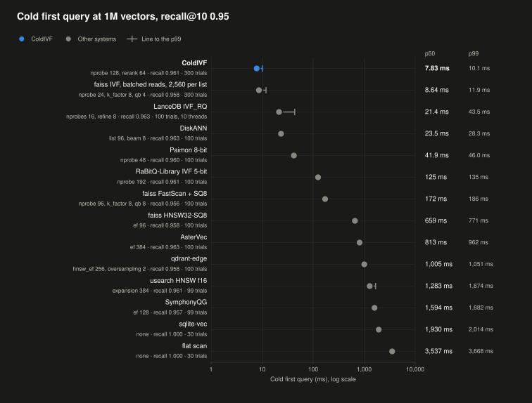

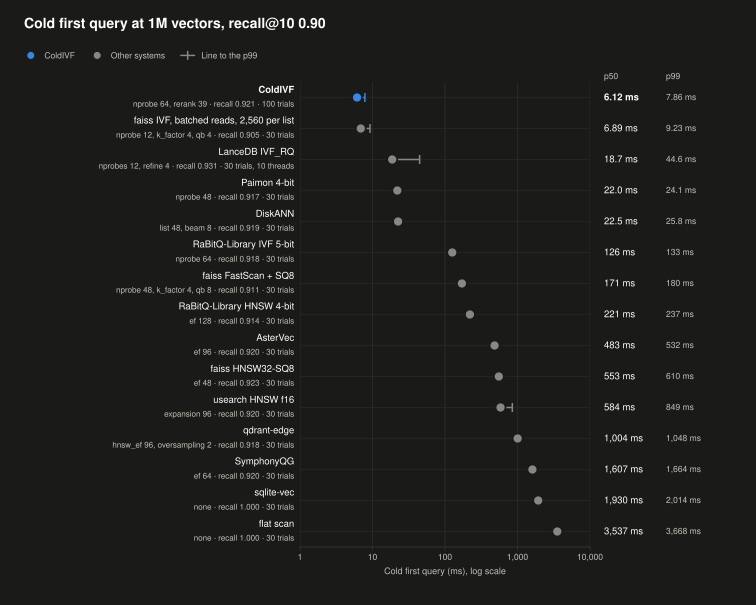

<details>
<summary>Cold first query at 1M, by system</summary>

**Recall@10 0.95**

| System | Setting | Recall@10 | Trials (Queries) | Cold p50 | Cold p99 | p50 Against ColdIVF |
|---|---|---|---|---|---|---|
| ColdIVF | nprobe 128, rerank 64 | 0.961 | 300 (50) | 7.83 ms | 10.1 ms | 1.00x |
| faiss IVF, batched reads, 2,560 per list | nprobe 24, k_factor 8, qb 4 | 0.958 | 300 (50) | 8.64 ms | 11.9 ms | 1.10x |
| LanceDB IVF_RQ | nprobes 16, refine 8 | 0.963 | 100 (50) | 21.4 ms | 43.5 ms | 2.74x |
| DiskANN | list 96, beam 8 | 0.963 | 100 (50) | 23.5 ms | 28.3 ms | 3.00x |
| Paimon 8-bit | nprobe 48 | 0.960 | 100 (50) | 41.9 ms | 46.0 ms | 5.35x |
| RaBitQ-Library IVF 5-bit | nprobe 192 | 0.961 | 100 (50) | 125 ms | 135 ms | 15.94x |
| faiss FastScan + SQ8 | nprobe 96, k_factor 8, qb 8 | 0.956 | 100 (50) | 172 ms | 186 ms | 21.92x |
| faiss HNSW32-SQ8 | ef 96 | 0.958 | 100 (50) | 659 ms | 771 ms | 84.22x |
| AsterVec | ef 384 | 0.963 | 100 (50) | 813 ms | 962 ms | 103.94x |
| qdrant-edge | hnsw_ef 256, oversampling 2 | 0.958 | 100 (50) | 1,005 ms | 1,051 ms | 128.36x |
| usearch HNSW f16 | expansion 384 | 0.961 | 99 (50) | 1,283 ms | 1,674 ms | 163.94x |
| SymphonyQG | ef 128 | 0.957 | 99 (50) | 1,594 ms | 1,682 ms | 203.67x |
| sqlite-vec | none | 1.000 | 30 (30) | 1,930 ms | 2,014 ms | 246.66x |
| flat scan | none | 1.000 | 30 (30) | 3,537 ms | 3,668 ms | 451.98x |

**Recall@10 0.90**

| System | Setting | Recall@10 | Trials (Queries) | Cold p50 | Cold p99 | p50 Against ColdIVF |
|---|---|---|---|---|---|---|
| ColdIVF | nprobe 64, rerank 39 | 0.921 | 100 (50) | 6.12 ms | 7.86 ms | 1.00x |
| faiss IVF, batched reads, 2,560 per list | nprobe 12, k_factor 4, qb 4 | 0.905 | 30 (30) | 6.89 ms | 9.23 ms | 1.13x |
| LanceDB IVF_RQ | nprobes 12, refine 4 | 0.931 | 30 (30) | 18.7 ms | 44.6 ms | 3.05x |
| Paimon 4-bit | nprobe 48 | 0.917 | 30 (30) | 22.0 ms | 24.1 ms | 3.59x |
| DiskANN | list 48, beam 8 | 0.919 | 30 (30) | 22.5 ms | 25.8 ms | 3.68x |
| RaBitQ-Library IVF 5-bit | nprobe 64 | 0.918 | 30 (30) | 126 ms | 133 ms | 20.56x |
| faiss FastScan + SQ8 | nprobe 48, k_factor 4, qb 8 | 0.911 | 30 (30) | 171 ms | 180 ms | 27.96x |
| RaBitQ-Library HNSW 4-bit | ef 128 | 0.914 | 30 (30) | 221 ms | 237 ms | 36.04x |
| AsterVec | ef 96 | 0.920 | 30 (30) | 483 ms | 532 ms | 78.90x |
| faiss HNSW32-SQ8 | ef 48 | 0.923 | 30 (30) | 553 ms | 610 ms | 90.28x |
| usearch HNSW f16 | expansion 96 | 0.920 | 30 (30) | 584 ms | 849 ms | 95.37x |
| qdrant-edge | hnsw_ef 96, oversampling 2 | 0.918 | 30 (30) | 1,004 ms | 1,048 ms | 164.11x |
| SymphonyQG | ef 64 | 0.920 | 30 (30) | 1,607 ms | 1,664 ms | 262.53x |
| sqlite-vec | none | 1.000 | 30 (30) | 1,930 ms | 2,014 ms | 315.44x |
| flat scan | none | 1.000 | 30 (30) | 3,537 ms | 3,668 ms | 578.01x |

</details>

<details>
<summary>Every configuration, at each target</summary>

These tables list every configuration each system ran, from [`coldivf-bench/py/headtohead.py`](coldivf-bench/py/headtohead.py), with ColdIVF's binaries as a control. They give throughput in QPS.

**Recall@10 0.90**

| System | Setting | Test Recall@10 | Warm p50 ms | QPS on 6 Threads | QPS on 12 Threads | QPS Method | Cold p50 ms | Cold p99 ms | Cold Trials (Queries) |
|---|---|---|---|---|---|---|---|---|---|
| ColdIVF, binaries | nprobe 64, rerank 39 | 0.9212 | 0.205 | 20,101 | 20,159 | threads | 5.46 | 6.55 | 100 (50) |
| ColdIVF | nprobe 64, rerank 39 | 0.9214 | 0.208 | 20,287 | 19,247 | threads | 6.12 | 7.86 | 100 (50) |
| faiss IVF, batched reads, 2,560 per list | nprobe 12, k_factor 4 | 0.9048 | 1.10 | 4,606 | 6,027 | processes | 6.89 | 9.23 | 30 (30) |
| faiss IVF, batched reads, 320 per list | nprobe 48, k_factor 4 | 0.9114 | 0.853 | 5,331 | 6,146 | processes | 8.54 | 11.7 | 30 (30) |
| faiss IVF, on-disk lists, 2,560 per list | nprobe 12, k_factor 4 | 0.9048 | 1.11 | 5,175 | 5,822 | batch call | 13.7 | 37.5 | 30 (30) |
| faiss IVF, on-disk lists, 320 per list | nprobe 48, k_factor 4 | 0.9114 | 0.996 | 6,485 | 7,980 | batch call | 16.3 | 54.1 | 30 (30) |
| LanceDB IVF_RQ | nprobes 12, refine 4 | 0.9314 | 6.51 | 1,402 | 1,406 | threads | 18.7 | 44.6 | 30 (30) |
| Paimon 4-bit | nprobe 48 | 0.9172 | 13.0 | 491 | 640 | batch call | 22.0 | 24.1 | 30 (30) |
| DiskANN | list 48, beam 8 | 0.9186 | 0.450 | 7,334 | 9,330 | batch call | 22.5 | 25.8 | 30 (30) |
| Paimon 8-bit | nprobe 24 | 0.9106 | 14.4 | 419 | 530 | batch call | 23.0 | 26.5 | 30 (30) |
| faiss IVF, parallel, 320 per list | nprobe 48, k_factor 4 | 0.9114 | 0.736 | 4,745 | 3,636 | batch call | 32.2 | 37.8 | 30 (30) |
| faiss IVF as shipped, 320 per list | nprobe 48, k_factor 4 | 0.9114 | 0.734 | 6,952 | 9,011 | batch call | 39.3 | 47.3 | 30 (30) |
| faiss IVF, HNSW quantizer, 320 per list | nprobe 48, k_factor 4 | 0.9090 | 0.668 | 8,224 | 10,011 | batch call | 50.7 | 59.7 | 30 (30) |
| RaBitQ-Library IVF 5-bit | nprobe 64 | 0.9178 | 0.476 | 11,240 | 14,270 | batch call | 126 | 133 | 30 (30) |
| faiss FastScan + SQ8 | nprobe 48, k_factor 4 | 0.9108 | 0.565 | 8,841 | 11,843 | batch call | 171 | 180 | 30 (30) |
| RaBitQ-Library IVF 9-bit | nprobe 48 | 0.9062 | 0.407 | 13,243 | 16,375 | batch call | 215 | 228 | 30 (30) |
| RaBitQ-Library HNSW 4-bit | ef 128 | 0.9142 | 0.160 | 33,319 | 45,149 | batch call | 221 | 237 | 30 (30) |
| AsterVec (warm 12 threads invalid) | ef 96 | 0.9200 | 4.23 | 991 | 870 | processes | 483 | 532 | 30 (30) |
| faiss HNSW32-SQ8 | ef 48 | 0.9228 | 0.288 | 12,199 | 18,112 | batch call | 553 | 610 | 30 (30) |
| usearch HNSW f16 | expansion 96 | 0.9204 | 0.601 | 7,698 | 10,749 | batch call | 584 | 849 | 30 (30) |
| qdrant-edge (warm 12 threads invalid) | hnsw_ef 96, oversampling 2 | 0.9184 | 0.350 | 11,543 | 10,668 | processes | 1,004 | 1,048 | 30 (30) |
| SymphonyQG | ef 64 | 0.9202 | 0.059 | 82,839 | 101,958 | batch call | 1,607 | 1,664 | 30 (30) |
| sqlite-vec | none | 1.0000 | 438 | 3 | 2 | processes | 1,930 | 2,014 | 30 (30) |
| flat scan | none | 1.0000 | 37.5 | 36 | 37 | threads | 3,537 | 3,668 | 30 (30) |
| usearch HNSW i8 | not reached, best tune recall@10 0.8568 at expansion 1024 | | | | | | | | |
| turbovec 4-bit | not reached, best tune recall@10 0.8720 at none | | | | | | | | |
| turbovec 4-bit, calibrated | not reached, best tune recall@10 0.8988 at none | | | | | | | | |

| System | Setting | Open and First Query: Process + Index Pages | Warm Mode | Warm: Process + Cached Pages | Build Minutes | Build Peak | Build Malloc Cache | Index Size | Bytes per Vector |
|---|---|---|---|---|---|---|---|---|---|
| ColdIVF, binaries | nprobe 64, rerank 39 | 4.37 MB + 4.89 MB = 9.26 MB | whole | 9.54 MB + 946 MB = 956 MB | 0.5 | 359 MB | off | 946 MB | 946 |
| ColdIVF | nprobe 64, rerank 39 | 3.88 MB + 4.89 MB = 8.74 MB | whole | 71.8 MB + 946 MB = 1.02 GB | 0.5 (another setup's file) | 359 MB | off | 946 MB | 946 |
| faiss IVF, batched reads, 2,560 per list | nprobe 12, k_factor 4 | 533 KB + 5.89 MB = 6.43 MB | whole | 70.4 MB + 881 MB = 952 MB | 0.1 (another setup's file) | 4.65 GB | off | 884 MB | 884 |
| faiss IVF, batched reads, 320 per list | nprobe 48, k_factor 4 | 705 KB + 12.9 MB = 13.7 MB | whole | 71.2 MB + 890 MB = 961 MB | 0.1 (another setup's file) | 4.67 GB | off | 892 MB | 892 |
| faiss IVF, on-disk lists, 2,560 per list | nprobe 12, k_factor 4 | 812 KB + 4.75 MB = 5.57 MB | whole | 70.9 MB + 880 MB = 951 MB | 0.1 | 4.65 GB | off | 884 MB | 884 |
| faiss IVF, on-disk lists, 320 per list | nprobe 48, k_factor 4 | 10.8 MB + 3.85 MB = 14.7 MB | whole | 80.1 MB + 880 MB = 960 MB | 0.1 | 4.67 GB | off | 892 MB | 892 |
| LanceDB IVF_RQ | nprobes 12, refine 4 | 4.33 MB + 8.19 MB = 12.3 MB | whole | 259 MB + 3.19 GB = 3.44 GB | 0.2 | 2.13 GB | off | 3.19 GB | 3,186 |
| Paimon 4-bit | nprobe 48 | 41.5 MB + 22.6 MB = 64.1 MB | whole | 85.6 MB + 406 MB = 492 MB | 0.1 | 457 MB | off | 409 MB | 409 |
| DiskANN | list 48, beam 8 | 96.1 MB + 347 KB = 96.5 MB | whole | 161 MB + 4.1 GB = 4.26 GB | 4.9 | 3.48 GB | off | 4.19 GB | 4,193 |
| Paimon 8-bit | nprobe 24 | 40 MB + 21.5 MB = 61.4 MB | whole | 102 MB + 790 MB = 892 MB | 0.1 | 462 MB | off | 793 MB | 793 |
| faiss IVF, parallel, 320 per list | nprobe 48, k_factor 4 | 582 KB + 12.9 MB = 13.5 MB | whole | 71 MB + 890 MB = 961 MB | 0.1 (another setup's file) | 4.67 GB | off | 892 MB | 892 |
| faiss IVF as shipped, 320 per list | nprobe 48, k_factor 4 | 607 KB + 12.9 MB = 13.5 MB | whole | 71.8 MB + 890 MB = 962 MB | 0.1 | 4.67 GB | off | 892 MB | 892 |
| faiss IVF, HNSW quantizer, 320 per list | nprobe 48, k_factor 4 | 607 KB + 8.54 MB = 9.2 MB | whole | 71.9 MB + 891 MB = 963 MB | 0.1 | 4.67 GB | off | 893 MB | 893 |
| RaBitQ-Library IVF 5-bit | nprobe 64 | 506 MB + 1.29 KB = 506 MB | whole | 549 MB + 0 B = 549 MB | 0.2 | 568 MB | off | 519 MB | 519 |
| faiss FastScan + SQ8 | nprobe 48, k_factor 4 | 919 MB + 15.8 KB = 919 MB | whole | 962 MB + 0 B = 962 MB | 0.1 | 4.67 GB | off | 897 MB | 897 |
| RaBitQ-Library IVF 9-bit | nprobe 48 | 900 MB + 1.29 KB = 900 MB | whole | 933 MB + 0 B = 933 MB | 0.8 | 953 MB | off | 903 MB | 903 |
| RaBitQ-Library HNSW 4-bit | ef 128 | 681 MB + 2.15 KB = 681 MB | whole | 718 MB + 0 B = 718 MB | 4.5 | 715 MB | off | 553 MB | 553 |
| AsterVec | ef 96 | 180 MB + 445 MB = 625 MB | whole | 325 MB + 2.05 GB = 2.37 GB | 6.0 | 4.76 GB | off | 2.04 GB | 2,045 |
| faiss HNSW32-SQ8 | ef 48 | 12.6 MB + 299 MB = 311 MB | whole | 80.2 MB + 1.04 GB = 1.12 GB | 3.1 | 1.57 GB | off | 1.04 GB | 1,040 |
| usearch HNSW f16 | expansion 96 | 16.9 MB + 262 MB = 279 MB | whole | 88.6 MB + 1.68 GB = 1.77 GB | 2.1 | 1.78 GB | off | 1.68 GB | 1,685 |
| qdrant-edge | hnsw_ef 96, oversampling 2 | 772 MB + 61.1 MB = 833 MB | whole | 879 MB + 3.27 GB = 4.15 GB | 1.4 | 1.23 GB | off | 4.04 GB | 4,044 |
| SymphonyQG | ef 64 | 6.53 GB + 7.77 KB = 6.53 GB | whole | 6.56 GB + 16.4 KB = 6.56 GB | 2.0 | 10.1 GB | off | 6.53 GB | 6,528 |
| sqlite-vec | none | 2.23 MB + 3.1 GB = 3.1 GB | whole | 31 MB + 3.1 GB = 3.13 GB | 1.1 | 36.4 MB | off | 3.1 GB | 3,101 |
| flat scan | none | 26 MB + 3.07 GB = 3.1 GB | whole | 50.8 MB + 3.07 GB = 3.12 GB | 0.0 | 24.1 MB | off | 3.07 GB | 3,072 |

**Recall@10 0.95**

| System | Setting | Test Recall@10 | Warm p50 ms | QPS on 6 Threads | QPS on 12 Threads | QPS Method | Cold p50 ms | Cold p99 ms | Cold Trials (Queries) | Cold p50 at Exactly the Target ms |
|---|---|---|---|---|---|---|---|---|---|---|
| ColdIVF, binaries | nprobe 128, rerank 64 | 0.9608 | 0.345 | 12,151 | 11,588 | threads | 7.18 | 9.09 | 300 (50) | 6.81 |
| ColdIVF | nprobe 128, rerank 64 | 0.9610 | 0.348 | 12,209 | 11,305 | threads | 7.83 | 10.1 | 300 (50) | 7.51 |
| faiss IVF, batched reads, 2,560 per list | nprobe 24, k_factor 8 | 0.9576 | 2.10 | 2,365 | 3,175 | processes | 8.64 | 11.9 | 300 (50) | 8.34 |
| faiss IVF, batched reads, 320 per list | nprobe 96, k_factor 8 | 0.9556 | 1.52 | 3,159 | 3,528 | processes | 11.4 | 13.6 | 100 (50) | 11.0 |
| faiss IVF, on-disk lists, 2,560 per list | nprobe 32, k_factor 4 | 0.9558 | 2.88 | 2,060 | 2,434 | batch call | 20.8 | 44.8 | 300 (50) | 19.2 |
| faiss IVF, on-disk lists, 320 per list | nprobe 128, k_factor 4 | 0.9538 | 1.98 | 3,149 | 3,937 | batch call | 21.3 | 47.7 | 100 (50) | 20.8 |
| LanceDB IVF_RQ | nprobes 16, refine 8 | 0.9634 | 5.18 | 1,083 | 1,150 | threads | 21.4 | 43.5 | 100 (50) | 20.2 |
| DiskANN | list 96, beam 8 | 0.9626 | 0.684 | 4,509 | 5,641 | batch call | 23.5 | 28.3 | 100 (50) | 23.2 |
| faiss IVF, parallel, 320 per list | nprobe 96, k_factor 8 | 0.9556 | 1.30 | 3,004 | 2,759 | batch call | 39.6 | 44.3 | 100 (50) | 38.6 |
| Paimon 8-bit | nprobe 48 | 0.9596 | 28.4 | 222 | 291 | batch call | 41.9 | 46.0 | 100 (50) | 37.2 |
| faiss IVF as shipped, 320 per list | nprobe 96, k_factor 8 | 0.9556 | 1.30 | 4,068 | 5,145 | batch call | 59.1 | 67.6 | 100 (50) | 56.2 |
| faiss IVF, HNSW quantizer, 320 per list | nprobe 96, k_factor 8 | 0.9528 | 1.27 | 4,478 | 5,447 | batch call | 68.0 | 79.8 | 100 (50) | 66.7 |
| RaBitQ-Library IVF 5-bit | nprobe 192 | 0.9612 | 1.12 | 5,095 | 6,652 | batch call | 125 | 135 | 100 (50) | 125 |
| faiss FastScan + SQ8 | nprobe 96, k_factor 8 | 0.9564 | 0.964 | 5,480 | 7,065 | batch call | 172 | 186 | 100 (50) | 171 |
| RaBitQ-Library IVF 9-bit | nprobe 128 | 0.9588 | 0.780 | 7,034 | 9,009 | batch call | 215 | 246 | 100 (50) | 215 |
| faiss HNSW32-SQ8 | ef 96 | 0.9580 | 0.509 | 7,175 | 10,427 | batch call | 659 | 771 | 100 (50) | 633 |
| AsterVec | ef 384 | 0.9634 | 14.9 | 298 | 269 | processes | 813 | 962 | 100 (50) | 692 |
| qdrant-edge (warm 12 threads invalid) | hnsw_ef 256, oversampling 2 | 0.9582 | 0.782 | 5,353 | 5,933 | processes | 1,005 | 1,051 | 100 (50) | 1,005 |
| usearch HNSW f16 | expansion 384 | 0.9612 | 2.06 | 2,282 | 3,199 | batch call | 1,283 | 1,674 | 99 (50) | 1,034 |
| SymphonyQG | ef 128 | 0.9572 | 0.096 | 51,620 | 65,967 | batch call | 1,594 | 1,682 | 99 (50) | 1,596 |
| sqlite-vec | none | 1.0000 | 438 | 3 | 2 | processes | 1,930 | 2,014 | 30 (30) | - |
| flat scan | none | 1.0000 | 37.5 | 36 | 37 | threads | 3,537 | 3,668 | 30 (30) | - |
| Paimon 4-bit | not reached, best tune recall@10 0.9470 at nprobe 384 | | | | | | | | | |
| usearch HNSW i8 | not reached, best tune recall@10 0.8568 at expansion 1024 | | | | | | | | | |
| RaBitQ-Library HNSW 4-bit | not reached, best tune recall@10 0.9440 at ef 2048 | | | | | | | | | |
| turbovec 4-bit | not reached, best tune recall@10 0.8720 at none | | | | | | | | | |
| turbovec 4-bit, calibrated | not reached, best tune recall@10 0.8988 at none | | | | | | | | | |

| System | Setting | Open and First Query: Process + Index Pages | Warm Mode | Warm: Process + Cached Pages | Build Minutes | Build Peak | Build Malloc Cache | Index Size | Bytes per Vector |
|---|---|---|---|---|---|---|---|---|---|
| ColdIVF, binaries | nprobe 128, rerank 64 | 7.38 MB + 8.22 MB = 15.6 MB | whole | 9.98 MB + 946 MB = 956 MB | 0.5 | 359 MB | off | 946 MB | 946 |
| ColdIVF | nprobe 128, rerank 64 | 7.47 MB + 8.22 MB = 15.7 MB | whole | 74.2 MB + 946 MB = 1.02 GB | 0.5 (another setup's file) | 359 MB | off | 946 MB | 946 |
| faiss IVF, batched reads, 2,560 per list | nprobe 24, k_factor 8 | 590 KB + 10.7 MB = 11.3 MB | whole | 70.5 MB + 881 MB = 952 MB | 0.1 (another setup's file) | 4.65 GB | off | 884 MB | 884 |
| faiss IVF, batched reads, 320 per list | nprobe 96, k_factor 8 | 787 KB + 15.9 MB = 16.7 MB | whole | 71.6 MB + 890 MB = 961 MB | 0.1 (another setup's file) | 4.67 GB | off | 892 MB | 892 |
| faiss IVF, on-disk lists, 2,560 per list | nprobe 32, k_factor 4 | 1.16 MB + 12.6 MB = 13.8 MB | whole | 71.3 MB + 880 MB = 951 MB | 0.1 | 4.65 GB | off | 884 MB | 884 |
| faiss IVF, on-disk lists, 320 per list | nprobe 128, k_factor 4 | 10.8 MB + 9.15 MB = 19.9 MB | whole | 80.1 MB + 880 MB = 960 MB | 0.1 | 4.67 GB | off | 892 MB | 892 |
| LanceDB IVF_RQ | nprobes 16, refine 8 | 5.91 MB + 11.4 MB = 17.2 MB | whole | 263 MB + 3.19 GB = 3.45 GB | 0.2 | 2.13 GB | off | 3.19 GB | 3,186 |
| DiskANN | list 96, beam 8 | 96.1 MB + 525 KB = 96.7 MB | whole | 162 MB + 4.1 GB = 4.26 GB | 4.9 | 3.48 GB | off | 4.19 GB | 4,193 |
| faiss IVF, parallel, 320 per list | nprobe 96, k_factor 8 | 640 KB + 15.9 MB = 16.5 MB | whole | 71.2 MB + 890 MB = 961 MB | 0.1 (another setup's file) | 4.67 GB | off | 892 MB | 892 |
| Paimon 8-bit | nprobe 48 | 74.5 MB + 43.5 MB = 118 MB | whole | 135 MB + 790 MB = 925 MB | 0.1 | 462 MB | off | 793 MB | 793 |
| faiss IVF as shipped, 320 per list | nprobe 96, k_factor 8 | 640 KB + 15.7 MB = 16.3 MB | whole | 71.2 MB + 890 MB = 961 MB | 0.1 | 4.67 GB | off | 892 MB | 892 |
| faiss IVF, HNSW quantizer, 320 per list | nprobe 96, k_factor 8 | 672 KB + 11.5 MB = 12.2 MB | whole | 72.2 MB + 891 MB = 963 MB | 0.1 | 4.67 GB | off | 893 MB | 893 |
| RaBitQ-Library IVF 5-bit | nprobe 192 | 506 MB + 1.29 KB = 506 MB | whole | 549 MB + 0 B = 549 MB | 0.2 | 568 MB | off | 519 MB | 519 |
| faiss FastScan + SQ8 | nprobe 96, k_factor 8 | 919 MB + 15.8 KB = 919 MB | whole | 963 MB + 0 B = 963 MB | 0.1 | 4.67 GB | off | 897 MB | 897 |
| RaBitQ-Library IVF 9-bit | nprobe 128 | 900 MB + 1.29 KB = 900 MB | whole | 933 MB + 0 B = 933 MB | 0.8 | 953 MB | off | 903 MB | 903 |
| faiss HNSW32-SQ8 | ef 96 | 12.6 MB + 319 MB = 331 MB | whole | 80.1 MB + 1.04 GB = 1.12 GB | 3.1 | 1.57 GB | off | 1.04 GB | 1,040 |
| AsterVec | ef 384 | 187 MB + 500 MB = 688 MB | whole | 329 MB + 1.63 GB = 1.96 GB | 6.0 | 4.76 GB | off | 2.04 GB | 2,045 |
| qdrant-edge | hnsw_ef 256, oversampling 2 | 772 MB + 61.1 MB = 833 MB | whole | 879 MB + 3.27 GB = 4.15 GB | 1.4 | 1.23 GB | off | 4.04 GB | 4,044 |
| usearch HNSW f16 | expansion 384 | 16.9 MB + 445 MB = 462 MB | whole | 88.6 MB + 1.68 GB = 1.77 GB | 2.1 | 1.78 GB | off | 1.68 GB | 1,685 |
| SymphonyQG | ef 128 | 6.53 GB + 7.77 KB = 6.53 GB | whole | 6.56 GB + 0 B = 6.56 GB | 2.0 | 10.1 GB | off | 6.53 GB | 6,528 |
| sqlite-vec | none | 2.23 MB + 3.1 GB = 3.1 GB | whole | 31 MB + 3.1 GB = 3.13 GB | 1.1 | 36.4 MB | off | 3.1 GB | 3,101 |
| flat scan | none | 26 MB + 3.07 GB = 3.1 GB | whole | 50.8 MB + 3.07 GB = 3.12 GB | 0.0 | 24.1 MB | off | 3.07 GB | 3,072 |

</details>

### ColdIVF's Cold First Query in Each Setup

These runs compare ColdIVF with itself, through its release binaries on Cohere 1M. Its first query takes 5.8 to 7.5 ms in every setup. The controls, which read its file another way, take 3.4 to 32 times as long.

Each dot is a setup's median and its line runs to the p99, on a log scale.

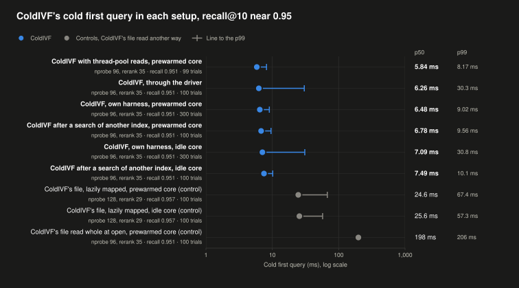

<details>
<summary>Each setup</summary>

| System | Setting | Recall@10 | Trials | Cold p50 | Cold p95 | Cold p99 | p50 Against ColdIVF |
|---|---|---|---|---|---|---|---|
| **ColdIVF with thread-pool reads, prewarmed core**<br>Reads its clusters with blocking reads on a pool of threads. Its default reader instead issues read hints from the calling thread. | nprobe 96, rerank 35 | 0.951 | 99 | 5.84 ms | 6.88 ms | 8.17 ms | 0.93x |
| **ColdIVF, through the driver**<br>The benchmark driver runs ColdIVF's cold binary as it runs every system. Each trial is a fresh process with the index dropped from the cache. | nprobe 96, rerank 35 | 0.951 | 100 | 6.26 ms | 7.93 ms | 30.3 ms | 1.00x |
| **ColdIVF, own harness, prewarmed core**<br>ColdIVF's own cold binary, which drops the index from the cache and times the open and the first search. The core spins for 150 ms first, thus the query starts at full speed on a performance core. | nprobe 96, rerank 35 | 0.951 | 300 | 6.48 ms | 8.04 ms | 9.02 ms | 1.03x |
| **ColdIVF after a search of another index, prewarmed core**<br>The process first searches a separate 50K-vector index, as an application that has searched before would. Thus its program code and reader are warm. | nprobe 96, rerank 35 | 0.951 | 100 | 6.78 ms | 8.31 ms | 9.56 ms | 1.08x |
| **ColdIVF, own harness, idle core**<br>ColdIVF's own harness, but the core sleeps 200 ms first, thus the query can start slowly or on an efficiency core. | nprobe 96, rerank 35 | 0.951 | 300 | 7.09 ms | 8.92 ms | 30.8 ms | 1.13x |
| **ColdIVF after a search of another index, idle core**<br>The search of another index first, then the query from an idle core. | nprobe 96, rerank 35 | 0.951 | 100 | 7.49 ms | 9.15 ms | 10.1 ms | 1.20x |
| **ColdIVF's file, lazily mapped, prewarmed core (control)**<br>A control that searches the same file through a memory map. The map reads each page when the search first touches it, instead of in batches. | nprobe 128, rerank 29 | 0.957 | 100 | 24.6 ms | 38.5 ms | 67.4 ms | 3.53x |
| **ColdIVF's file, lazily mapped, idle core (control)**<br>The same lazy map, with the query from an idle core. | nprobe 128, rerank 29 | 0.957 | 100 | 25.6 ms | 33.5 ms | 57.3 ms | 3.41x |
| **ColdIVF's file read whole at open, prewarmed core (control)**<br>A control that reads the whole 953 MB file into memory at open, then searches it. | nprobe 96, rerank 35 | 0.951 | 100 | 198 ms | 202 ms | 206 ms | 31.78x |

</details>

### Warm Query

On warm queries, ColdIVF is second at recall@10 0.95 and third at 0.90. Only graphs held in memory rank above it: SymphonyQG at both targets and RaBitQ-Library's HNSW graph at 0.90. It is ahead of every other inverted-file and disk index.

Each dot is a system's median at 1 thread and its line runs to the p99, on a log scale.

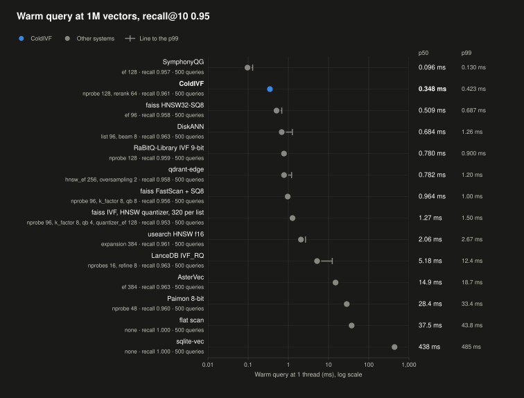

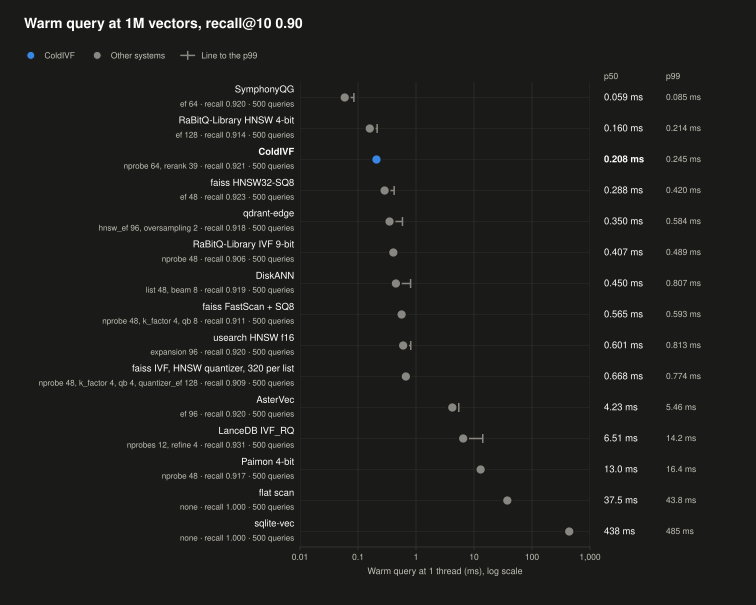

Each dot is a system's queries per second on 6 threads, on a log scale. The columns give the values on 6 and 12 threads.

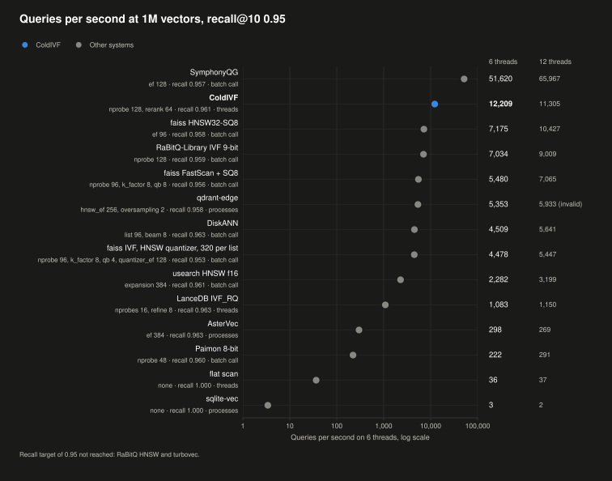

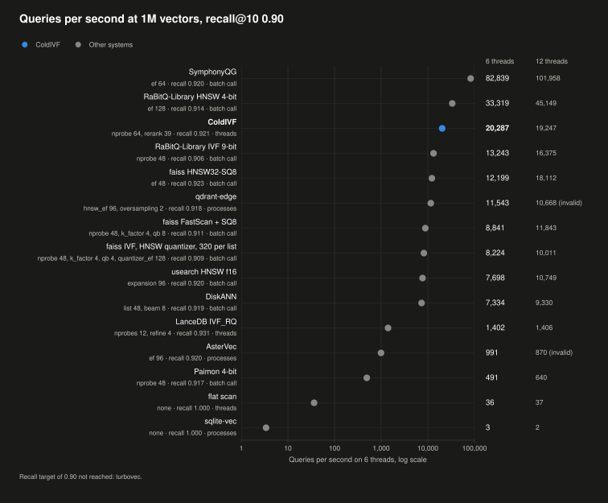

<details>
<summary>Warm query at 1M, by system</summary>

| System | Warm p50 at 0.90 | QPS, 6 Threads, at 0.90 | Warm p50 at 0.95 | QPS, 6 Threads, at 0.95 | QPS Method |
|---|---|---|---|---|---|
| SymphonyQG | 0.059 ms | 82,839 | 0.096 ms | 51,620 | batch call |
| **ColdIVF** | **0.208 ms** | **20,287** | **0.348 ms** | **12,209** | threads |
| faiss HNSW32-SQ8 | 0.288 ms | 12,199 | 0.509 ms | 7,175 | batch call |
| DiskANN | 0.450 ms | 7,334 | 0.684 ms | 4,509 | batch call |
| RaBitQ-Library IVF 9-bit | 0.407 ms | 13,243 | 0.780 ms | 7,034 | batch call |
| qdrant-edge | 0.350 ms | 11,543 | 0.782 ms | 5,353 | processes |
| faiss FastScan + SQ8 | 0.565 ms | 8,841 | 0.964 ms | 5,480 | batch call |
| faiss IVF, HNSW quantizer, 320 per list | 0.668 ms | 8,224 | 1.27 ms | 4,478 | batch call |
| usearch HNSW f16 | 0.601 ms | 7,698 | 2.06 ms | 2,282 | batch call |
| LanceDB IVF_RQ | 6.51 ms | 1,402 | 5.18 ms | 1,083 | threads |
| AsterVec | 4.23 ms | 991 | 14.9 ms | 298 | processes |
| Paimon 8-bit | 13.0 ms (Paimon 4-bit) | 491 (Paimon 4-bit) | 28.4 ms | 222 | batch call |
| flat scan | 37.5 ms | 36 | 37.5 ms | 36 | threads |
| sqlite-vec | 438 ms | 3 | 438 ms | 3 | processes |
| RaBitQ-Library HNSW 4-bit | 0.160 ms | 33,319 | not reached | not reached | batch call |

</details>

### Memory and Build

ColdIVF's open and first query add 16 MB, the second least. When warm, ColdIVF holds 1.0 GB, about the size of its index.

Light gray is process memory and dark gray is the index's pages in the page cache. ColdIVF is in blue.

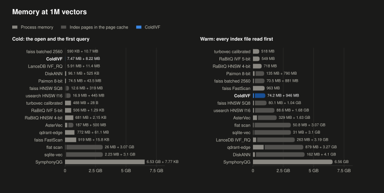

ColdIVF's build peaks at 359 MB, less than every system except the two exact scans. Its index takes 946 bytes per vector.

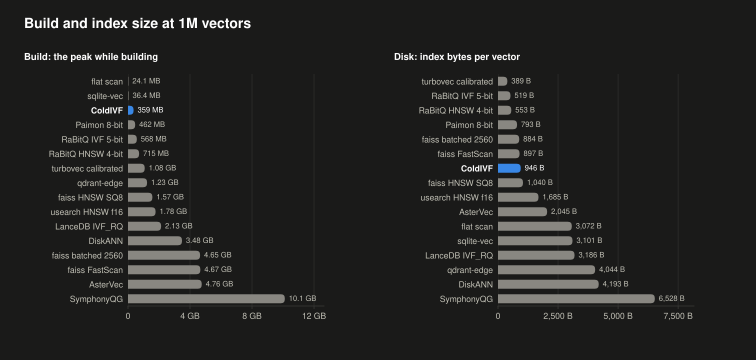

<details>
<summary>Memory and build at 1M, by system</summary>

| System | Open + First Query, Process and Pages | Warm: Process + Cached Pages | Build Time | Build Peak | Index on Disk |
|---|---|---|---|---|---|
| **ColdIVF** | **15.7 MB** | **74.2 MB + 946 MB** | **31 s** | **359 MB** | **946 MB** |
| faiss IVF, batched reads, 2,560 per list | 11.3 MB | 70.5 MB + 881 MB | 5 s | 4.65 GB | 884 MB |
| LanceDB IVF_RQ | 17.2 MB | 263 MB + 3.19 GB | 14 s | 2.13 GB | 3.19 GB |
| DiskANN | 96.7 MB | 162 MB + 4.1 GB | 4.9 min | 3.48 GB | 4.19 GB |
| Paimon 8-bit | 118 MB | 135 MB + 790 MB | 9 s | 462 MB | 793 MB |
| faiss HNSW32-SQ8 | 331 MB | 80.1 MB + 1.04 GB | 3.1 min | 1.57 GB | 1.04 GB |
| usearch HNSW f16 | 462 MB | 88.6 MB + 1.68 GB | 2.1 min | 1.78 GB | 1.68 GB |
| turbovec 4-bit, calibrated, at its setting of most recall | 488 MB | 518 MB | 1 s | 1.08 GB | 389 MB |
| RaBitQ-Library IVF 5-bit | 506 MB | 549 MB | 12 s* | 568 MB | 519 MB |
| RaBitQ-Library HNSW 4-bit, at 0.90 | 681 MB | 718 MB | 4.5 min | 715 MB | 553 MB |
| AsterVec | 688 MB | 329 MB + 1.63 GB | 6.0 min | 4.76 GB | 2.04 GB |
| qdrant-edge | 833 MB | 879 MB + 3.27 GB | 1.4 min | 1.23 GB | 4.04 GB |
| faiss FastScan + SQ8 | 919 MB | 963 MB | 6 s* | 4.67 GB | 897 MB |
| flat scan | 3.1 GB | 50.8 MB + 3.07 GB | 1 s | 24.1 MB | 3.07 GB |
| sqlite-vec | 3.1 GB | 31 MB + 3.1 GB | 1.1 min | 36.4 MB | 3.1 GB |
| SymphonyQG | 6.53 GB | 6.56 GB | 2.0 min | 10.1 GB | 6.53 GB |

</details>

## 10M Vectors

Every system that fits in this Mac's memory ran on all 10M rows of Cohere 10M.

### Cold First Query

ColdIVF has **the fastest cold first query**, 7.9 ms at recall@10 0.90 and 11.2 ms at 0.95. The next system, faiss with batched reads, takes 2.4 and 2.1 times as long. LanceDB takes 3.7 and 2.8 times as long, and the rest up to 680 times.

Each dot is a system's median and its line runs to the p99, on a log scale.

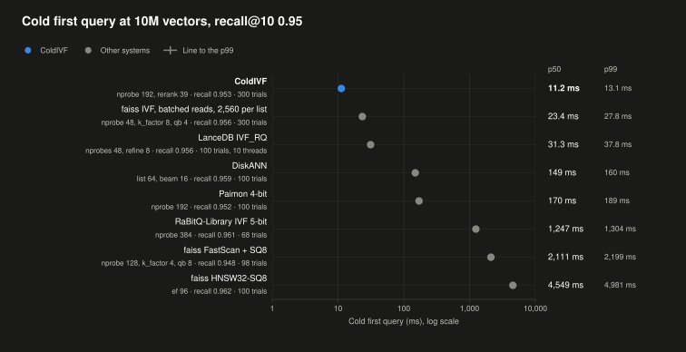

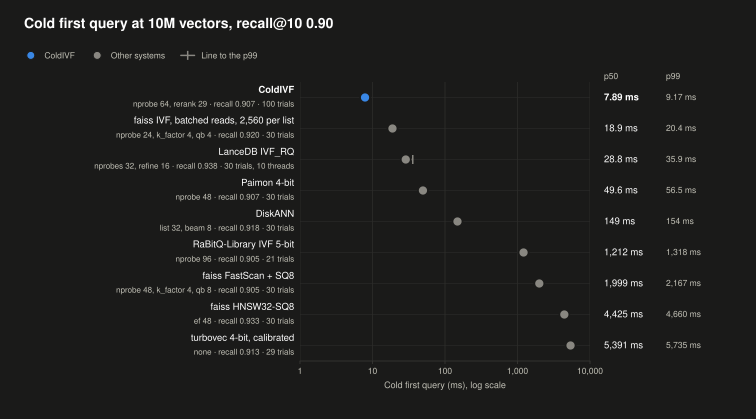

<details>
<summary>Cold first query at 10M, by system</summary>

**Recall@10 0.95**

| System | Setting | Recall@10 | Trials (Queries) | Cold p50 | Cold p99 | p50 Against ColdIVF |
|---|---|---|---|---|---|---|
| ColdIVF | nprobe 192, rerank 39 | 0.953 | 300 (50) | 11.2 ms | 13.1 ms | 1.00x |
| faiss IVF, batched reads, 2,560 per list | nprobe 48, k_factor 8, qb 4 | 0.956 | 300 (50) | 23.4 ms | 27.8 ms | 2.09x |
| LanceDB IVF_RQ | nprobes 48, refine 8 | 0.956 | 100 (50) | 31.3 ms | 37.8 ms | 2.79x |
| DiskANN | list 64, beam 16 | 0.959 | 100 (50) | 149 ms | 160 ms | 13.31x |
| Paimon 4-bit | nprobe 192 | 0.952 | 100 (50) | 170 ms | 189 ms | 15.17x |
| RaBitQ-Library IVF 5-bit | nprobe 384 | 0.961 | 68 (46) | 1,247 ms | 1,304 ms | 111.03x |
| faiss FastScan + SQ8 | nprobe 128, k_factor 4, qb 8 | 0.948 | 98 (50) | 2,111 ms | 2,199 ms | 187.98x |
| faiss HNSW32-SQ8 | ef 96 | 0.962 | 100 (50) | 4,549 ms | 4,981 ms | 405.07x |

**Recall@10 0.90**

| System | Setting | Recall@10 | Trials (Queries) | Cold p50 | Cold p99 | p50 Against ColdIVF |
|---|---|---|---|---|---|---|
| ColdIVF | nprobe 64, rerank 29 | 0.907 | 100 (50) | 7.89 ms | 9.17 ms | 1.00x |
| faiss IVF, batched reads, 2,560 per list | nprobe 24, k_factor 4, qb 4 | 0.920 | 30 (30) | 18.9 ms | 20.4 ms | 2.39x |
| LanceDB IVF_RQ | nprobes 32, refine 16 | 0.938 | 30 (30) | 28.8 ms | 35.9 ms | 3.65x |
| Paimon 4-bit | nprobe 48 | 0.907 | 30 (30) | 49.6 ms | 56.5 ms | 6.29x |
| DiskANN | list 32, beam 8 | 0.918 | 30 (30) | 149 ms | 154 ms | 18.84x |
| RaBitQ-Library IVF 5-bit | nprobe 96 | 0.905 | 21 (21) | 1,212 ms | 1,318 ms | 153.58x |
| faiss FastScan + SQ8 | nprobe 48, k_factor 4, qb 8 | 0.905 | 30 (30) | 1,999 ms | 2,167 ms | 253.36x |
| faiss HNSW32-SQ8 | ef 48 | 0.933 | 30 (30) | 4,425 ms | 4,660 ms | 560.88x |
| turbovec 4-bit, calibrated | none | 0.913 | 29 (29) | 5,391 ms | 5,735 ms | 683.39x |

</details>

<details>
<summary>Every configuration, at each target</summary>

These tables list every configuration each system ran, from [`coldivf-bench/py/headtohead.py`](coldivf-bench/py/headtohead.py), with ColdIVF's binaries as a control.

**Recall@10 0.90**

| System | Setting | Test Recall@10 | Warm p50 ms | QPS on 6 Threads | QPS on 12 Threads | QPS Method | Cold p50 ms | Cold p99 ms | Cold Trials (Queries) | Cold p50 at Exactly the Target ms |
|---|---|---|---|---|---|---|---|---|---|---|
| ColdIVF, binaries | nprobe 64, rerank 29 | 0.9070 | 0.417 | 11,061 | 12,006 | threads | 7.02 | 8.40 | 100 (50) | 6.93 |
| ColdIVF | nprobe 64, rerank 29 | 0.9070 | 0.418 | 11,340 | 11,605 | threads | 7.89 | 9.17 | 100 (50) | 7.56 |
| faiss IVF, batched reads, 2,560 per list | nprobe 24, k_factor 4 | 0.9200 | 2.62 | 1,996 | 2,556 | processes | 18.9 | 20.4 | 30 (30) | - |
| faiss IVF, on-disk lists, 2,560 per list | nprobe 24, k_factor 4 | 0.9200 | 2.67 | 2,086 | 2,423 | batch call | 21.8 | 45.2 | 30 (30) | - |
| faiss IVF, on-disk lists, 640 per list | nprobe 48, k_factor 4 | 0.9052 | 2.17 | 2,326 | 2,729 | batch call | 27.6 | 76.6 | 30 (30) | - |
| LanceDB IVF_RQ | nprobes 32, refine 16 | 0.9384 | 11.6 | 433 | 420 | threads | 28.8 | 35.9 | 30 (30) | - |
| faiss IVF, batched reads, 640 per list | nprobe 48, k_factor 4 | 0.9052 | 2.01 | 2,096 | 2,370 | processes | 30.4 | 43.1 | 30 (30) | - |
| Paimon 4-bit | nprobe 48 | 0.9072 | 30.4 | 173 | 214 | batch call | 49.6 | 56.5 | 30 (30) | - |
| Paimon 8-bit | nprobe 32 | 0.9032 | 45.1 | 98 | 117 | batch call | 68.5 | 76.0 | 30 (30) | - |
| faiss IVF, parallel, 640 per list | nprobe 48, k_factor 4 | 0.9052 | 1.86 | 2,942 | 2,635 | batch call | 85.8 | 88.4 | 30 (30) | - |
| faiss IVF, HNSW quantizer, 640 per list | nprobe 48, k_factor 4 | 0.9054 | 1.27 | 4,004 | 4,773 | batch call | 95.4 | 120 | 30 (30) | - |
| faiss IVF as shipped, 640 per list | nprobe 48, k_factor 4 | 0.9052 | 1.85 | 2,429 | 2,953 | batch call | 133 | 146 | 30 (30) | - |
| DiskANN | list 32, beam 8 | 0.9182 | 1.72 | 2,172 | 2,415 | batch call | 149 | 154 | 30 (30) | - |
| RaBitQ-Library IVF 5-bit | nprobe 96 | 0.9054 | 1.80 | 2,384 | 2,648 | batch call | 1,212 | 1,318 | 21 (21) | - |
| faiss FastScan + SQ8 | nprobe 48, k_factor 4 | 0.9054 | 1.29 | 3,211 | 3,412 | batch call | 1,999 | 2,167 | 30 (30) | - |
| RaBitQ-Library IVF 9-bit | nprobe 96 | 0.9162 | 1.74 | 2,397 | 2,718 | batch call | 2,331 | 2,377 | 22 (22) | - |
| faiss HNSW32-SQ8 | ef 48 | 0.9332 | 0.332 | 10,897 | 16,020 | batch call | 4,425 | 4,660 | 30 (30) | - |
| turbovec 4-bit, calibrated | none | 0.9132 | 26.9 | 213 | 291 | batch call | 5,391 | 5,735 | 29 (29) | - |
| usearch HNSW i8 | not reached, best tune recall@10 0.8818 at expansion 1024 | | | | | | | | | |
| turbovec 4-bit | not reached, best tune recall@10 0.8986 at none | | | | | | | | | |

| System | Setting | Open and First Query: Process + Index Pages | Warm Mode | Warm: Process + Cached Pages | Build Minutes | Build Peak | Build Malloc Cache | Index Size | Bytes per Vector |
|---|---|---|---|---|---|---|---|---|---|
| ColdIVF, binaries | nprobe 64, rerank 29 | 7.87 MB + 12.7 MB = 20.6 MB | whole | 26.4 MB + 9.43 GB = 9.45 GB | 11.8 | 843 MB | off | 9.43 GB | 943 |
| ColdIVF | nprobe 64, rerank 29 | 7.27 MB + 12.7 MB = 20 MB | whole | 75 MB + 9.43 GB = 9.5 GB | 11.8 (another setup's file) | 843 MB | off | 9.43 GB | 943 |
| faiss IVF, batched reads, 2,560 per list | nprobe 24, k_factor 4 | 2.43 MB + 21.8 MB = 24.3 MB | whole | 80.6 MB + 8.81 GB = 8.89 GB | 3.8 (another setup's file) | 9.66 GB | on | 8.81 GB | 881 |
| faiss IVF, on-disk lists, 2,560 per list | nprobe 24, k_factor 4 | 13.4 MB + 10.7 MB = 24.1 MB | whole | 86 MB + 8.8 GB = 8.89 GB | 3.6 | 9.69 GB | on | 8.81 GB | 881 |
| faiss IVF, on-disk lists, 640 per list | nprobe 48, k_factor 4 | 49.6 MB + 6.47 MB = 56.1 MB | whole | 123 MB + 8.8 GB = 8.92 GB | 2.4 | 10.2 GB | on | 8.85 GB | 885 |
| LanceDB IVF_RQ | nprobes 32, refine 16 | 35.7 MB + 21.4 MB = 56.8 MB | index | 1.39 GB + 3.93 GB = 5.33 GB | 2.9 | 4.9 GB | on | 31.9 GB | 3,188 |
| faiss IVF, batched reads, 640 per list | nprobe 48, k_factor 4 | 3.43 MB + 53.6 MB = 57 MB | whole | 84.1 MB + 8.85 GB = 8.93 GB | 2.3 (another setup's file) | 10 GB | on | 8.85 GB | 885 |
| Paimon 4-bit | nprobe 48 | 124 MB + 53.7 MB = 178 MB | whole | 111 MB + 4.06 GB = 4.17 GB | 3.6 | 6.48 GB | on | 4.07 GB | 407 |
| Paimon 8-bit | nprobe 32 | 146 MB + 70.2 MB = 217 MB | whole | 280 MB + 7.9 GB = 8.18 GB | 3.8 | 9.71 GB | on | 7.91 GB | 791 |
| faiss IVF, parallel, 640 per list | nprobe 48, k_factor 4 | 3.13 MB + 53.5 MB = 56.6 MB | whole | 83.5 MB + 8.85 GB = 8.93 GB | 2.3 (another setup's file) | 10 GB | on | 8.85 GB | 885 |
| faiss IVF, HNSW quantizer, 640 per list | nprobe 48, k_factor 4 | 3.15 MB + 19.7 MB = 22.8 MB | whole | 77.1 MB + 8.85 GB = 8.93 GB | 2.1 | 10 GB | on | 8.85 GB | 885 |
| faiss IVF as shipped, 640 per list | nprobe 48, k_factor 4 | 3.11 MB + 53.4 MB = 56.5 MB | whole | 83.5 MB + 8.85 GB = 8.93 GB | 2.3 | 10 GB | on | 8.85 GB | 885 |
| DiskANN | list 32, beam 8 | 961 MB + 310 KB = 961 MB | pq | 997 MB + 0 B = 997 MB | 55.4 | 5.98 GB | off | 41.9 GB | 4,192 |
| RaBitQ-Library IVF 5-bit | nprobe 96 | 5.12 GB + 6.44 KB = 5.12 GB | whole | 5.15 GB + 0 B = 5.15 GB | 4.0 | 5.32 GB | on | 5.11 GB | 511 |
| faiss FastScan + SQ8 | nprobe 48, k_factor 4 | 9.02 GB + 3.07 KB = 9.02 GB | whole | 9.07 GB + 0 B = 9.07 GB | 2.2 | 11.3 GB | on | 8.88 GB | 888 |
| RaBitQ-Library IVF 9-bit | nprobe 96 | 8.96 GB + 6.44 KB = 8.96 GB | whole | 8.99 GB + 0 B = 8.99 GB | 10.2 | 9.16 GB | on | 8.95 GB | 895 |
| faiss HNSW32-SQ8 | ef 48 | 125 MB + 2.75 GB = 2.87 GB | whole | 192 MB + 10.4 GB = 10.6 GB | 46.0 | 10.7 GB | on | 10.4 GB | 1,040 |
| turbovec 4-bit, calibrated | none | 4.92 GB + 16.2 KB = 4.92 GB | whole | 4.95 GB + 0 B = 4.95 GB | 1.1 | 3.95 GB | off | 3.88 GB | 388 |

**Recall@10 0.95**

| System | Setting | Test Recall@10 | Warm p50 ms | QPS on 6 Threads | QPS on 12 Threads | QPS Method | Cold p50 ms | Cold p99 ms | Cold Trials (Queries) | Cold p50 at Exactly the Target ms |
|---|---|---|---|---|---|---|---|---|---|---|
| ColdIVF, binaries | nprobe 192, rerank 39 | 0.9534 | 0.809 | 4,977 | 4,866 | threads | 10.4 | 12.7 | 300 (50) | 9.83 |
| ColdIVF | nprobe 192, rerank 39 | 0.9534 | 0.816 | 5,325 | 4,938 | threads | 11.2 | 13.1 | 300 (50) | 10.6 |
| faiss IVF, batched reads, 2,560 per list | nprobe 48, k_factor 8 | 0.9562 | 4.98 | 1,056 | 1,402 | processes | 23.4 | 27.8 | 300 (50) | 23.1 |
| LanceDB IVF_RQ | nprobes 48, refine 8 | 0.9562 | 11.3 | 435 | 432 | threads | 31.3 | 37.8 | 100 (50) | 30.4 |
| faiss IVF, batched reads, 640 per list | nprobe 128, k_factor 4 | 0.9480 | 3.82 | 1,284 | 1,592 | processes | 33.6 | 36.9 | 100 (50) | 34.8 |
| faiss IVF, on-disk lists, 2,560 per list | nprobe 48, k_factor 8 | 0.9562 | 5.07 | 1,128 | 1,299 | batch call | 34.3 | 47.8 | 300 (50) | 30.1 |
| faiss IVF, on-disk lists, 640 per list | nprobe 128, k_factor 4 | 0.9480 | 4.22 | 1,402 | 1,634 | batch call | 34.8 | 58.7 | 100 (50) | 36.6 |
| faiss IVF, parallel, 640 per list | nprobe 128, k_factor 4 | 0.9480 | 3.56 | 1,557 | 1,530 | batch call | 94.7 | 105 | 100 (50) | 97.6 |
| faiss IVF, HNSW quantizer, 640 per list | nprobe 128, k_factor 8 | 0.9526 | 2.99 | 1,791 | 2,217 | batch call | 147 | 200 | 100 (50) | 143 |
| DiskANN | list 64, beam 16 | 0.9588 | 2.31 | 1,252 | 1,234 | batch call | 149 | 160 | 100 (50) | 149 |
| faiss IVF as shipped, 640 per list (warm 12 threads invalid) | nprobe 128, k_factor 4 | 0.9480 | 3.58 | 1,416 | 1,720 | batch call | 166 | 188 | 100 (50) | 176 |
| Paimon 4-bit | nprobe 192 | 0.9524 | 117 | 53 | 67 | batch call | 170 | 189 | 100 (50) | 160 |
| Paimon 8-bit | nprobe 96 | 0.9636 | 130 | 44 | 56 | batch call | 184 | 203 | 100 (50) | 147 |
| RaBitQ-Library IVF 5-bit | nprobe 384 | 0.9606 | 4.50 | 1,165 | 1,396 | batch call | 1,247 | 1,304 | 68 (46) | 1,240 |
| faiss FastScan + SQ8 | nprobe 128, k_factor 4 | 0.9476 | 2.13 | 2,253 | 2,498 | batch call | 2,111 | 2,199 | 98 (50) | 2,107 |
| RaBitQ-Library IVF 9-bit | nprobe 256 | 0.9644 | 3.27 | 1,499 | 1,745 | batch call | 2,327 | 2,405 | 70 (47) | 2,328 |
| faiss HNSW32-SQ8 | ef 96 | 0.9618 | 0.605 | 5,974 | 9,180 | batch call | 4,549 | 4,981 | 100 (50) | 4,497 |
| usearch HNSW i8 | not reached, best tune recall@10 0.8818 at expansion 1024 | | | | | | | | | |
| turbovec 4-bit | not reached, best tune recall@10 0.8986 at none | | | | | | | | | |
| turbovec 4-bit, calibrated | not reached, best tune recall@10 0.9072 at none | | | | | | | | | |

| System | Setting | Open and First Query: Process + Index Pages | Warm Mode | Warm: Process + Cached Pages | Build Minutes | Build Peak | Build Malloc Cache | Index Size | Bytes per Vector |
|---|---|---|---|---|---|---|---|---|---|
| ColdIVF, binaries | nprobe 192, rerank 39 | 23.9 MB + 24 MB = 48 MB | whole | 25.7 MB + 9.43 GB = 9.45 GB | 11.8 | 843 MB | off | 9.43 GB | 943 |
| ColdIVF | nprobe 192, rerank 39 | 23.1 MB + 24 MB = 47.1 MB | whole | 95.2 MB + 9.43 GB = 9.52 GB | 11.8 (another setup's file) | 843 MB | off | 9.43 GB | 943 |
| faiss IVF, batched reads, 2,560 per list | nprobe 48, k_factor 8 | 3.07 MB + 31.5 MB = 34.5 MB | whole | 80.6 MB + 8.81 GB = 8.89 GB | 3.8 (another setup's file) | 9.66 GB | on | 8.81 GB | 881 |
| LanceDB IVF_RQ | nprobes 48, refine 8 | 44.4 MB + 28.3 MB = 72.8 MB | index | 1.39 GB + 4.12 GB = 5.51 GB | 2.9 | 4.9 GB | on | 31.9 GB | 3,188 |
| faiss IVF, batched reads, 640 per list | nprobe 128, k_factor 4 | 3.51 MB + 60.6 MB = 64.2 MB | whole | 84.2 MB + 8.85 GB = 8.93 GB | 2.3 (another setup's file) | 10 GB | on | 8.85 GB | 885 |
| faiss IVF, on-disk lists, 2,560 per list | nprobe 48, k_factor 8 | 14.2 MB + 21.2 MB = 35.5 MB | whole | 86 MB + 8.8 GB = 8.89 GB | 3.6 | 9.69 GB | on | 8.81 GB | 881 |
| faiss IVF, on-disk lists, 640 per list | nprobe 128, k_factor 4 | 49.7 MB + 16.1 MB = 65.8 MB | whole | 125 MB + 8.8 GB = 8.92 GB | 2.4 | 10.2 GB | on | 8.85 GB | 885 |
| faiss IVF, parallel, 640 per list | nprobe 128, k_factor 4 | 3.21 MB + 60.4 MB = 63.7 MB | whole | 83.7 MB + 8.85 GB = 8.93 GB | 2.3 (another setup's file) | 10 GB | on | 8.85 GB | 885 |
| faiss IVF, HNSW quantizer, 640 per list | nprobe 128, k_factor 8 | 3.72 MB + 27.7 MB = 31.5 MB | whole | 77.2 MB + 8.85 GB = 8.93 GB | 2.1 | 10 GB | on | 8.85 GB | 885 |
| DiskANN | list 64, beam 16 | 961 MB + 588 KB = 961 MB | pq | 997 MB + 0 B = 997 MB | 55.4 | 5.98 GB | off | 41.9 GB | 4,192 |
| faiss IVF as shipped, 640 per list | nprobe 128, k_factor 4 | 3.2 MB + 60.1 MB = 63.3 MB | whole | 83.7 MB + 8.85 GB = 8.93 GB | 2.3 | 10 GB | on | 8.85 GB | 885 |
| Paimon 4-bit | nprobe 192 | 155 MB + 211 MB = 365 MB | whole | 79.1 MB + 4.06 GB = 4.14 GB | 3.6 | 6.48 GB | on | 4.07 GB | 407 |
| Paimon 8-bit | nprobe 96 | 173 MB + 205 MB = 375 MB | whole | 223 MB + 7.9 GB = 8.12 GB | 3.8 | 9.71 GB | on | 7.91 GB | 791 |
| RaBitQ-Library IVF 5-bit | nprobe 384 | 5.12 GB + 6.44 KB = 5.12 GB | whole | 5.15 GB + 0 B = 5.15 GB | 4.0 | 5.32 GB | on | 5.11 GB | 511 |
| faiss FastScan + SQ8 | nprobe 128, k_factor 4 | 9.02 GB + 3.07 KB = 9.02 GB | whole | 9.07 GB + 0 B = 9.07 GB | 2.2 | 11.3 GB | on | 8.88 GB | 888 |
| RaBitQ-Library IVF 9-bit | nprobe 256 | 8.96 GB + 6.44 KB = 8.96 GB | whole | 8.99 GB + 16.4 KB = 8.99 GB | 10.2 | 9.16 GB | on | 8.95 GB | 895 |
| faiss HNSW32-SQ8 | ef 96 | 125 MB + 2.77 GB = 2.89 GB | whole | 192 MB + 10.4 GB = 10.6 GB | 46.0 | 10.7 GB | on | 10.4 GB | 1,040 |

</details>

### Warm Query

ColdIVF answers warm queries second fastest at both targets, behind faiss HNSW, a graph held in memory. On 6 threads at 0.90, ColdIVF serves the most queries per second of any system.

Each dot is a system's median at 1 thread and its line runs to the p99, on a log scale.

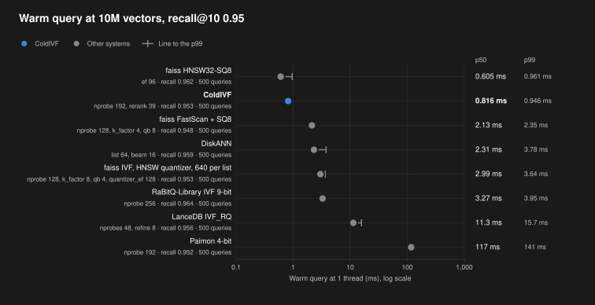

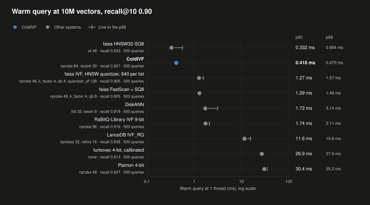

Each dot is a system's queries per second on 6 threads, on a log scale. The columns give the values on 6 and 12 threads.

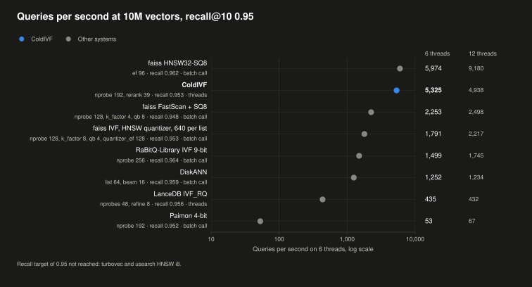

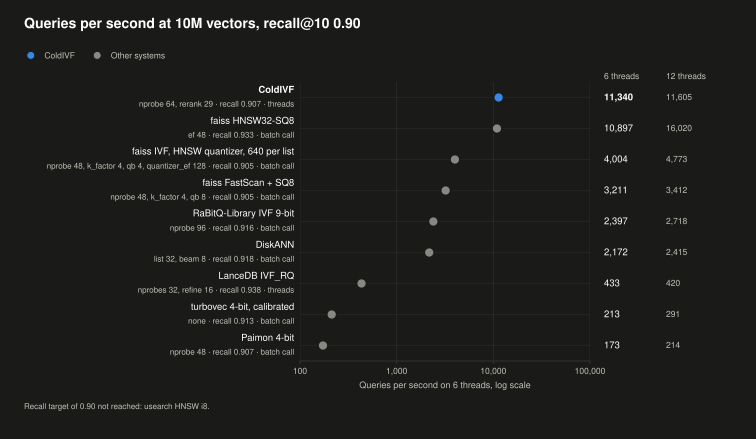

<details>
<summary>Warm query at 10M, by system</summary>

| System | Warm p50 at 0.90 | QPS, 6 Threads, at 0.90 | Warm p50 at 0.95 | QPS, 6 Threads, at 0.95 | QPS Method |
|---|---|---|---|---|---|
| faiss HNSW32-SQ8 | 0.332 ms | 10,897 | 0.605 ms | 5,974 | batch call |
| **ColdIVF** | **0.418 ms** | **11,340** | **0.816 ms** | **5,325** | threads |
| faiss IVF, HNSW quantizer | 1.27 ms | 4,004 | 2.99 ms | 1,791 | batch call |
| faiss FastScan + SQ8 | 1.29 ms | 3,211 | 2.13 ms | 2,253 | batch call |
| DiskANN | 1.72 ms | 2,172 | 2.31 ms | 1,252 | batch call |
| RaBitQ-Library IVF, 9-bit | 1.74 ms | 2,397 | 3.27 ms | 1,499 | batch call |
| LanceDB IVF_RQ | 11.6 ms | 433 | 11.3 ms | 435 | threads |
| turbovec, 4-bit calibrated | 26.9 ms | 213 | not reached | | batch call |
| Paimon, 4-bit | 30.4 ms | 173 | 117 ms | 53 | batch call |
| faiss IVF, batched reads, 2,560 per list | 2.62 ms | 1,996 | 4.98 ms | 1,056 | processes |

</details>

### Memory and Build

ColdIVF's open and first query add 20 MB at recall@10 0.90, the least of any system. At 0.95, they add 47 MB. When warm, ColdIVF holds 9.5 GB, about the size of its index.

Light gray is process memory and dark gray is the index's pages in the page cache. ColdIVF is in blue.

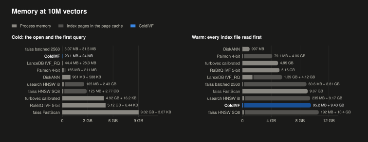

ColdIVF's build peaks at 0.84 GB, the lowest here. Its index takes 943 bytes per vector.

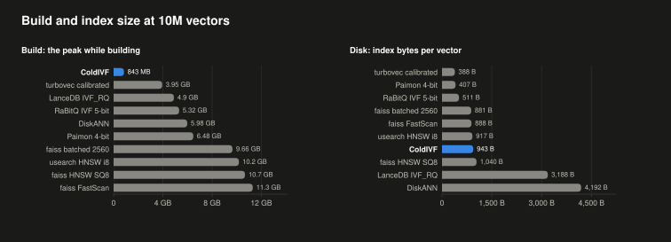

<details>
<summary>Memory and build at 10M, by system</summary>

| System | Open + First Query, Process and Pages | Warm: Process + Cached Pages | Build Time | Build Peak | Index on Disk |
|---|---|---|---|---|---|
| **ColdIVF** | **47.1 MB** | **95.2 MB + 9.43 GB** | **11.8 min** | **0.84 GB** | **9.43 GB** |
| faiss IVF, batched reads, 2,560 per list | 34.5 MB | 80.6 MB + 8.81 GB | 3.8 min | 9.66 GB | 8.81 GB |
| LanceDB IVF_RQ | 72.8 MB | 1.39 GB + 4.12 GB | 2.9 min | 4.90 GB | 31.9 GB |
| Paimon, 4-bit | 365 MB | 79.1 MB + 4.06 GB | 3.6 min | 6.48 GB | 4.07 GB |
| DiskANN | 961 MB | 997 MB | 55.4 min | 5.98 GB | 41.9 GB |
| usearch HNSW i8 | 2.59 GB | 235 MB + 9.17 GB | 14.8 min | 10.2 GB | 9.17 GB |
| faiss HNSW32-SQ8 | 2.89 GB | 192 MB + 10.4 GB | 46.0 min | 10.7 GB | 10.4 GB |
| turbovec, 4-bit calibrated | 4.92 GB | 4.95 GB | 1.1 min | 3.95 GB | 3.88 GB |
| RaBitQ-Library IVF, 5-bit | 5.12 GB | 5.15 GB | 4.0 min* | 5.32 GB | 5.11 GB |
| faiss FastScan + SQ8 | 9.02 GB | 9.07 GB | 2.2 min* | 11.3 GB | 8.88 GB |

</details>

### Not Run at 10M

The other systems took too much memory to run at 10M on this Mac's 36 GB. They are qdrant-edge, SymphonyQG, AsterVec, RaBitQ-Library HNSW, sqlite-vec and the flat scan, plus faiss HNSW, RaBitQ-Library IVF and usearch over full-precision rows.

## Writes

Every system takes the same stream of writes on its index of the [1M benchmark](#1m-vectors): 100,000 inserts of new vectors, rows 1,000,000 to 1,099,999 of Cohere 10M, and 100,000 deletes, in batches of 1,000. Its three rounds leave the states S1, S5 and S10, with 1%, 5% and 10% of the vectors inserted and as many deleted. S10i holds the inserts alone. Each system keeps its build and its settings from the 1M benchmark, and each state's recall is scored against the exact top 10 of the vectors it holds. [coldivf-bench/suites/bench-1m-writes.toml](coldivf-bench/suites/bench-1m-writes.toml) describes the protocol.

### Write Latency

ColdIVF has **the fastest durable insert**, 3.14 ms with the sync that makes it survive a power loss. turbovec takes 1.21 times as long, sqlite-vec 3.4 times, LanceDB 5.1 times and qdrant-edge 10.7 times. The systems that save their whole index take 257 ms to 1.4 s per save.

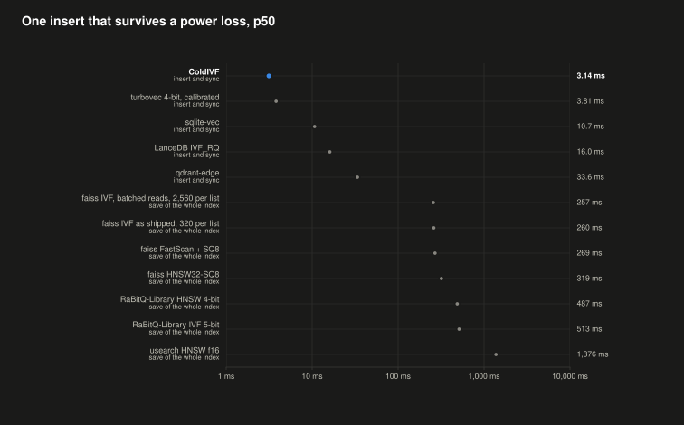

<details>
<summary>Write latency at S0, by system</summary>

| System | Insert p50 | Insert p99 | Delete p50 | Durable Insert p50 | How It Becomes Durable | Inserts per Second in Batches of 1,000 |
|---|---|---|---|---|---|---|
| **ColdIVF** | **64 µs** | **79 µs** | **5.0 µs** | **3.14 ms** | **a sync of its log** | **15,940** |
| turbovec 4-bit, calibrated | 7.0 µs | 11 µs | 5.8 µs | 3.81 ms | a sync | 415,101 |
| sqlite-vec | 54 µs | 9.15 ms | 3.78 ms | 10.7 ms | a commit with `synchronous=FULL` | 9,716 |
| LanceDB IVF_RQ | 6.62 ms | 13.1 ms | 35.1 ms | 16.0 ms | a sync of the commit's files, which LanceDB never makes | 137,266 |
| qdrant-edge | 26 µs | 163 µs | 3.6 µs | 33.6 ms | a flush | 54,563 |
| faiss IVF, batched reads, 2,560 per list | 46 µs | 92 µs | 1.32 ms | 257 ms | a save of the whole index | 83,660 |
| faiss IVF as shipped, 320 per list | 218 µs | 803 µs | 1.35 ms | 260 ms | a save of the whole index | 56,638 |
| faiss FastScan + SQ8 | 286 µs | 860 µs | 1.48 ms | 269 ms | a save of the whole index | 53,312 |
| faiss HNSW32-SQ8 | 1.12 ms | 2.00 ms | none | 319 ms | a save of the whole index | inserts only |
| RaBitQ-Library HNSW 4-bit | 2.59 ms | 5.88 ms | 1.6 µs | 487 ms | a save of the whole index | 371 |
| RaBitQ-Library IVF 5-bit, malloc cache off | 34.1 ms | 40.4 ms | 445 µs | 513 ms | a save of the whole index | 3,669 |
| AsterVec | 8.67 ms | 21.9 ms | 3.7 µs | 675 ms, process crash only | a close, which syncs none of its vectors | 268 |
| usearch HNSW f16 | 988 µs | 1.84 ms | 1.9 µs | 1,376 ms | a save of the whole index | 1,055 |

A durable insert is one insert, then the call that makes it survive a power loss, timed together. Where that call saves the whole index, the column gives the save alone. Every sync and save ends with `F_FULLFSYNC`. AsterVec has no call that survives a power loss, thus its row gives a close, after which its writes survive a process crash. RaBitQ-Library's IVF copies its whole index at each add. With macOS malloc's default cache of freed blocks, the old copies stayed in its footprint, which passed this benchmark's 16 GB cap at 100,000 inserts in one session, thus it runs with that cache off.

</details>

### Cold First Query After Writes

ColdIVF's cold first query grows with the changes that maintenance hasn't folded in yet, since an open replays its log: from 7.93 ms at S0 to 23.9 ms at S1 and 85.8 ms at S10, at recall@10 0.95. That is faster than LanceDB at every state. One fold, which takes 2.4 s, brings it back to 14.6 ms. faiss IVF with batched reads stays at 8.5 to 9.4 ms in every state, since it saves its whole index at every durable point.

Each line is a system's cold first-query p50 at each state, on a log scale.

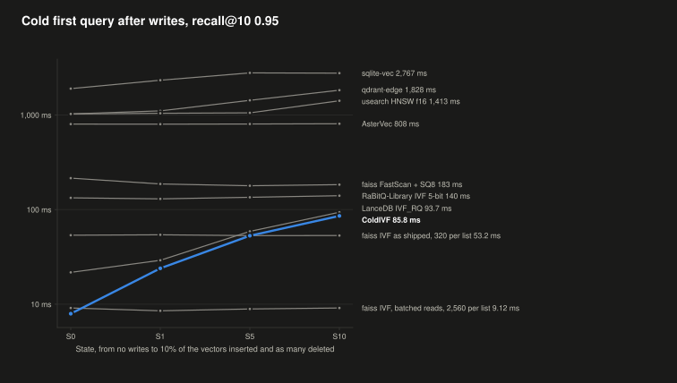

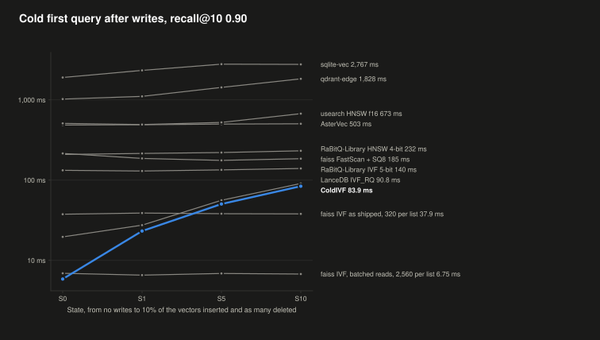

<details>
<summary>Cold first query at each state, by system</summary>

Each cell gives the p50 and, in parentheses, recall@10. The fresh build is a new build of S10's vectors.

**Recall@10 0.95**

| System | Setting | S0 | S1 | S5 | S10 | S10i | Fresh Build |
|---|---|---|---|---|---|---|---|
| **ColdIVF** | **nprobe 128, rerank 64** | **7.93 ms (0.961)** | **23.9 ms (0.959)** | **52.9 ms (0.959)** | **85.8 ms (0.961)** | **73.2 ms (0.961)** | **6.99 ms (0.959)** |
| faiss IVF, batched reads, 2,560 per list | nprobe 24, k_factor 8 | 9.12 ms (0.958) | 8.51 ms (0.958) | 8.90 ms (0.958) | 9.12 ms (0.959) | 9.39 ms (0.960) | 8.84 ms (0.963) |
| faiss IVF as shipped, 320 per list | nprobe 96, k_factor 8 | 53.6 ms (0.956) | 54.1 ms (0.956) | 53.1 ms (0.956) | 53.2 ms (0.957) | 56.2 ms (0.959) | 56.9 ms (0.961) |
| LanceDB IVF_RQ | nprobes 16, refine 8 | 21.7 ms (0.965) | 29.1 ms (0.966) | 58.8 ms (0.967) | 93.7 ms (0.970) | 91.6 ms (0.970) | 22.0 ms (0.963) |
| RaBitQ-Library IVF 5-bit | nprobe 192 | 133 ms (0.960) | 130 ms (0.960) | 135 ms (0.963) | 140 ms (0.963) | 140 ms (0.961) | 133 ms (0.967) |
| faiss FastScan + SQ8 | nprobe 96, k_factor 8 | 215 ms (0.956) | 187 ms (0.955) | 179 ms (0.932) | 183 ms (0.904) | 184 ms (0.958) | 200 ms (0.961) |
| faiss HNSW32-SQ8 | ef 96 | 708 ms (0.958) | - | - | - | 800 ms (0.958) | 745 ms (0.956) |
| AsterVec | ef 384 | 801 ms (0.959) | 799 ms (0.957) | 803 ms (0.958) | 808 ms (0.953) | 801 ms (0.957) | 798 ms (0.959) |
| usearch HNSW f16 | expansion 384 | 1,025 ms (0.954) | 1,042 ms (0.954) | 1,053 ms (0.953) | 1,413 ms (0.951) | 1,335 ms (0.955) | 981 ms (0.973) |
| qdrant-edge | hnsw_ef 256, oversampling 2 | 1,026 ms (0.953) | 1,105 ms (0.954) | 1,428 ms (0.953) | 1,828 ms (0.951) | 1,753 ms (0.959) | 1,032 ms (0.959) |
| sqlite-vec | none | 1,899 ms (1.000) | 2,330 ms (1.000) | 2,785 ms (1.000) | 2,767 ms (1.000) | 2,024 ms (1.000) | 1,895 ms (1.000) |

**Recall@10 0.90**

| System | Setting | S0 | S1 | S5 | S10 | S10i | Fresh Build |
|---|---|---|---|---|---|---|---|
| **ColdIVF** | **nprobe 64, rerank 39** | **5.85 ms (0.921)** | **23.2 ms (0.921)** | **50.3 ms (0.921)** | **83.9 ms (0.925)** | **70.5 ms (0.924)** | **5.61 ms (0.925)** |
| faiss IVF, batched reads, 2,560 per list | nprobe 12, k_factor 4 | 6.90 ms (0.905) | 6.54 ms (0.904) | 6.86 ms (0.904) | 6.75 ms (0.908) | 6.65 ms (0.907) | 6.97 ms (0.908) |
| faiss IVF as shipped, 320 per list | nprobe 48, k_factor 4 | 37.6 ms (0.911) | 38.9 ms (0.912) | 38.1 ms (0.912) | 37.9 ms (0.916) | 39.8 ms (0.918) | 41.6 ms (0.915) |
| LanceDB IVF_RQ | nprobes 12, refine 4 | 19.6 ms (0.938) | 27.4 ms (0.938) | 56.1 ms (0.944) | 90.8 ms (0.949) | 87.2 ms (0.948) | 19.2 ms (0.933) |
| RaBitQ-Library IVF 5-bit | nprobe 64 | 132 ms (0.917) | 130 ms (0.917) | 134 ms (0.921) | 140 ms (0.922) | 141 ms (0.919) | 131 ms (0.918) |
| faiss FastScan + SQ8 | nprobe 48, k_factor 4 | 215 ms (0.911) | 186 ms (0.910) | 176 ms (0.886) | 185 ms (0.857) | 186 ms (0.918) | 200 ms (0.916) |
| RaBitQ-Library HNSW 4-bit | ef 128 | 209 ms (0.911) | 215 ms (0.910) | 221 ms (0.912) | 232 ms (0.913) | 231 ms (0.910) | 209 ms (0.921) |
| AsterVec | ef 96 | 485 ms (0.924) | 489 ms (0.918) | 499 ms (0.914) | 503 ms (0.906) | 502 ms (0.909) | 479 ms (0.915) |
| usearch HNSW f16 | expansion 96 | 509 ms (0.916) | 492 ms (0.914) | 524 ms (0.910) | 673 ms (0.905) | 606 ms (0.914) | 436 ms (0.927) |
| faiss HNSW32-SQ8 | ef 48 | 598 ms (0.923) | - | - | - | 684 ms (0.924) | 631 ms (0.926) |
| qdrant-edge | hnsw_ef 96, oversampling 2 | 1,023 ms (0.918) | 1,105 ms (0.919) | 1,429 ms (0.918) | 1,828 ms (0.918) | 1,749 ms (0.928) | 1,029 ms (0.927) |
| sqlite-vec | none | 1,899 ms (1.000) | 2,330 ms (1.000) | 2,785 ms (1.000) | 2,767 ms (1.000) | 2,024 ms (1.000) | 1,895 ms (1.000) |

</details>

### Warm Query After Writes

ColdIVF's warm p50 rises by 15% from S0 to S10 at recall@10 0.95, from 0.354 to 0.408 ms, since each search also scans the pending inserts of its clusters. It stays the fastest of the systems that take writes at 0.95. LanceDB's rises 7 times and qdrant-edge's 8.8 times.

<details>
<summary>Warm query at each state, by system</summary>

**Recall@10 0.95**

| System | Setting | S0 | S1 | S5 | S10 | S10i | Fresh Build |
|---|---|---|---|---|---|---|---|
| **ColdIVF** | **nprobe 128, rerank 64** | **0.354 ms (0.961)** | **0.378 ms (0.959)** | **0.391 ms (0.959)** | **0.408 ms (0.961)** | **0.404 ms (0.961)** | **0.355 ms (0.959)** |
| faiss HNSW32-SQ8 | ef 96 | 0.503 ms (0.958) | - | - | - | 0.508 ms (0.958) | 0.509 ms (0.956) |
| faiss FastScan + SQ8 | nprobe 96, k_factor 8 | 0.965 ms (0.956) | 0.962 ms (0.955) | 0.972 ms (0.932) | 0.961 ms (0.904) | 0.984 ms (0.958) | 0.951 ms (0.961) |
| RaBitQ-Library IVF 5-bit | nprobe 192 | 1.10 ms (0.960) | 1.12 ms (0.960) | 1.19 ms (0.963) | 1.29 ms (0.963) | 1.28 ms (0.961) | 1.12 ms (0.967) |
| faiss IVF as shipped, 320 per list | nprobe 96, k_factor 8 | 1.31 ms (0.956) | 1.31 ms (0.956) | 1.31 ms (0.956) | 1.31 ms (0.957) | 1.39 ms (0.959) | 1.32 ms (0.961) |
| usearch HNSW f16 | expansion 384 | 2.03 ms (0.954) | 1.98 ms (0.954) | 2.03 ms (0.953) | 1.98 ms (0.951) | 2.03 ms (0.955) | 1.98 ms (0.973) |
| faiss IVF, batched reads, 2,560 per list | nprobe 24, k_factor 8 | 2.15 ms (0.958) | 2.15 ms (0.958) | 2.17 ms (0.958) | 2.19 ms (0.959) | 2.35 ms (0.960) | 2.21 ms (0.963) |
| qdrant-edge | hnsw_ef 256, oversampling 2 | 0.734 ms (0.953) | 1.38 ms (0.954) | 3.63 ms (0.953) | 6.47 ms (0.951) | 6.39 ms (0.959) | 0.723 ms (0.959) |
| AsterVec | ef 384 | 14.8 ms (0.959) | 13.9 ms (0.957) | 13.8 ms (0.958) | 13.7 ms (0.953) | 13.7 ms (0.957) | 14.3 ms (0.959) |
| LanceDB IVF_RQ | nprobes 16, refine 8 | 3.77 ms (0.965) | 8.17 ms (0.966) | 13.4 ms (0.967) | 26.3 ms (0.970) | 22.4 ms (0.970) | 2.83 ms (0.963) |
| flat scan | none | 37.9 ms (1.000) | 37.6 ms (1.000) | 41.0 ms (1.000) | 44.1 ms (1.000) | 41.9 ms (1.000) | - |
| sqlite-vec | none | 452 ms (1.000) | 462 ms (1.000) | 473 ms (1.000) | 501 ms (1.000) | 499 ms (1.000) | 444 ms (1.000) |

**Recall@10 0.90**

| System | Setting | S0 | S1 | S5 | S10 | S10i | Fresh Build |
|---|---|---|---|---|---|---|---|
| **ColdIVF** | **nprobe 64, rerank 39** | **0.210 ms (0.921)** | **0.225 ms (0.921)** | **0.230 ms (0.921)** | **0.288 ms (0.925)** | **0.285 ms (0.924)** | **0.216 ms (0.925)** |
| RaBitQ-Library HNSW 4-bit | ef 128 | 0.154 ms (0.911) | 0.154 ms (0.910) | 0.158 ms (0.912) | 0.160 ms (0.913) | 0.156 ms (0.910) | 0.153 ms (0.921) |
| faiss HNSW32-SQ8 | ef 48 | 0.288 ms (0.923) | - | - | - | 0.345 ms (0.924) | 0.287 ms (0.926) |
| RaBitQ-Library IVF 5-bit | nprobe 64 | 0.482 ms (0.917) | 0.490 ms (0.917) | 0.517 ms (0.921) | 0.653 ms (0.922) | 0.681 ms (0.919) | 0.485 ms (0.918) |
| faiss FastScan + SQ8 | nprobe 48, k_factor 4 | 0.568 ms (0.911) | 0.562 ms (0.910) | 0.572 ms (0.886) | 0.694 ms (0.857) | 0.711 ms (0.918) | 0.566 ms (0.916) |
| usearch HNSW f16 | expansion 96 | 0.581 ms (0.916) | 0.611 ms (0.914) | 0.581 ms (0.910) | 0.727 ms (0.905) | 0.733 ms (0.914) | 0.589 ms (0.927) |
| faiss IVF as shipped, 320 per list | nprobe 48, k_factor 4 | 0.741 ms (0.911) | 0.743 ms (0.912) | 0.738 ms (0.912) | 0.917 ms (0.916) | 0.973 ms (0.918) | 0.757 ms (0.915) |
| faiss IVF, batched reads, 2,560 per list | nprobe 12, k_factor 4 | 1.11 ms (0.905) | 1.12 ms (0.904) | 1.18 ms (0.904) | 1.31 ms (0.908) | 1.47 ms (0.907) | 1.14 ms (0.908) |
| AsterVec | ef 96 | 4.35 ms (0.924) | 4.22 ms (0.918) | 4.09 ms (0.914) | 3.97 ms (0.906) | 3.98 ms (0.909) | 4.24 ms (0.915) |
| qdrant-edge | hnsw_ef 96, oversampling 2 | 0.341 ms (0.918) | 0.989 ms (0.919) | 3.22 ms (0.918) | 6.05 ms (0.918) | 5.98 ms (0.928) | 0.327 ms (0.927) |
| LanceDB IVF_RQ | nprobes 12, refine 4 | 6.74 ms (0.938) | 6.49 ms (0.938) | 13.4 ms (0.944) | 26.2 ms (0.949) | 22.4 ms (0.948) | 6.06 ms (0.933) |
| flat scan | none | 37.9 ms (1.000) | 37.6 ms (1.000) | 41.0 ms (1.000) | 44.1 ms (1.000) | 41.9 ms (1.000) | - |
| sqlite-vec | none | 452 ms (1.000) | 462 ms (1.000) | 473 ms (1.000) | 501 ms (1.000) | 499 ms (1.000) | 444 ms (1.000) |

</details>

### Maintenance

A ColdIVF fold of S10 takes 2.4 s and a major run, which clusters every vector again, 187 s, at 10 threads. Either one brings its cold first query back to 14.6 to 14.9 ms and keeps its recall. As a background job at 2 threads, a run of kind auto takes 66 s.

<details>
<summary>Maintenance at S10, by system</summary>

| System | Action | Threads | Time | Peak Memory | Bytes Written | Cold p50 Before, After and Fresh | Warm p50 Before, After and Fresh | Recall@10 Before, After and Fresh |
|---|---|---|---|---|---|---|---|---|
| **ColdIVF** | **fold** | **10** | **2.4 s** | **369 MB** | **948 MB** | **85.8 / 14.6 / 6.99 ms** | **0.408 / 0.356 / 0.355 ms** | **0.961 / 0.961 / 0.959** |
| **ColdIVF** | **auto** | **10** | **25.1 s** | **608 MB** | **948 MB** | **85.8 / 14.9 / 6.99 ms** | **0.408 / 0.354 / 0.355 ms** | **0.961 / 0.961 / 0.959** |
| **ColdIVF** | **major** | **10** | **187 s** | **426 MB** | **948 MB** | **85.8 / 14.8 / 6.99 ms** | **0.408 / 0.361 / 0.355 ms** | **0.961 / 0.963 / 0.959** |
| **ColdIVF** | **auto, as a background job** | **2** | **66.1 s** | **558 MB** | **1.88 GB** | **the same file as auto** | **the same file as auto** | **the same file as auto** |
| LanceDB IVF_RQ | optimize | 10 | 1.1 s | 1.4 GB | 432 MB | 93.7 / 21.0 / 22.0 ms | 26.3 / 10.3 / 2.83 ms | 0.970 / 0.966 / 0.963 |
| LanceDB IVF_RQ | retrain | 10 | 13.0 s | 2.51 GB | 658 MB | 93.7 / 25.0 / 22.0 ms | 26.3 / 9.77 / 2.83 ms | 0.970 / 0.964 / 0.963 |
| qdrant-edge | optimize | 10 | 26.2 s | 2.28 GB | 4.28 GB | 1,828 / 1,298 / 1,032 ms | 6.47 / 0.759 / 0.723 ms | 0.951 / 0.956 / 0.959 |
| sqlite-vec | vacuum | 10 | 15.2 s | 29.2 MB | 7.39 GB | 2,767 / 1,492 / 1,895 ms | 501 / 503 / 444 ms | 1.000 / 1.000 / 1.000 |

The other systems have no maintenance call. With its own policy, ColdIVF ran 4 runs during S10's writes, 2 folds and 2 minor runs, in 32.1 s, which takes its writes from 30,012 to 5,163 rows per second.

</details>

### Writes That Drift

A second stream inserts the 100,000 rows nearest 10 of 200 topics of the data, so that new vectors pile up in a few clusters, with as many deletes spread evenly. D10 is its last state. ColdIVF keeps its recall@10 at D10, 0.957 against 0.957 for a fresh build, and a fold brings its cold first query back to 13.3 ms. Clustering the vectors again, in a minor or a major run, gains no recall over the fold.

<details>
<summary>Cold first query at D10, by system</summary>

**Recall@10 0.95**

| System | Setting | D10 | After Maintenance | Fresh Build |
|---|---|---|---|---|
| **ColdIVF** | **nprobe 128, rerank 64** | **85.7 ms (0.957)** | **fold: 13.3 ms (0.956)<br>auto: 13.7 ms (0.953)<br>major: 14.6 ms (0.954)** | **7.56 ms (0.957)** |
| faiss IVF, batched reads, 2,560 per list | nprobe 24, k_factor 8 | 9.02 ms (0.954) | none | 9.41 ms (0.957) |
| faiss IVF as shipped, 320 per list | nprobe 96, k_factor 8 | 57.2 ms (0.953) | none | 58.3 ms (0.955) |
| LanceDB IVF_RQ | nprobes 16, refine 8 | 93.5 ms (0.975) | optimize: 20.1 ms (0.959)<br>retrain: 24.6 ms (0.962) | 21.0 ms (0.951) |
| RaBitQ-Library IVF 5-bit | nprobe 192 | 153 ms (0.965) | none | 138 ms (0.944) |
| faiss FastScan + SQ8 | nprobe 96, k_factor 8 | 186 ms (0.906) | none | 174 ms (0.956) |
| qdrant-edge | hnsw_ef 256, oversampling 2 | 1,738 ms (0.957) | optimize: 1,442 ms (0.957) | 1,034 ms (0.958) |

**Recall@10 0.90**

| System | Setting | D10 | After Maintenance | Fresh Build |
|---|---|---|---|---|
| **ColdIVF** | **nprobe 64, rerank 39** | **84.2 ms (0.918)** | **fold: 12.1 ms (0.914)<br>auto: 11.8 ms (0.916)<br>major: 13.3 ms (0.917)** | **6.12 ms (0.915)** |
| faiss IVF, batched reads, 2,560 per list | nprobe 12, k_factor 4 | 6.69 ms (0.899) | none | 6.97 ms (0.904) |
| faiss IVF as shipped, 320 per list | nprobe 48, k_factor 4 | 40.5 ms (0.906) | none | 41.9 ms (0.908) |
| LanceDB IVF_RQ | nprobes 12, refine 4 | 89.6 ms (0.955) | optimize: 18.8 ms (0.924)<br>retrain: 22.2 ms (0.930) | 19.1 ms (0.919) |
| RaBitQ-Library IVF 5-bit | nprobe 64 | 152 ms (0.928) | none | 138 ms (0.877) |
| faiss FastScan + SQ8 | nprobe 48, k_factor 4 | 184 ms (0.849) | none | 174 ms (0.908) |
| qdrant-edge | hnsw_ef 96, oversampling 2 | 1,733 ms (0.928) | optimize: 1,436 ms (0.922) | 1,034 ms (0.915) |

</details>

### Checks

No system returned a deleted vector at any state. ColdIVF found every inserted and every base vector that the checks searched for, at S10, at S10i and after each maintenance run. faiss FastScan found 70.7% of the inserted vectors at S10, since its deletes leave codes in place that later inserts write over.

## Caveats / Observations

- ColdIVF runs through its Python module, just as every other system runs through its binding. Its release binaries ran beside each system as a control.
- faiss with batched reads is a read path that we added to faiss. At 1M, faiss's own setups take at least 2.2 times ColdIVF's cold time. At 10M, they take at least 2.8 times.
- ColdIVF was tuned on Cohere 1M, which shares 9.8% of the first 1M rows of Cohere 10M. Its own setups above also ran on Cohere 1M.
- ColdIVF doesn't reach recall@10 0.99, thus the comparisons stop at 0.95.
- LanceDB's warm memory leaves its table on disk. At 10M, the build peaks include memory that macOS kept after it was freed. The exceptions are ColdIVF, turbovec and DiskANN.
- DiskANN's 10M index is 41.9 GB, more than this Mac's memory. Thus, its warm queries read from the SSD and its warm memory is its process alone.
- Since a full-vector DiskANN build at 10M doesn't fit the 16 GB each job may use, its graph was built on 192-byte PQ codes. On the first 1M rows, a PQ build's recall@10 came within 0.004 of the full-vector build's.
- ColdIVF gains little from 12 threads over 6, likely because of the test Mac. Its queries per second change by −7.4% to +2.3% from 6 to 12 threads, and those of its release binaries by −4.6% to +8.5%. The M3 Pro has 6 performance cores and 6 slower efficiency cores, thus threads 7 to 12 run on the efficiency cores. Every core shares the memory bandwidth, and each warm ColdIVF query reads ~2.2 MB of 1-bit codes at 1M and recall@10 0.90. Thus the extra threads add memory traffic but little throughput. The graph indexes held in memory, eg. faiss HNSW and SymphonyQG, gain 23% to 54%, since they wait on memory latency more than on bandwidth. We haven't profiled this, nor run it on a machine with 12 equal cores.
- Some p99s spike well above the p95. The most common spike is a stall of ~25 ms in a cold query's reads, eg. ColdIVF through the driver has a p95 of 7.93 ms but a p99 of 30.3 ms. The stall matches macOS's 25 ms throttle window for lower-priority disk I/O, thus macOS's I/O throttling is its likely cause. It hit 3.5% of the trials of faiss IVF with prefetch threads, and 1% to 4% of ColdIVF's trials in its own harness. Other slow trials vary more widely, and their causes weren't studied. Since each setting ran only 21 to 300 trials, its p99 is set by its slowest few trials. Future work is to rerun these benchmarks to a more rigorous standard, with more trials and the throttling traced.

## Disclosure

- ColdIVF is a fun personal project that I have been working on.
- The results weren't measured with full scientific rigor. They are my general findings.
- Most of the ideas are my own, combined with the papers and other people's work that this README cites.
- The implementation was written in part with Claude Code.

## License

Licensed under either the [Apache License, Version 2.0](https://www.apache.org/licenses/LICENSE-2.0) or the [MIT License](https://opensource.org/license/mit), at your option.

## Contribution

Unless you explicitly state otherwise, any contribution intentionally submitted for inclusion in the work by you, as defined in the Apache-2.0 license, shall be dual licensed as above, without any additional terms or conditions.
